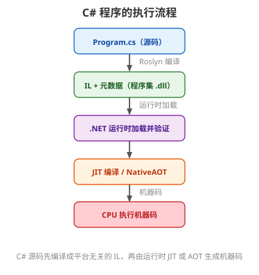

# C# 与 .NET 的设计目标与运行链路

C# 把源码编译为中间语言（IL），再由 .NET 运行时在目标平台上执行。理解 C# 要解决的问题和这条运行链路，是继续学习类型系统、对象语义和 .NET 运行时的共同起点。

## 1. C# 与 .NET 要解决什么问题

C# 诞生于 2000 年前后，.NET 平台的目标是解决 C/C++ 在大型应用开发中的两类难题：手动内存管理带来的正确性风险，以及程序难以跨平台运行。下面分别说明。

### 1.1 手动内存管理与类型安全

20 世纪 90 年代，C 和 C++ 广泛用于系统编程和桌面应用。它们提供接近硬件的控制能力，也把更多正确性责任交给开发者：

**C 的问题：** 开发者需要手动调用 `malloc()` 和 `free()`。遗漏释放会造成内存泄漏，重复释放会破坏堆状态，越界写入还可能覆盖其他对象的数据。这些问题可能在程序运行很久之后才暴露，排查成本很高。

**C++ 的问题：** 面向对象机制帮助组织复杂系统，但多重继承、模板错误信息和手动内存管理也增加了认知负担。开发者需要在表达能力、抽象层次和错误风险之间持续权衡。

.NET 的设计方向是降低这些风险：由运行时承担内存回收，由编译器和类型系统提前发现更多错误，同时保留面向对象的表达能力。

### 1.2 跨平台与统一运行时

C/C++ 程序通常需要针对目标平台编译，还要处理不同的系统调用、库和二进制格式。对于需要覆盖多种设备的软件，这会显著增加构建和维护成本。

.NET 在源码和机器码之间加入 IL 和 CLR（Common Language Runtime），让同一份程序无需针对每个平台重新编译源码。**一次编译，处处运行**描述的正是这一设计方向：编译产物是平台无关的 IL，运行时由各平台上的 .NET 运行时提供。

## 2. .NET 的核心设计目标

C# 语言与 .NET 平台绑定在一起演进。语言设计围绕以下目标展开。

### 2.1 一次编译、跨平台运行

C# 源码先由编译器转换为 IL，再由目标平台上的 .NET 运行时执行。运行时屏蔽操作系统和 CPU 指令集的差异，让应用依赖统一的 IL 契约：

```txt
C/C++：Source → Machine Code → 针对目标平台运行
.NET：  Source → IL → .NET Runtime → 在安装对应运行时的平台上运行
```

IL 不是机器码，而是运行时可以进一步解释或编译的中间表示。.NET 支持多种语言（C#、F#、VB）编译到同一套 IL，这是「语言互操作」的基础。

### 2.2 自动内存管理

.NET 不要求开发者手动释放托管对象内存。垃圾回收器（GC）识别不再可达的对象并回收其占用的托管堆空间。

这减少了悬空指针、Use-After-Free 和 Double Free 等错误，但不会消除所有内存问题。可达性判断不等于业务使用判断：一个已经不再被业务访问的对象，只要仍被静态集合或缓存引用，GC 仍会视其为存活。非托管资源（文件句柄、网络连接、原生内存）不归 GC 管理，仍需要显式释放。

GC 也有成本：它会消耗 CPU，并在部分阶段暂停应用线程。是否可接受取决于堆大小、分配速率、延迟目标和 GC 配置。

### 2.3 静态类型检查

C# 是静态类型语言。变量类型在编译期确定，编译器会在运行前检查明显的类型错误。例如，`string s = 123;` 无法通过编译。

类型检查不能发现所有运行时错误，例如空引用、数组越界和逻辑条件错误，但它把大量错误从生产环境提前到开发阶段。C# 8 起引入的可空引用类型进一步把「空引用」也纳入编译期检查，但这是可选启用的分析，不是强制的运行时保证。

### 2.4 类型安全与 IL 验证

.NET 运行时在执行 IL 前会进行验证，检查指令、类型和访问权限是否合法。这套机制用于降低非法 IL 直接破坏运行时的风险。

IL 验证不是完整的安全沙箱。程序集加载、代码访问权限和操作系统权限分别约束不同层面的行为，不能互相替代。类型安全主要防止内存布局被破坏，而不是替代应用自身的鉴权逻辑。

### 2.5 面向对象与多范式

C# 代码通常以类、接口、结构体、枚举和记录作为组织单位，通过封装、继承和多态表达对象之间的关系。

面向对象不是唯一可用的编程方式。C# 也支持函数式风格：委托、Lambda、LINQ 和不可变记录；关键在于根据状态所有权和变化方向选择合适的抽象，而不是机械套用继承。

### 2.6 向后兼容

.NET 重视语言和 IL 层面的兼容性。旧版本编译生成的程序集通常能在较新运行时上运行，但源码能否重新编译、程序行为是否一致，还取决于使用的 API、第三方依赖和运行环境。因此 .NET 升级不能只看编译是否通过。

## 3. .NET 的性能取舍

.NET 的设计目标不是在所有场景中追求极致性能，而是在性能、安全、可维护性和开发效率之间取得平衡。

C/C++ 可以直接控制内存布局，并允许更接近硬件的优化，因此在部分系统编程场景中仍有优势。.NET 则通过垃圾回收、边界检查和运行时抽象承担更多自动化，也付出了相应开销。

运行时提供两条执行路径：JIT 编译根据运行时 profile 优化长期运行的服务端程序；NativeAOT 则在发布时把 IL 预编译为原生代码，改善启动时间和内存占用，代价是失去部分动态特性。在充分预热、分配模式稳定的部分工作负载中，.NET 的吞吐量可以接近原生代码，但这不是保证；启动时间、短生命周期任务、尾延迟和特定数值计算仍可能更适合其他方案。

## 4. C# 代码如何运行

先用一个最小程序建立全局视角。使用 .NET SDK 创建控制台项目后，`Program.cs` 通常只有一行：

```csharp
Console.WriteLine("Hello, World!");
```

这是 C# 9 引入的顶级语句（top-level statements）：编译器会自动补全 `Program` 类和 `Main` 方法。在项目目录下执行：

```txt
dotnet run
```

`dotnet run` 会还原依赖、编译源码并启动运行时执行程序，输出：

```txt
Hello, World!
```

这段代码从源码到 CPU 执行，主要经历以下步骤：`dotnet build` 把 C# 源码编译为 IL 并打包为程序集（`.dll`）；`dotnet run` 启动运行时加载程序集，由 JIT 把 IL 编译为机器码执行，或由 NativeAOT 直接运行预编译的原生代码。



图中文字等价于以下流程：`Program.cs` 源码经 Roslyn 编译为 IL + 元数据（程序集 `.dll`），.NET 运行时加载并验证后，由 JIT 编译或 NativeAOT 预编译为机器码，最终由 CPU 执行。

继续学习 C# 语言，进入[类型系统](./chapter-02-type-system.md)和[对象与值语义](./chapter-03-object-values.md)；理解程序如何运行，进入[编译与 CLR](../02-dotnet-runtime/chapter-01-compilation-clr.md)、[类型布局与内存](../02-dotnet-runtime/chapter-02-type-layout-memory.md)和 GC。

这一章要记住的结论是：C# 源码先编译成平台无关的 IL，而不是目标 CPU 的机器码；运行时再由 .NET 运行时解释执行 IL，或把热点代码经 JIT 编译为本机机器码执行。

> 本页的技术边界按 .NET 10 / C# 14 核对；顶级语句自 C# 9 引入，可空引用类型自 C# 8 引入，NativeAOT 自 .NET 7 起可用。官方参考：[C# 语言参考](https://learn.microsoft.com/en-us/dotnet/csharp/language-reference/)、[.NET 文档](https://learn.microsoft.com/en-us/dotnet/)。
