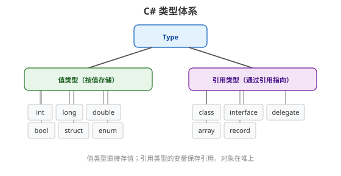

# C# 类型系统：值类型、引用类型与编译期检查

本页面向已经能编写类和方法、但还不清楚 C# 类型边界的读者，回答三个问题：C# 如何区分值类型和引用类型，编译器如何检查赋值与转换，哪些问题必须留到运行时处理。

对象存储、相等性和记录类型属于[对象与值语义](./chapter-03-object-values.md)；多态属于[面向对象](./chapter-04-oop.md)；泛型的类型参数和约束属于[泛型](./chapter-05-generics.md)。本页只建立这些章节共同依赖的类型模型。

## 1. C# 类型如何分类

C# 把类型分为值类型（value type）和引用类型（reference type）。编译期检查依赖的是声明类型和表达式类型，而不是对象在运行时的实际类型；声明为 `object` 的变量，运行时指向的可能是一个 `string` 对象。编译器据此拒绝无法安全完成的赋值、访问和方法调用。

值类型包括 `struct`、`enum` 和内置数值类型（`int`、`double` 等）；引用类型包括 `class`、`interface`、`delegate`、数组和 `record class`。两者最本质的区别是赋值语义：值类型赋值复制值本身，引用类型赋值复制引用。



图中文字等价于以下分类：值类型直接存值，包括 `int`、`long`、`double`、`bool`、`struct`、`enum`；引用类型的变量保存引用、对象在堆上，包括 `class`、`interface`、`delegate`、数组和 `record`。

### 1.1 值类型：值与默认值

值类型直接表达值，变量本身持有数据，不通过引用访问。下表中的「默认值」适用于字段和数组元素；局部变量必须在使用前由初始化或赋值明确提供值。

| 类型 | 说明 | 默认值 |
| :-- | :-- | :-- |
| `sbyte`/`byte` | 8 位有/无符号整数 | `0` |
| `short`/`ushort` | 16 位有/无符号整数 | `0` |
| `int`/`uint` | 32 位有/无符号整数 | `0` |
| `long`/`ulong` | 64 位有/无符号整数 | `0` |
| `float` | IEEE 754 binary32 | `0f` |
| `double` | IEEE 754 binary64 | `0d` |
| `decimal` | 128 位十进制数，适合金额 | `0m` |
| `char` | UTF-16 代码单元 | `'\0'` |
| `bool` | `true` 或 `false` | `false` |
| `struct` | 自定义值类型 | 各字段的默认值 |

值类型没有引用类型的 `null` 状态。需要表达「没有值」时，使用 `Nullable<T>`（简写 `T?`），它仍是一个值类型。

### 1.2 引用类型：变量、引用与对象

声明一个引用类型变量时，变量保存的是引用；引用指向一个对象，而不是对象的副本。

```csharp
var first = new StringBuilder("Tom");
var second = first;

second.Append("!");
Console.WriteLine(first); // Tom!
```

`second = first` 复制的是引用。两个变量因此指向同一个对象，修改对象状态会通过两个变量观察到。赋值不会复制对象。

引用类型变量可以是 `null`，表示不指向任何对象。C# 8 起，可空引用类型（nullable reference types，NRT）把「这个引用是否允许为 `null`」纳入编译期分析，但运行时并不区分 `string` 和 `string?`——它只是编译期标注。

### 1.3 装箱与拆箱

把值类型赋给 `object` 或接口类型时，运行时会在托管堆上创建一个副本并保存其引用，这称为装箱（boxing）；把装箱后的值取回值类型称为拆箱（unboxing）：

```csharp
int number = 10;
object boxed = number;      // 装箱：在堆上分配一个 int 的副本
int restored = (int)boxed;  // 拆箱：从堆上取出值

object wrong = 10;
long cast = (long)wrong;    // InvalidCastException：装箱的是 int，不是 long
```

拆箱要求目标类型与装箱时的值类型完全一致，否则抛出 `InvalidCastException`。装箱涉及堆分配，在热点路径中频繁装箱会增加 GC 压力；泛型正是为了减少装箱而设计的机制。

用 `dotnet-ildasm` 反汇编上面的代码，可以看到装箱和拆箱分别对应 `box` 和 `unbox.any` 两条 IL 指令：

```txt
ldc.i4.s 10             // 常量 10 压栈
stloc.0                 // number = 10
ldloc.0                 // 加载 number
box System.Int32        // 装箱：堆上分配 int 副本，返回 object 引用
stloc.1                 // boxed = 引用
ldloc.1                 // 加载 boxed
unbox.any System.Int32  // 拆箱：取出堆上的 int 值
stloc.2                 // restored = 值
```

`box` 指令在托管堆上分配一个 `int` 的副本并返回 `object` 引用；`unbox.any` 从堆上取出值。这两条指令说明了「装箱有堆分配」这一代价来自何处。

### 1.4 枚举：受限的值类型

枚举声明定义一种受限的值类型，用来表示少量命名常量：

```csharp
enum Color { Red, Green, Blue }
```

枚举底层默认是 `int`，可以显式指定底层类型和数值：

```csharp
enum HttpStatus : int
{
    OK = 200,
    NotFound = 404,
    InternalError = 500
}
```

枚举常量可以作为 `switch` 的选择器，让分支使用有类型的常量而不是比较字符串编号。业务逻辑应使用枚举常量本身或显式的业务字段，不要把底层整数值当作稳定的持久化协议。

## 2. 类型转换与编译期检查

C# 在编译期完成大部分类型检查，但检查分为不同类型：有些转换可以自动发生，有些需要显式写法，还有些只能在运行时根据实际对象确认。

### 2.1 数值类型转换

数值类型转换分为两类。

**隐式转换**在不会丢失信息时自动发生：

```csharp
int i = 42;
long l = i;       // int → long，安全
double d = i;     // int → double，数值不变
```

但 `long → float`、`long → double` 的隐式转换可能丢失精度。隐式不等于无损。

**显式转换**（强制转换）可能丢失精度或改变数值，必须写出目标类型：

```csharp
double value = 3.14;
int integer = (int)value; // integer = 3，小数部分丢失

long large = 130L;
byte wrapped = (byte)large; // wrapped = -126，超出 byte 范围后回绕
```

显式转换不会抛出异常，而是按 C# 规则截断或回绕；这一点与拆箱的 `InvalidCastException` 不同。

### 2.2 引用类型转换

把子类型的值赋给父类型或接口变量是自动的向上转型：

```csharp
string text = "hello";
object value = text;
```

向下转型可能失败，因为编译期只知道声明类型，运行时才知道引用实际指向的对象：

```csharp
object value = "hello";
string text = (string)value; // 成功

object boxedNumber = 123;
string invalid = (string)boxedNumber; // InvalidCastException：实际是 int
```

`as` 运算符在转换失败时返回 `null` 而不是抛异常，`is` 运算符用于在转换前检查类型：

```csharp
object value = "hello";
string? text = value as string; // 成功时为字符串，失败时为 null

if (value is string s)
{
    Console.WriteLine(s.Length); // 模式匹配同时完成检查与转换
}
```

`is` 的模式匹配在 C# 7 起可用，把类型检查、转换和变量声明合并为一步，是向下转型更推荐的写法。

### 2.3 编译器如何检查类型

编译器主要用类型信息完成以下检查：

**赋值与成员访问**

```csharp
string name = 123;          // 编译错误：int 不能隐式转换为 string
int length = name.Length;   // name 的声明类型必须有 Length 成员
```

局部变量还必须满足「先赋值后使用」的确定赋值规则；这与字段拥有默认值是两套规则。

**方法重载解析**

```csharp
void Print(string text) { }
void Print(int number) { }

Print("hello"); // 选择 Print(string)
Print(42);      // 选择 Print(int)
```

编译器根据调用时的参数类型选择候选方法；如果转换需要额外的装箱或数值转换，规则会比简单匹配更复杂，但错误通常仍会在编译期暴露。

**泛型约束**

```csharp
List<string> names = new();
names.Add("Ada");
string first = names[0]; // 元素类型是 string，无需转换
```

泛型把集合元素的类型检查提前到编译期；与 Java 不同，C# 的泛型在运行时保留类型信息（不存在类型擦除），因此装箱和运行时类型检查的行为不同。

### 2.4 运行时仍需检查的边界

静态类型检查不能消除所有错误。以下问题必须留到运行时：

- 向下转型时，引用实际指向的对象是否匹配目标类型，不匹配则抛出 `InvalidCastException`。
- 拆箱一个与实际值类型不匹配的 `object`，抛出 `InvalidCastException`。
- 解引用一个为 `null` 的引用，抛出 `NullReferenceException`；启用 NRT 后，编译器能提前警告但不会完全消除。
- 数组下标越界，抛出 `IndexOutOfRangeException`。
- 整数溢出默认按回绕发生（除非在 `checked` 上下文中），不自动抛异常。

动态分派不属于上述失败场景。通过父类或接口引用调用实例方法时，执行哪个重写方法由对象的运行时类型决定，这是多态的正常机制。

因此，C# 的类型系统负责尽早拒绝确定的类型错误，而不负责替代运行时的空值、边界和动态类型检查。

## 3. 后续阅读

本页建立了类型分类、值/引用语义和编译期检查的基础。接下来：

- [对象与值语义](./chapter-03-object-values.md)解释引用与对象、`Equals`/`GetHashCode`、记录类型和不可变性。
- [面向对象](./chapter-04-oop.md)解释继承、接口和多态如何组织类型关系。
- [泛型](./chapter-05-generics.md)解释类型参数、约束、协变与逆变。
- [集合与 LINQ](./chapter-09-collections-linq.md)解释如何按契约选择 `List`、`Dictionary`、`HashSet`。

> 本页的技术边界按 .NET 10 / C# 14 核对；可空引用类型自 C# 8 引入，`is` 模式匹配自 C# 7 引入。官方参考：[C# 语言参考](https://learn.microsoft.com/en-us/dotnet/csharp/language-reference/)、[C# 语言规范 ECMA-334](https://learn.microsoft.com/en-us/dotnet/csharp/language-reference/language-specification/)。
