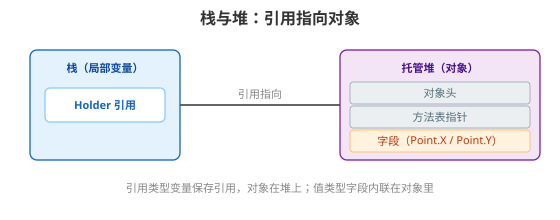

# .NET 类型布局与内存：值类型、对象头与 Span

本页回答三个问题：托管对象在堆上如何布局，值类型和引用类型在内存中的差异如何影响性能，`Span<T>` 如何在不分配的情况下访问内存。理解这些是优化分配和解读内存问题的基础。

## 1. 值类型与引用类型的存储

值类型按值存储，直接嵌入其所在的位置——在栈上、作为字段内联在对象里，或作为数组元素内联在数组里：

```csharp
struct Point { public int X; public int Y; }

class Holder
{
    private Point point; // 内联在 Holder 对象里，不单独堆分配
}
```

引用类型则堆分配一个对象，变量持有指向该对象的引用。对象的字段本身又可能内联值类型或持有其他引用：



图中文字等价于：栈上的 `Holder` 引用指向托管堆上的对象，对象由「对象头 + 方法表指针 + 字段」构成；值类型字段（`Point.X`、`Point.Y`）内联在对象里，而不是另一次堆分配。这是值类型的主要收益：减少分配和间接访问。

## 2. 托管对象的布局

每个托管对象在堆上有两个额外开销：

- **对象头（object header）**：存放同步锁和 GC 相关的标志位。
- **方法表指针（method table pointer）**：指向类型的方法表，用于运行时识别对象类型和调用虚方法。

在 64 位进程中，这两个指针各占 8 字节。一个空 `object` 因此至少占用 24 字节（16 字节头 + 8 字节对齐），比直觉上的「空」大得多。

字段按对齐规则排列。编译器可能重排字段以减少填充，但跨进程互操作或需要稳定布局时，应显式用 `[StructLayout]` 指定（见[非托管互操作](./chapter-05-unmanaged-interop.md)）。

## 3. 引用类型数组与值类型数组

引用类型数组存放的是引用，值类型数组存放的是值本身：

```csharp
string[] refs = new string[1000];     // 数组存 1000 个引用，元素各自堆分配
Point[] points = new Point[1000];     // 数组直接存 1000 个 Point，一次分配
```

`Point[]` 是一次连续的堆分配，元素内联在数组里；`string[]` 则需要 1000 次额外的元素分配。对大量小对象，用值类型数组（或 `List<T>` 搭配 `struct`）能显著减少分配和 GC 压力。

但这不意味着处处用值类型：大 struct 的拷贝成本高，可变的 struct 也容易引入语义混淆（见[对象与值语义](../01-csharp-language/chapter-03-object-values.md)）。

## 4. ref struct 与 `Span<T>`

`Span<T>` 是对一段连续内存的只读视图，本身是 `ref struct`，只能存在于栈上：

```csharp
int[] array = { 1, 2, 3, 4 };
Span<int> slice = array.AsSpan(1, 2); // 指向 array 的第 2、3 个元素，无分配

slice[0] = 99;
Console.WriteLine(array[1]); // 99：Span 直接操作原数组
```

`Span<T>` 不拥有内存，只是「视图」。切分、遍历 `Span<T>` 都不分配堆内存，因此适合解析大缓冲区、处理连续数据的场景。`ref struct` 的限制——不能装箱、不能作为类字段、不能用于 `async` 方法——正是为了确保它只指向栈上或固定内存，不会被 GC 移动。

需要跨异步边界或存入字段时，用 `Memory<T>`（可堆分配、可跨 `async`）代替 `Span<T>`，在具体使用时再通过 `Memory<T>.Span` 取得 `Span<T>`。

## 5. 内存优化的边界

理解布局的价值在于识别分配来源，而不是盲目优化：

- 频繁创建的小对象 → 考虑值类型或对象池。
- 大缓冲区切片 → 用 `Span<T>`/`Memory<T>` 避免复制。
- 需要稳定内存布局 → 用 `[StructLayout]` 显式指定。

但先有基准数据再优化。多数业务代码的分配来自业务逻辑本身，而不是这些微观布局。优化应针对测量出的热点，而非假设。

## 6. 后续阅读

- [GC](./chapter-03-gc.md)解释托管堆的分配与回收机制。
- [非托管互操作](./chapter-05-unmanaged-interop.md)解释 `[StructLayout]` 与固定内存。
- [并发与异步](../03-csharp-concurrency/chapter-02-task-async-await.md)解释为何 `Span<T>` 不能跨 `async`。

> 本页的技术边界按 .NET 10 / C# 14 核对；`Span<T>` 与 `ref struct` 自 C# 7.2 引入，对象头的具体大小随进程位宽和运行时实现变化。官方参考：[.NET 文档](https://learn.microsoft.com/en-us/dotnet/)、[Span API](https://learn.microsoft.com/en-us/dotnet/api/system.span-1)。
