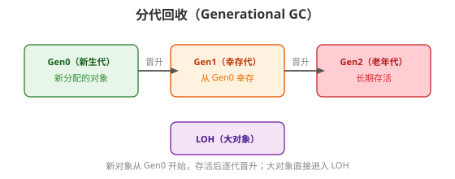

# .NET 垃圾回收：分代、标记压缩与触发

本页回答三个问题：托管堆如何分配和回收内存，分代机制如何降低 GC 成本，GC 何时触发以及如何影响延迟。类型布局见[类型布局与内存](./chapter-02-type-layout-memory.md)。

## 1. 托管堆与分配

托管对象在托管堆上分配。堆上的分配只移动一个指针（分配指针），成本远低于传统 `malloc` 的碎片管理：

```csharp
var s = new string('x', 100); // 在托管堆分配
```

对象不再被任何引用可达时，GC 会回收它。可达性从「根」出发追踪：栈上的局部变量、静态字段、寄存器等是根，从根能到达的对象都是存活的。

## 2. 分代回收

GC 假设「新对象更可能早死」，把堆分为三代：

| 代 | 内容 | 回收频率与成本 |
| :-- | :-- | :-- |
| Gen0 | 新分配的对象 | 最频繁，最便宜 |
| Gen1 | 从 Gen0 幸存的对象 | 次频繁 |
| Gen2 | 长期存活的对象 | 最少，最贵 |
| LOH | 大对象（约 85KB 以上） | 随 Gen2 回收 |



图中文字等价于：新对象从 Gen0 开始，Gen0 回收后存活的对象晋升到 Gen1，再晋升到 Gen2；大对象直接进入 LOH，随 Gen2 一起回收。

Gen0 回收只扫描少量新对象，很快。存活下来的对象晋升到下一代；反复晋升到 Gen2 的对象被视为长期存活，很少再扫描。这使 GC 把成本集中在「短命对象」上，避免每次都扫描整个堆。

大对象（约 85KB 以上）直接进入 LOH（Large Object Heap），因为复制大对象成本高，LOH 不压缩（.NET 起才在需要时提供压缩），可能产生碎片。

## 3. 标记-压缩

GC 的核心算法是标记-压缩（mark-compact）：

1. **标记**：从根出发追踪可达对象，标记为存活。
2. **压缩**：把存活对象向一端移动，消除碎片，更新引用。
3. **清理**：回收未标记的内存。

压缩让后续分配仍是简单的指针移动。代价是移动对象时要暂停应用线程（除非是并发/后台 GC，见下）。

## 4. 暂停与并发

GC 的标记-压缩通常需要短暂暂停应用线程（stop-the-world）。为降低延迟，.NET 提供：

- **后台（concurrent）GC**：Gen2 的标记大部分与应用并发执行，只在压缩等阶段短暂暂停。默认在工作站 GC 下对 Gen2 启用。
- **工作站 GC vs 服务器 GC**：工作站 GC 为低延迟桌面场景优化，服务器 GC 为高吞吐的多核服务端场景优化，为每个逻辑处理器分配独立堆和 GC 线程。

选择哪种通过配置控制。服务端默认倾向服务器 GC，桌面默认工作站 GC。

## 5. GC 何时触发

GC 在以下时机触发，而不是由开发者显式调用：

- Gen0 堆空间不足时。
- 分配大对象需要空间时。
- 系统内存压力大时。
- 显式调用 `GC.Collect()`（生产代码应避免，除非确知后果）。

开发者几乎不应手动触发 GC。`GC.Collect()` 会强制回收，可能打断正常的分代节奏，造成不必要的暂停。正确的做法是减少分配（见下文），让 GC 自然工作。

## 6. 减少 GC 压力的手段

GC 问题表现为频繁回收、长暂停或内存持续增长。常见的减少分配手段：

- 用值类型替代大量小引用对象（见[类型布局与内存](./chapter-02-type-layout-memory.md)）。
- 用 `Span<T>`/`Memory<T>` 避免缓冲区复制。
- 复用对象（对象池），而不是反复创建。
- 避免装箱：泛型和值类型已消除大部分装箱，警惕把值类型赋给 `object` 或接口。

但先测量再优化。用 `dotnet-counters`、`dotnet-trace` 观察分配速率和 GC 停顿（见[诊断](../07-diagnostics/index.md)），确认 GC 是真实瓶颈后再动手。

## 7. 后续阅读

- [类型布局与内存](./chapter-02-type-layout-memory.md)解释分配如何产生。
- [JIT 与 AOT](./chapter-04-jit-aot.md)解释编译模式如何影响启动与内存。
- [非托管互操作](./chapter-05-unmanaged-interop.md)解释非托管内存为何不受 GC 管理。
- [诊断](../07-diagnostics/index.md)了解如何测量分配与 GC。

> 本页的技术边界按 .NET 10 / C# 14 核对；分代 GC 与 LOH 的阈值随运行时版本演进，约 85KB 是常见参考值。官方参考：[.NET 文档](https://learn.microsoft.com/en-us/dotnet/standard/garbage-collection/)、[GC 基础](https://learn.microsoft.com/en-us/dotnet/standard/garbage-collection/fundamentals)。
