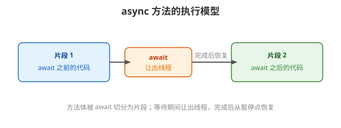

# C# Task 与 async/await：异步的执行模型

本页回答三个问题：`Task` 如何表示进行中的操作，`async/await` 编译成什么，`await` 之后在哪个线程继续执行。异步动机见[为什么需要异步](./chapter-01-why-async.md)。

## 1. Task：表示一个操作

`Task` 表示一个进行中的异步操作，`Task<T>` 表示会产出 `T` 的操作：

```csharp
Task<int> ReadLengthAsync()
{
    return File.ReadAllTextAsync("data.txt")
        .ContinueWith(t => t.Result.Length);
}
```

`Task` 是操作的对象化：可以等待、检查状态、组合、取消。`await` 是等待 `Task` 完成的主要方式。

## 2. async/await 语法

`async` 标记方法，`await` 等待异步操作完成并提取结果：

```csharp
async Task<int> GetLengthAsync()
{
    string content = await File.ReadAllTextAsync("data.txt"); // 等待期间让出线程
    return content.Length;
}
```

方法体在 `await` 处「暂停」，异步操作完成后「恢复」。调用方看到的是返回的 `Task<int>`，可以用 `await` 继续等待：

```csharp
int length = await GetLengthAsync();
```

编译器把 `async` 方法编译成状态机：方法体的代码被切分为多个片段，每个 `await` 是一个暂停点，完成时从对应片段恢复。局部变量被提升到状态机对象里保存，跨越 `await` 依然可用。



图中文字等价于：方法体被 `await` 切分为「片段 1」「await 暂停点」「片段 2」；在 `await` 处让出线程，异步操作完成后从暂停点继续执行片段 2。

### 2.1 异步方法的返回值

- `async Task`：无返回值的异步方法。
- `async Task<T>`：返回 `T` 的异步方法。
- `async void`：只用于事件处理器，**其他场合禁用**。

`async void` 的问题是无法被调用方等待，异常无法被正常捕获，会直接抛到同步上下文导致崩溃。除事件处理器外，异步方法一律返回 `Task` 或 `Task<T>`。

## 3. await 之后在哪个线程继续

`await` 完成后，方法恢复执行的线程取决于**同步上下文**（SynchronizationContext）：

- 在 UI 应用（WPF、WinForms）中，同步上下文会把恢复调度回 UI 线程，保证 UI 更新安全。
- 在 ASP.NET Core 和控制台应用中，没有特殊的同步上下文，恢复在 `Task` 完成时所在的线程（通常是线程池）执行。

`ConfigureAwait(false)` 显式放弃捕获同步上下文，让恢复不必回到原上下文：

```csharp
string content = await File.ReadAllTextAsync("data.txt").ConfigureAwait(false);
```

在库代码中，`ConfigureAwait(false)` 是推荐做法：库不应强制调用方回到某个特定上下文。在应用代码（尤其 UI）中，需要回到 UI 线程更新界面时不要加它。规则是：**库代码默认 `ConfigureAwait(false)`，应用顶层代码按需决定**。

## 4. 组合与等待

多个独立操作应并行等待，而不是串行：

```csharp
// 串行：总耗时是两者之和
var a = await GetAAsync();
var b = await GetBAsync();

// 并行：总耗时是两者中较慢者
Task<int> taskA = GetAAsync();
Task<int> taskB = GetBAsync();
await Task.WhenAll(taskA, taskB);
var a = taskA.Result;
var b = taskB.Result;
```

`Task.WhenAll` 等待多个任务全部完成，`Task.WhenAny` 等待任意一个完成。并行等待前先确认这些操作彼此独立，且内部没有依赖顺序。

## 5. 异常传播

`async` 方法抛出的异常被捕获并存储在返回的 `Task` 里，`await` 时重新抛出：

```csharp
try
{
    await GetLengthAsync(); // 方法内部抛异常，在这里被捕获
}
catch (Exception ex)
{
    Console.WriteLine(ex.Message);
}
```

多个任务用 `Task.WhenAll` 等待时，如果多个任务都失败，异常会被包装进 `AggregateException`；`await Task.WhenAll` 抛出第一个异常，但可通过 `Task.WhenAll` 返回的任务的 `Exception` 属性查看全部。

## 6. 后续阅读

- [取消](./chapter-03-cancellation.md)解释 `CancellationToken` 如何停止异步操作。
- [线程与同步](./chapter-04-threading-synchronization.md)解释 `await` 之后共享状态如何保护。
- [常见并发缺陷](./chapter-06-concurrency-pitfalls.md)汇总 `async void`、死锁等陷阱。

> 本页的技术边界按 .NET 10 / C# 14 核对；`async/await` 自 C# 5 引入，值类型状态机由运行时自动应用。官方参考：[.NET 文档](https://learn.microsoft.com/en-us/dotnet/)、[异步编程](https://learn.microsoft.com/en-us/dotnet/csharp/asynchronous-programming/)。
