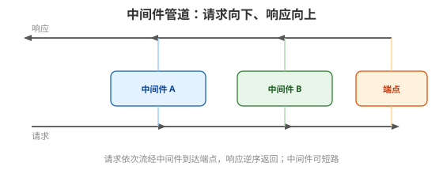

# ASP.NET Core 中间件管道：请求如何流经处理链

本页回答三个问题：中间件是什么，请求如何依次流经多个中间件，如何编写和排布中间件。路由见[路由与 MVC](./chapter-03-mvc-routing.md)。

## 1. 中间件与管道

中间件是处理 HTTP 请求的一段逻辑。多个中间件按注册顺序组成管道，请求依次流经每个中间件，响应再逆序返回：

```txt
请求 → 中间件 A → 中间件 B → 中间件 C → 路由/端点 → 响应逆序返回
```



图中文字等价于：请求（下方）依次流经中间件 A、中间件 B 到达端点，响应（上方）再逆序经过中间件 B、中间件 A 返回；任意中间件都可在请求阶段短路，直接返回响应。

每个中间件可以选择：处理请求后交给下一个，或短路直接返回响应（如认证失败直接 401）。

## 2. 内置中间件

ASP.NET Core 提供大量内置中间件，在 `Program.cs` 中按顺序注册：

```csharp
var app = builder.Build();

app.UseExceptionHandler("/error");   // 异常处理
app.UseHttpsRedirection();           // HTTP 转 HTTPS
app.UseStaticFiles();                // 静态文件
app.UseRouting();                    // 路由匹配
app.UseAuthentication();             // 认证
app.UseAuthorization();              // 授权
app.MapControllers();                // 端点执行
```

顺序是关键：`UseRouting` 必须先于 `UseAuthentication`/`UseAuthorization`，因为先匹配路由、再判断身份和权限，最后执行端点。顺序颠倒会导致授权不生效。

## 3. Run、Use 与 Map

三个方法在管道中的作用不同：

- `Run`：终止管道，不再调用下一个中间件。
- `Use`：处理后调用 `next()` 交给下一个。
- `Map`：按路径前缀分支到子管道。

```csharp
app.Use(async (context, next) =>
{
    Console.WriteLine("before");
    await next();               // 交给下一个中间件
    Console.WriteLine("after"); // 响应返回时再执行
});

app.Run(async context =>
{
    await context.Response.WriteAsync("done"); // 终止管道
});
```

访问时输出 `before`、`done`、`after`——`before` 在请求进入时打印，`after` 在响应返回时打印，展示了「请求向下、响应向上」的双向流。

## 4. 短路

中间件可以不出继续调 `next()`，直接返回响应，这就是短路：

```csharp
app.Use(async (context, next) =>
{
    if (!context.Request.Headers.ContainsKey("X-Api-Key"))
    {
        context.Response.StatusCode = 401;
        return; // 短路：不再调用 next()
    }
    await next();
});
```

短路让中间件充当「守卫」：不满足条件的请求在管道前部被拦截，不进入后续业务逻辑。认证、限流、静态文件缓存命中都是短路的典型场景。

## 5. 自定义中间件

中间件封装在类里，便于复用和测试：

```csharp
public class RequestTimingMiddleware
{
    private readonly RequestDelegate next;

    public RequestTimingMiddleware(RequestDelegate next) => this.next = next;

    public async Task InvokeAsync(HttpContext context)
    {
        var stopwatch = Stopwatch.StartNew();
        await next(context);
        stopwatch.Stop();
        Console.WriteLine($"{context.Request.Path}: {stopwatch.ElapsedMilliseconds}ms");
    }
}
```

注册它：

```csharp
app.UseMiddleware<RequestTimingMiddleware>();
```

`InvokeAsync` 中先启动计时，`await next` 后统计耗时。中间件类通过构造函数注入服务（如 `ILogger`），由框架提供。

## 6. 中间件 vs 控制器

中间件适合横切关注点：认证、日志、异常处理、CORS、限流。业务逻辑应放在控制器/Minimal API 端点里，而不是塞进中间件。中间件处理「所有请求共有的前置/后置逻辑」，端点处理「具体业务」。

## 7. 后续阅读

- [依赖注入](./chapter-05-dependency-injection.md)解释中间件如何注入服务。
- [配置与日志](./chapter-06-configuration-logging.md)解释中间件里如何记录日志。
- [路由与 MVC](./chapter-03-mvc-routing.md)理解中间件与端点的衔接。

> 本页的技术边界按 .NET 10 / C# 14 核对；中间件管道自 ASP.NET Core 1.0 起是核心模型。官方参考：[ASP.NET Core 文档](https://learn.microsoft.com/en-us/aspnet/core/fundamentals/middleware/)。
