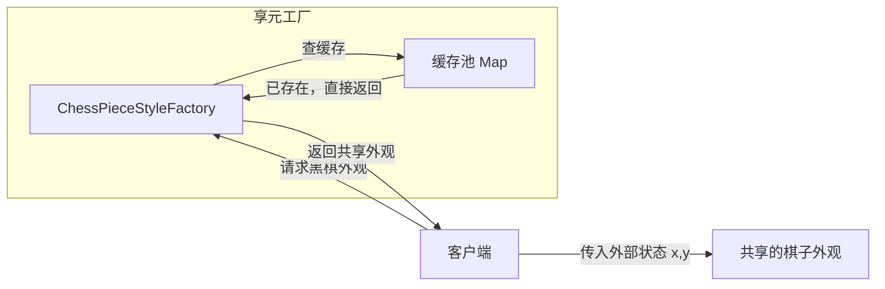

# 享元模式（Flyweight Pattern）

> **一句话记忆口诀**：享元共享内部状态，分离外部状态，String 常量池和 Integer 缓存是最经典的例子。

## 1. 🏠 生活类比

**共享单车**：城市里有成千上万的骑行需求，但不需要每人买一辆自行车。共享单车（享元对象）被多人复用，每次骑行的起点终点（外部状态）不同，但车本身（内部状态）是共享的。

**围棋棋子**：棋盘上有 361 个位置，但棋子的外观只有黑和白两种。享元共享的不是「棋子」这个实体，而是「棋子的外观」（颜色、纹理）。每颗落子仍是独立记录，保存自己的坐标（外部状态），并引用共享的外观对象。

## 2. 💩 烂代码：大量重复对象浪费内存

```java
// ❌ 反例：每颗落子都独立持有外观字段，并可能各自重复加载纹理
public class ChessPiece {
    private String color;    // "黑" 或 "白" — 只有 2 种，却被 361 个落子重复持有
    private String texture;  // 纹理资源 — 可能被每个落子重复加载
    private int x, y;        // 坐标 — 每个落子不同

    public ChessPiece(String color, String texture, int x, int y) {
        this.color = color;
        this.texture = texture;  // 每个落子各自持有纹理资源
        this.x = x;
        this.y = y;
    }
}

// 创建 361 个棋子，每个都独立持有外观字段引用
for (int i = 0; i < 361; i++) {
    ChessPiece piece = new ChessPiece(color, loadTexture(color), x, y);
}
// 外观只有 2 种，却被 361 个落子重复持有引用，甚至各自重复加载纹理
```

**问题根因**：大量对象的**内部状态**（不变部分）被重复存储，没有共享复用。

## 3. ✨ 享元模式方案

将对象状态分为：
- **内部状态**（Intrinsic）：可共享、不变的部分（如棋子的颜色、纹理）
- **外部状态**（Extrinsic）：不可共享、随环境变化的部分（如落子的坐标）

关键在于，享元共享的是「外观」这类内部状态，而不是把多颗棋子合并成一个对象。棋盘上的每颗落子仍是独立实体，各自持有坐标，只是共同引用共享的外观。



## 4. 💻 完整代码实现

```java
import java.util.*;

// ===== 享元接口：棋子外观（可共享的内部状态）=====
public interface ChessPieceStyle {
    void draw(int x, int y); // x, y 是外部状态（落子坐标）
}

// ===== 具体享元：外观只包含颜色、纹理（可共享）=====
public class ConcreteChessPieceStyle implements ChessPieceStyle {
    private final String color;    // 内部状态：颜色
    private final String texture;  // 内部状态：纹理

    public ConcreteChessPieceStyle(String color) {
        this.color = color;
        this.texture = loadTexture(color); // 只在创建时加载一次
        System.out.println("创建" + color + "外观（耗时操作，仅执行一次）");
    }

    @Override
    public void draw(int x, int y) {
        System.out.printf("在(%d,%d)绘制%s棋子，纹理=%s%n", x, y, color, texture);
    }

    private String loadTexture(String color) {
        // 模拟耗时操作：加载纹理（演示代码，忽略中断）
        try { Thread.sleep(100); } catch (InterruptedException e) { }
        return color + "_texture_data";
    }
}

// ===== 落子记录：独立实体，持有自己的坐标，引用共享的外观 =====
class Stone {
    private final int x, y;              // 外部状态：坐标，每颗落子独立
    private final ChessPieceStyle style; // 引用共享的外观（享元）

    public Stone(int x, int y, ChessPieceStyle style) {
        this.x = x;
        this.y = y;
        this.style = style;
    }

    public void draw() {
        style.draw(x, y);
    }
}

// ===== 享元工厂：缓存并复用外观对象 =====
public class ChessPieceStyleFactory {
    // 注：示例假设单线程调用。多线程共享工厂时应改用 ConcurrentHashMap，
    // 并保证享元构造过程不修改共享状态。
    private static final Map<String, ChessPieceStyle> styleCache = new HashMap<>();

    public static ChessPieceStyle getStyle(String color) {
        // 如果缓存中已有，直接返回；否则创建新对象并缓存
        return styleCache.computeIfAbsent(color, ConcreteChessPieceStyle::new);
    }

    public static int getCacheSize() {
        return styleCache.size();
    }
}

// ===== 使用示例 =====
public class Main {
    public static void main(String[] args) {
        // 模拟一局围棋：下了 10 手棋
        int[][] moves = {
            {0, 0}, {1, 1}, {0, 1}, {1, 0}, {2, 2},
            {3, 3}, {4, 4}, {5, 5}, {6, 6}, {7, 7}
        };

        // 每颗落子是独立实体，各自持有坐标，共享黑白两种外观
        List<Stone> board = new ArrayList<>();
        for (int i = 0; i < moves.length; i++) {
            String color = (i % 2 == 0) ? "黑" : "白";
            ChessPieceStyle style = ChessPieceStyleFactory.getStyle(color);
            board.add(new Stone(moves[i][0], moves[i][1], style));
        }

        // 绘制：外观对象只有黑白两个
        for (Stone stone : board) {
            stone.draw();
        }

        System.out.println("外观对象数量: " + ChessPieceStyleFactory.getCacheSize());
        // 输出：2（只有黑和白两种外观）

        // 验证：同一颜色的外观是同一个对象
        ChessPieceStyle black1 = ChessPieceStyleFactory.getStyle("黑");
        ChessPieceStyle black2 = ChessPieceStyleFactory.getStyle("黑");
        System.out.println("black1 == black2: " + (black1 == black2)); // true
    }
}
```

### 4.1 进阶示例：字符渲染器

```java
// ===== 场景：文本编辑器渲染大量字符 =====
// 每个字符有：字体（内部状态）、字号（内部状态）、位置（外部状态）
// 10000 个字符可能只对应少量几种样式组合
// 享元模式：只创建实际出现的样式组合，而不是每个字符一个

// 享元：字符样式（内部状态）
public class CharacterStyle {
    private final String fontFamily;
    private final int fontSize;
    private final boolean bold;

    public CharacterStyle(String fontFamily, int fontSize, boolean bold) {
        this.fontFamily = fontFamily;
        this.fontSize = fontSize;
        this.bold = bold;
        System.out.println("创建样式: " + this);
    }

    public void render(char ch, int x, int y) {
        System.out.printf("在(%d,%d)渲染字符'%c'，样式=%s%n", x, y, ch, this);
    }

    @Override
    public String toString() {
        return fontFamily + "-" + fontSize + (bold ? "-Bold" : "");
    }
}

// 享元工厂
public class StyleFactory {
    // 注：示例假设单线程调用；多线程共享时应改用 ConcurrentHashMap。
    // 缓存键由字体、字号、粗细拼接而成，需保证同一键唯一对应一种样式。
    private static final Map<String, CharacterStyle> styles = new HashMap<>();

    public static CharacterStyle getStyle(String fontFamily, int fontSize, boolean bold) {
        String key = fontFamily + "-" + fontSize + "-" + bold;
        return styles.computeIfAbsent(key,
                k -> new CharacterStyle(fontFamily, fontSize, bold));
    }
}

// 使用：渲染一篇 10000 字的文章
public class TextRenderer {
    public void render(String text) {
        for (int i = 0; i < text.length(); i++) {
            CharacterStyle style = StyleFactory.getStyle("Arial", 12, false);
            style.render(text.charAt(i), i * 10, 0);
        }
    }
}
// 无论文本多长，CharacterStyle 对象只创建实际出现的样式组合数（此处只有 1 种）

// 成本分析：享元收益来自避免为每个字符重复保存样式数据（字体、字号、粗细），
// 字符本身与位置仍属于每个字符的独立状态，代价是缓存与键的查找开销。
// 只有共享状态足够大、重复率足够高时，整体内存收益才显著。
```

## 5. 🔧 框架应用

下表列出的 JDK 缓存是「享元思想」的体现，并不代表这些类被正式定义为 GoF 享元模式的实现；其中 `String` 常量池、包装类缓存共享的是不可变内容。数据库连接池、线程池属于对象池（借用-归还）而非享元，见第 7 节。

| 框架/类 | 内部状态 | 外部状态 | 说明 |
| :-- | :-- | :-- | :-- |
| `String` 常量池 | 字符串内容 | — | `"abc" == "abc"` 为 true |
| `Integer.valueOf()` | 整数值 | — | 默认缓存 -128~127，上界可受 JVM 配置影响 |
| `Boolean.valueOf()` | 布尔值 | — | 只有 TRUE 和 FALSE 两个实例 |
| `Long.valueOf()` | 长整数值 | — | 默认缓存 -128~127 |

### 5.1 经典面试题

```java
// ⚠️ 为什么 Integer 在默认 -128~127 范围内 == 为 true？
Integer a = 127, b = 127;
System.out.println(a == b); // true — 装箱规范保证该范围内装箱结果相同，JDK 通过 IntegerCache 实现

Integer c = 128, d = 128;
System.out.println(c == d); // 通常为 false — 超出默认缓存上界，重复装箱通常得到不同对象
// 注意：缓存上界可受 JVM 配置影响（如 -XX:AutoBoxCacheMax），不能无条件断言 == 结果

// 结论：Integer 比较永远用 equals()，不要用 ==
```

## 6. ⚠️ 适用场景

**适合：**

- 系统中存在**大量相似对象**
- 对象的**内部状态可以外部化**（分离出不变的部分）
- 对象数量多导致内存问题
- 典型场景：字符渲染、棋子外观、常量池与包装类缓存

**不适合：**

- 对象数量不多，直接创建即可
- 内部状态和外部状态难以分离
- 共享的内部状态可变，多个上下文并发访问需要额外同步

## 7. 🔍 享元模式 vs 缓存 vs 对象池

| 对比维度 | 享元模式 | 缓存 | 对象池 |
| :-- | :-- | :-- | :-- |
| **核心思想** | 分离内部/外部状态 | 存储计算结果 | 复用对象避免创建/销毁 |
| **对象数量** | 由内部状态种类决定，可随场景增长 | 动态增长 | 通常受池容量策略限制 |
| **共享方式** | 多个上下文共享同一份不可变（或可安全共享）的内部状态 | 避免重复计算 | 借用-归还 |
| **典型例子** | `IntegerCache` | Redis、Guava Cache | 数据库连接池、线程池 |
