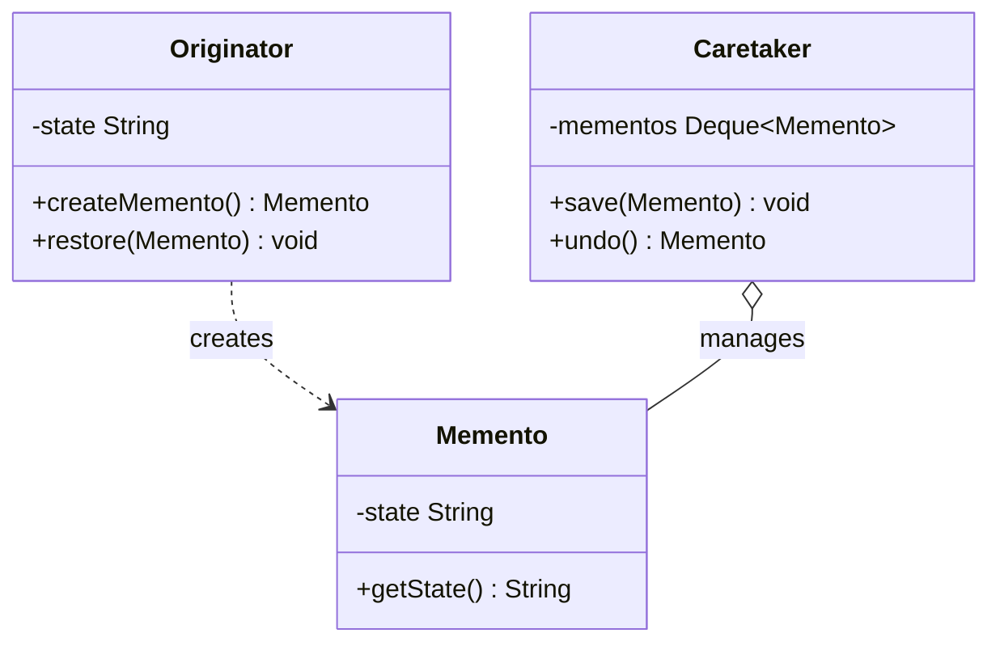

# 备忘录模式（Memento Pattern）

> **一句话记忆口诀**：备忘录在不破坏封装的前提下保存对象状态快照，支持撤销/回滚；Git 和数据库日志可用于比较其思想，但不完全等同 GoF 备忘录模式。

## 1. 🏠 生活类比

**游戏存档**：玩家在关键节点保存进度（创建备忘录），失败后读取存档恢复到之前的状态。存档可以类比备忘录，但实际存档通常还涉及文件格式、版本兼容与状态重建，不一定是对象在内存中的完整快照。

**Ctrl+Z 撤销**：编辑器在操作前保存状态，撤销时恢复到对应的历史状态。实际编辑器也可能采用命令的逆操作、增量记录等机制，不一定是每次操作都保存完整快照。

## 2. 💩 烂代码：保存状态破坏封装

```java
// ❌ 反例：直接暴露对象内部状态来实现撤销
public class TextEditor {
    public String content = "";     // 公开字段！
    public int cursorPos = 0;      // 公开字段！
    public List<String> history = new ArrayList<>(); // 公开字段！

    public void save() {
        // 保存状态 —— 但外部可以直接修改这些字段！
        history.add(content);
    }

    public void undo() {
        if (!history.isEmpty()) {
            content = history.remove(history.size() - 1);
        }
    }
}

// 外部代码可以直接修改 editor.content，破坏状态一致性！
editor.content = "被篡改了";
```

**问题根因**：撤销逻辑如果直接读取和修改编辑器的内部字段，调用方就会依赖编辑器的实现细节；后续新增状态字段或调整内部结构时，撤销逻辑也得跟着改。而且上面的 `save()` 只保存了 `content`、没有保存 `cursorPos`，即使补全历史记录也无法完整恢复编辑器状态。

## 3. ✨ 备忘录模式方案



三个角色：
- **发起人（Originator）**：创建备忘录，并负责从备忘录恢复自身状态
- **备忘录（Memento）**：保存发起人的状态快照；其内部状态不应由管理者直接读取或修改
- **管理者（Caretaker）**：保存、排序和淘汰备忘录，不负责解释或修改快照内容

> 这里区分两个容易混淆的概念：**不可变性**指快照创建后不能被修改，**封装边界**指管理者可以保存、传递快照，却不能读取其内部状态。类图中的 `getState()` 与下文 Java 示例的公开 getter 都是教学简化，只满足不可变性，不满足严格的封装边界；严格实现时应把备忘录做成发起人的私有嵌套类，让管理者持有一个不暴露内部状态的类型。

## 4. 💻 完整代码实现

> 以下代码块为便于阅读合并展示，实际编译时请按类拆分：每个 `public` 顶层类对应一个同名 `.java` 文件（`EditorMemento.java`、`TextEditor.java`、`History.java`、`Main.java`）。

> `EditorMemento` 同时保存文本内容与光标位置，是因为二者都是撤销时需要恢复的状态；`timestamp` 只用于显示保存时间，不参与恢复。备忘录不必复制发起人的全部字段，只需覆盖恢复目标依赖的状态。

```java
import java.time.LocalDateTime;
import java.util.*;

// ===== 备忘录：保存状态快照（不可变）=====
public class EditorMemento {
    private final String content;         // 文本内容
    private final int cursorPosition;     // 光标位置
    private final LocalDateTime timestamp; // 保存时间

    public EditorMemento(String content, int cursorPosition) {
        this.content = Objects.requireNonNull(content, "content 不能为 null");
        if (cursorPosition < 0 || cursorPosition > content.length()) {
            throw new IllegalArgumentException("光标位置超出文本范围");
        }
        this.cursorPosition = cursorPosition;
        this.timestamp = LocalDateTime.now();
    }

    // 字段为 final 且引用类型均为不可变类型，创建后不能修改快照内容
    public String getContent() { return content; }
    public int getCursorPosition() { return cursorPosition; }
    public LocalDateTime getTimestamp() { return timestamp; }
}

// ===== 发起人：文本编辑器 =====
public class TextEditor {
    private String content = "";
    private int cursorPosition = 0;

    public void type(String text) {
        Objects.requireNonNull(text, "text 不能为 null");
        // 在光标位置插入文本
        content = content.substring(0, cursorPosition) + text + content.substring(cursorPosition);
        cursorPosition += text.length();
    }

    public void delete(int count) {
        if (count < 0) {
            throw new IllegalArgumentException("count 不能为负");
        }
        int start = Math.max(0, cursorPosition - count);
        content = content.substring(0, start) + content.substring(cursorPosition);
        cursorPosition = start;
    }

    public void moveCursor(int position) {
        cursorPosition = Math.max(0, Math.min(position, content.length()));
    }

    // 创建备忘录（保存当前状态）
    public EditorMemento save() {
        return new EditorMemento(content, cursorPosition);
    }

    // 从备忘录恢复状态
    public void restore(EditorMemento memento) {
        Objects.requireNonNull(memento, "memento 不能为 null");
        this.content = memento.getContent();
        this.cursorPosition = memento.getCursorPosition();
    }

    @Override
    public String toString() {
        return "内容: \"" + content + "\"，光标位置: " + cursorPosition;
    }
}

// ===== 管理者：历史记录管理 =====
public class History {
    private final Deque<EditorMemento> snapshots = new ArrayDeque<>();
    private final int maxSize;

    public History(int maxSize) {
        if (maxSize <= 0) {
            throw new IllegalArgumentException("maxSize 必须大于 0");
        }
        this.maxSize = maxSize;
    }

    public void push(EditorMemento memento) {
        Objects.requireNonNull(memento, "memento 不能为 null");
        if (snapshots.size() >= maxSize) {
            snapshots.removeLast(); // 移除最旧的快照
        }
        snapshots.push(memento);
    }

    public EditorMemento pop() {
        return snapshots.isEmpty() ? null : snapshots.pop();
    }

    public boolean canUndo() {
        return !snapshots.isEmpty();
    }
}

// ===== 使用示例 =====
public class Main {
    public static void main(String[] args) {
        TextEditor editor = new TextEditor();
        History history = new History(10);

        // 在每次操作前保存状态，撤销时恢复到上一个历史状态
        history.push(editor.save()); // 保存初始空状态
        editor.type("Hello");
        System.out.println("1: " + editor);

        history.push(editor.save());
        editor.type(" World");
        System.out.println("2: " + editor);

        history.push(editor.save());
        editor.type("!");
        System.out.println("3: " + editor);

        // 撤销两次（canUndo 保护，避免空历史）
        if (history.canUndo()) {
            editor.restore(history.pop());
        }
        System.out.println("撤销1次: " + editor); // Hello World

        if (history.canUndo()) {
            editor.restore(history.pop());
        }
        System.out.println("撤销2次: " + editor); // Hello
    }
}
```

> **封装说明**：本例 `EditorMemento` 用公开 getter 简化教学，管理者 `History` 按约定只保存和传递快照、不读取内容，是有意放弃严格封装边界（概念见 §3）。严格实现时，仅把 `EditorMemento` 改为 `TextEditor` 的私有嵌套类还不够，`History` 还需要一种不暴露内部状态的持有类型（如不透明标记接口），否则它无法在 `TextEditor` 外部声明并管理快照。

> **撤销时机说明**：示例采用「操作前保存状态」的策略，出栈得到的正是上一个历史状态；这不是备忘录模式的硬性要求，只要明确每个快照对应哪个历史状态，「操作后保存」同样能实现撤销。完整的编辑器历史还需处理连续撤销、撤销后重新编辑与重做分支，本篇不展开。

### 4.1 补充示例：用内存快照演示回滚

> 下面的示例独立演示全量快照恢复，不是前面 `TextEditor` 的扩展，也不模拟完整的数据库事务实现；它按单层事务的约定工作，`commit()` 清除当前事务使用的快照，连续 `begin()` 后 `commit()` 会丢失外层回滚点（代码本身并不拒绝第二次 `begin()`），这是有意保留的简化。

```java
// ===== 场景：用内存 Map 演示快照与回滚（类比数据库 Undo Log 的思想）=====
public class DatabaseTransaction {
    private final Map<String, String> data = new HashMap<>();
    private final Deque<Memento> undoLog = new ArrayDeque<>();

    // 保存当前状态快照
    public void begin() {
        undoLog.push(new Memento(new HashMap<>(data)));
        System.out.println("事务开始，保存快照");
    }

    public void put(String key, String value) {
        data.put(key, value);
        System.out.println("写入: " + key + "=" + value);
    }

    public String get(String key) {
        return data.get(key);
    }

    // 提交：清除快照（仅支持单层事务，不支持嵌套）
    public void commit() {
        undoLog.clear();
        System.out.println("事务提交");
    }

    // 回滚：恢复到最近的快照
    public void rollback() {
        if (undoLog.isEmpty()) {
            throw new IllegalStateException("没有可回滚的快照");
        }
        Memento snapshot = undoLog.pop();
        data.clear();
        data.putAll(snapshot.getState());
        System.out.println("事务回滚，恢复到快照状态");
    }

    // 备忘录
    private static class Memento {
        private final Map<String, String> state;
        Memento(Map<String, String> state) { this.state = state; }
        Map<String, String> getState() { return state; }
    }
}

// 使用示例（放在 main 方法中调用）
DatabaseTransaction tx = new DatabaseTransaction();
tx.begin();
tx.put("user:1", "Alice");
tx.put("user:2", "Bob");
tx.rollback(); // 回滚，user:1 和 user:2 的修改被撤销
```

> `new HashMap<>(data)` 是浅拷贝：本例键和值均为 `String`（不可变），足以隔离快照；若值换成可变对象，复制 Map 并不能保证对象内部状态被完整隔离，需要深拷贝。这里演示的是应用层内存数据的全量快照恢复，仅类比数据库 Undo Log 的思想，并非数据库引擎的真实实现。

## 5. 🔧 相关机制与区别

**典型应用**

- 编辑器历史记录：IDE 的 Ctrl+Z，备忘录模式的直接体现。

**思想相近但不等同**

- 数据库 Undo Log：通过记录撤销修改所需的信息支持事务回滚，与备忘录有思想相似性，但通常不是整个对象状态的全量快照。
- Git 版本控制：每次 commit 记录代码快照，但版本管理不等于 GoF 备忘录对象。

**相关机制**

- Spring `@Transactional` 回滚：管理事务资源的提交与回滚，不会自动恢复任意 Java 对象字段。
- `Serializable`：提供对象状态的序列化与还原能力，不负责历史记录的管理。
- `Prototype` 模式：通过 clone 复制对象状态，仅当副本用于保存与恢复历史状态时才与备忘录相近。

## 6. ⚠️ 适用场景

**适合：**

- 需要保存对象的**历史状态**以支持撤销/回滚
- 不想暴露对象的**内部实现细节**
- 典型场景：文本编辑器、绘图软件、应用层对象状态回滚（事务回滚的思想类比）、游戏存档

**不适合：**

- 每次保存都复制大量状态时，全量快照可能带来较高的内存和复制成本
- 状态变化频率极高（如每帧都变）→ 可结合状态大小、操作频率与恢复成本，选择增量记录、命令及其逆操作，或定期全量快照加增量记录

### 6.1 内存优化技巧

- **限制历史数量**：设置最大快照数，淘汰较旧的记录；固定数量不一定能限制内存总量，因为不同快照大小可能相差很大。
- **增量记录**：只保存相邻状态之间的变化，恢复时按正确顺序应用或逆转变化，并处理基准快照。
- **压缩旧记录**：适合历史数据占用大、访问频率低的场景，但要权衡压缩与解压的 CPU 成本。

> **一句话记忆口诀**：备忘录保存「操作前」的历史快照，管理者只管存和淘汰、不能读内容；不可变性不等于封装边界，Git 和 Undo Log 是思想类比而非全量快照。
