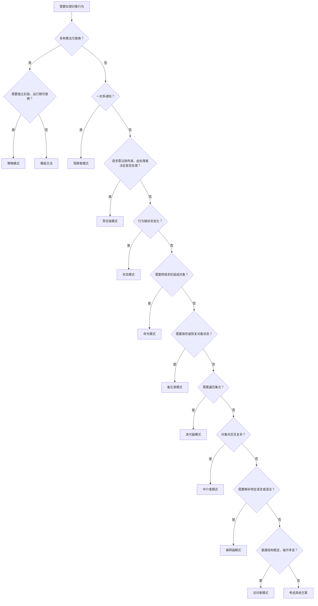

# 行为型模式对比 — 选型指南

> **一句话记忆口诀**：策略选算法、观察者发通知、模板定骨架、责任链串处理、命令封装请求、状态管转换、迭代器遍历、中介者解耦、备忘录存快照、访问者分离操作。

## 1. 十一种行为型模式一览

| 模式 | 核心思想 | 一句话 | 关键词 |
| :-- | :-- | :-- | :-- |
| **策略** | 算法可替换 | 付款方式选择 | if-else 替代 |
| **观察者** | 一对多通知 | 微信公众号推送 | 事件、发布-订阅 |
| **模板方法** | 骨架+细节 | 冲泡流程 | 继承、final |
| **责任链** | 链式处理 | 审批流程 | Filter、拦截 |
| **命令** | 请求对象化 | 餐厅订单 | Undo、队列 |
| **状态** | 状态驱动 | 自动售货机 | 状态机 |
| **迭代器** | 统一遍历 | 遥控器下一个频道 | hasNext/next |
| **中介者** | 集中交互 | 机场塔台 | 星型拓扑 |
| **备忘录** | 状态快照 | 游戏存档 | 撤销、回滚 |
| **访问者** | 分离操作 | 税务审计 | 双分派 |
| **解释器** | 语法解析 | 翻译官 | 表达式树 |

## 2. 最容易混淆的几组对比

### 2.1 [策略](./chapter-01-strategy.md) vs [状态](./chapter-06-state.md)（最常混淆）

```java
// 策略：客户端主动选择算法
context.setStrategy(new AlipayStrategy()); // 外部驱动
context.pay(100);

// 状态：状态自动转换
order.pay(); // 内部驱动，状态 CreatedState → PaidState
```

| 对比维度 | 策略模式 | 状态模式 |
| :-- | :-- | :-- |
| **切换方式** | 客户端**主动选择**（常见用法） | 状态**自动转换**（常见用法） |
| **关注点** | **算法**的可替换性 | **行为**随状态变化 |
| **状态感知** | 各策略相互独立（常见实现） | 转换由状态对象或上下文驱动（常见实现） |
| **典型场景** | 支付方式、排序算法 | 订单状态机、TCP 连接 |

### 2.2 [模板方法](./chapter-03-template-method.md) vs [策略](./chapter-01-strategy.md)（继承 vs 组合）

| 对比维度 | 模板方法 | 策略模式 |
| :-- | :-- | :-- |
| **实现机制** | **继承**，子类覆盖方法 | **组合**，注入策略接口 |
| **算法骨架** | 父类定义**固定骨架** | 无固定骨架 |
| **切换时机** | 编译期确定（骨架固定） | 运行期可切换（常见用法，非本质区别） |
| **典型例子** | `HttpServlet.service()` | `Comparator` |

### 2.3 [责任链](./chapter-04-chain-of-responsibility.md) vs [装饰器](../02-structural/chapter-02-decorator.md)（结构相似）

| 对比维度 | 责任链 | 装饰器 |
| :-- | :-- | :-- |
| **关注点** | 请求沿处理者链传递，处理者可处理、拒绝或继续传递 | 不改接口，动态组合扩展职责 |
| **典型例子** | Servlet Filter | IO 流 |

### 2.4 [观察者](./chapter-02-observer.md) vs [中介者](./chapter-08-mediator.md)（解耦方式不同）

| 对比维度 | 观察者 | 中介者 |
| :-- | :-- | :-- |
| **通信方式** | Subject **直接通知** Observer | 通过中介者**集中转发** |
| **关系** | 一对多 | 多对多（通过中心） |
| **典型例子** | Spring Event | 聊天室（`DispatcherServlet` 为前端控制器，仅体现集中协调思想） |

## 3. 决策树：如何选择行为型模式



决策树给出的是初步选型方向，应按主要变化点和设计意图选型，而非为了消除分支而套用模式；各模式的具体实现机制、代价与适用边界见对应单篇详解。

## 4. 按场景分类

### 4.1 消除 if-else

| 场景 | 推荐模式 | 适用边界 | 示例 |
| :-- | :-- | :-- | :-- |
| 算法选择 | **策略** | 多个算法可互换，调用方无需了解内部实现 | 支付方式、排序算法 |
| 状态判断 | **状态** | 行为随状态变化，转换逻辑集中管理 | 订单状态、审批流程 |
| 类型判断 | **工厂** | 对象创建与具体实现选择，非所有类型分支的通用替代 | 对象创建 |
| 操作判断 | **访问者** | 元素类型稳定，需要持续增加跨类型操作 | 文档导出、AST 遍历 |

### 4.2 解耦

| 场景 | 推荐模式 | 适用边界 | 示例 |
| :-- | :-- | :-- | :-- |
| 一对多通知 | **观察者** | 状态变化需自动通知多个依赖对象 | 事件监听、消息推送 |
| 多对多交互 | **中介者** | 协调逻辑集中管理确实能降低耦合 | 聊天室 |
| 请求与处理解耦 | **命令** | 请求需对象化，以支持排队、记录、撤销 | 任务队列、撤销操作 |

### 4.3 流程控制

| 场景 | 推荐模式 | 适用边界 | 示例 |
| :-- | :-- | :-- | :-- |
| 固定骨架，部分步骤不同 | **模板方法** | 算法骨架固定，仅个别步骤可定制 | Servlet、JdbcTemplate |
| 多步骤，可动态组合 | **责任链** | 处理者可决定处理、拒绝或继续传递 | Filter、审批流程 |

### 4.4 状态管理

| 场景 | 推荐模式 | 适用边界 | 示例 |
| :-- | :-- | :-- | :-- |
| 保存/恢复状态 | **备忘录** | 需恢复对象的历史状态快照 | 撤销操作、游戏存档 |
| 状态驱动行为 | **状态** | 对象行为随内部状态切换 | 状态机 |

## 5. Spring 中的行为型模式

> 下表区分标准实现与仅体现相似思想、或容易混淆的框架组件，并非每一项都严格实现 GoF 模式。

| 模式 | Spring 中的应用 | 说明 |
| :-- | :-- | :-- |
| **策略** | `Resource` 接口 | ClassPath/FileSystem/URL 资源策略 |
| **观察者** | `ApplicationEvent` + `@EventListener` | Spring 事件机制 |
| **模板方法** | `JdbcTemplate`、`refresh()` | 模板回调，固定流程+变化步骤（广义模板式，非继承式） |
| **责任链** | `FilterChain`、`HandlerInterceptor` | 请求过滤链 |
| **命令** | `Runnable` 提交给线程池 | 任务封装 |
| **状态** | Spring State Machine | 状态机框架 |
| **迭代器** | `Iterator` | 集合遍历（`Stream` 为惰性流水线，不等同 Iterator） |
| **中介者** | `DispatcherServlet` | 前端控制器，集中分发请求，体现集中协调思想 |
| **备忘录** | `@Transactional` 回滚（易混淆反例） | 回滚依赖底层 Undo Log 等恢复机制，非备忘录本身 |
| **访问者** | `BeanDefinitionVisitor` | Bean 定义访问 |

## 6. 常见误区

### 6.1 误区一：策略和状态搞混

```java
// ❌ 错误：用策略模式实现状态机
// 策略关注算法替换，不承担状态机职责，状态转换逻辑会散落各处
context.setStrategy(new CreatedState());
context.handle(); // 处理后谁来切换到下一个策略？

// ✅ 正确：状态模式中，状态对象自己决定转换到哪个状态
public class CreatedState implements OrderState {
    public void handle(OrderContext ctx) {
        // 处理后自动转换
        ctx.setState(new PaidState());
    }
}
```

### 6.2 误区二：观察者不处理异常

```java
// ❌ 一个观察者抛异常，后续都不执行
for (Observer o : observers) {
    o.update(event); // 如果这里抛异常...
}

// ✅ 一种隔离失败的实现：捕获每个观察者的异常，避免相互影响
// 异常策略取决于事件语义与业务要求，不总是适合吞掉异常
for (Observer o : observers) {
    try { o.update(event); }
    catch (Exception e) { log.error("观察者失败", e); }
}
```

### 6.3 误区三：责任链没有默认处理者

```java
// ❌ 链末端没有处理者，且未定义末端行为
Handler chain = new AuthHandler();
chain.setNext(new ValidationHandler());
// 请求走到链尾仍未处理，行为未定义

// ✅ 根据业务契约定义末端行为：加默认处理者兜底
chain.setNext(new BusinessHandler()); // 由契约决定末端如何处理未决请求
```

## 7. 总结：面试回答模板

**面试官问：行为型模式怎么选？**

> 选择标准：
> 1. **算法可替换** → 策略（组合、可运行期替换）或模板方法（继承、固定骨架）
> 2. **一对多通知** → 观察者（Spring Event）
> 3. **多步处理，可动态组合** → 责任链（Filter 链）
> 4. **行为随状态变化** → 状态（组织状态相关行为，不保证消除所有 if-else）
> 5. **需要撤销/回滚** → 备忘录（保存快照）或命令（封装请求）
> 6. **统一遍历集合** → 迭代器（增强 for 遍历 Iterable 对象时走迭代器机制）
> 7. **对象间交互复杂** → 中介者（聊天室、集中协调）
> 8. **数据结构稳定，操作多变** → 访问者（编译器 AST）
> 9. **解析特定语言或语法** → 解释器（语法相对简单、规则明确时）
>
> 最容易混淆的是策略 vs 状态（算法替换 vs 状态决定行为）和模板方法 vs 策略（继承 vs 组合）。
