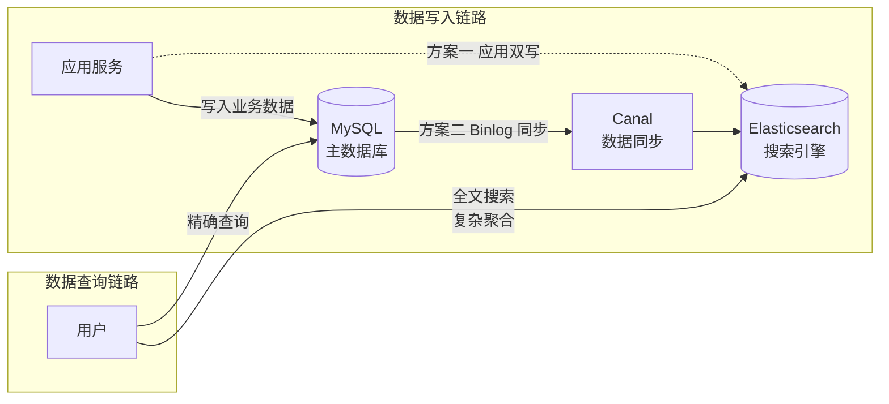

# ES 引入：它解决了什么问题？

## 1. 问题背景

MySQL 在全文搜索场景下有一定局限：

| 场景 | MySQL 的问题 | ES 的解决方案 |
| :-- | :-- | :-- |
| 全文搜索"Java 工程师" | `LIKE '%Java%'` 前导通配符难以利用 B-tree 索引，通常需扫描大量记录 | 倒排索引按词项定位文档，适合词项检索与相关性排序 |
| 商品多条件筛选+排序 | 多字段联合索引难以覆盖所有查询组合 | 支持多字段组合过滤与排序 |
| 日志聚合分析 | 大结果集聚合需跨分片协调，延迟与内存开销高 | 分片并行聚合，性能取决于聚合类型、基数与分片配置 |
| 搜索结果相关性排序 | 相关性打分能力有限，缺少灵活的权重与组合排序 | TF-IDF / BM25 算法 |

## 2. 不了解 ES 会导致的线上问题

- 对 `text` 字段用 `term` 精确匹配，查不到数据（字段已被分词），见 [Mapping 设计](../02-indexing/chapter-02-mapping)
- 动态 Mapping 字段类型被错误推断，且类型一旦创建通常不能直接修改（需新建索引 reindex），见 [Mapping 设计](../02-indexing/chapter-02-mapping)
- 主分片数设置过少，后期无法水平扩展，见 [分片机制](../05-distributed-internals/chapter-02-sharding)
- 深度分页超时或 OOM（每个分片返回大量数据到协调节点合并），见 [分页查询](../03-search/chapter-07-pagination)

## 3. ES 在系统架构中的位置

写入 ES 有两条路径，同一份数据的同步通常择一设计。应用直接双写，或由 Binlog 经 Canal 异步同步。两者的一致性语义不同，具体边界取决于所选架构。

## 4. 类比：用生活模型建立直觉

### 4.1 ES 的倒排索引 → 图书馆的关键词索引

| ES 概念 | 生活类比 | 映射关系 |
| :-- | :-- | :-- |
| **MySQL 查询** | 逐本翻书找关键词 | 按查询条件选全表扫描或走 B-tree 索引定位 |
| **倒排索引（ES）** | 书后面的"关键词索引"，直接找到页码 | 按词项定位文档，再计算匹配与相关性得分 |
| **分词器** | 把"Java工程师招聘"拆成["Java","工程师","招聘"] | 将文本拆分为词项，结果取决于 analyzer |
| **Mapping** | 图书馆的分类规则（按作者/按主题/按年份） | 定义字段类型和索引方式 |
| **Shard（分片）** | 图书馆的多个分馆 | 数据分片，支持水平扩展 |