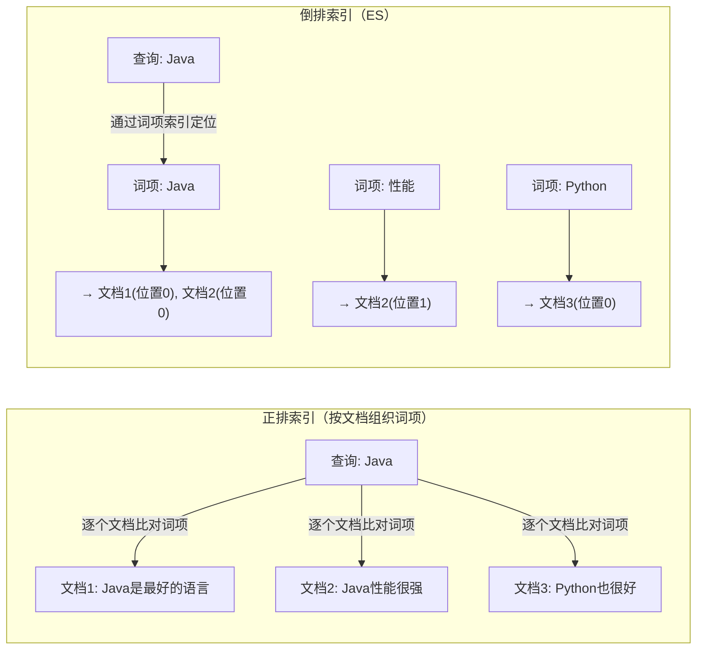
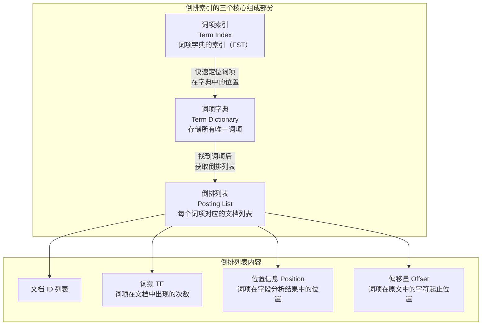
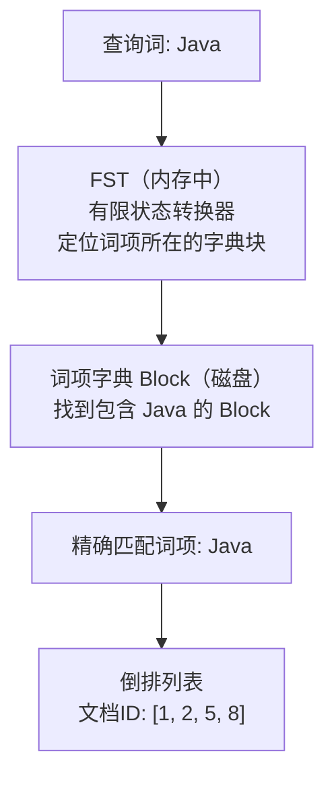
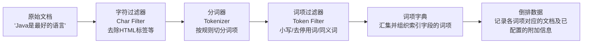
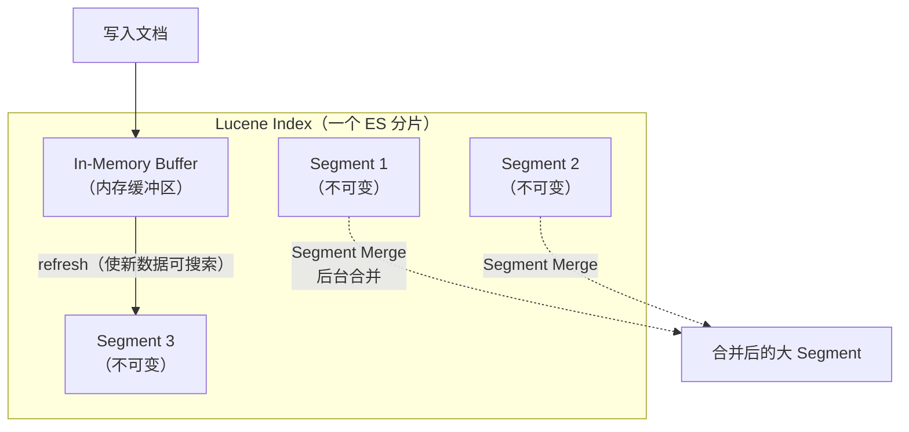

# ES 倒排索引：为何擅长全文检索

> **核心问题**：为什么 ES 的全文检索通常比 MySQL 的 LIKE 更快？倒排索引的底层结构是什么？ES 如何在海量词项中快速定位？

## 1. 它解决了什么问题？

传统数据库使用 B+ 树索引，擅长等值查询和范围查询，但无法直接支持 `LIKE '%Java%'` 这样的任意子串匹配。普通 B+ 树索引定位不到子串的匹配范围，数据库往往需要检查大量记录。

倒排索引**反转了查找方向**——不是"从文档找词"，而是"从词找文档"。索引阶段先对文本进行分析，为每个词项记录包含它的文档；查询时先定位词项，再读取对应的倒排列表，执行条件匹配和相关性评分。查询成本取决于词项定位、倒排列表长度、候选文档交集和相关性评分等因素。

**生活类比**：正排索引就像翻书找某个词——你需要逐页翻阅；倒排索引就像书末尾的"索引页"——直接查词就能知道它在哪几页出现过。

## 2. 正排索引 vs 倒排索引



| 对比维度 | 正排索引 | 倒排索引 |
| :-- | :-- | :-- |
| **查找方向** | 文档 → 词 | 词 → 文档 |
| **查找方式** | 按文档 ID 取得其字段值或词项 | 词项定位 → 倒排列表遍历 |
| **典型用途** | 取回命中文档的内容、排序与聚合 | 基于词项的全文检索 |

## 3. 倒排索引的核心结构

倒排索引由三个核心部分组成：



### 3.1 词项字典（Term Dictionary）

存储所有经过分词后的唯一词项，按字典序排列。

```txt
词项字典示例（按字典序排列）：
┌──────────┬──────────────────┐
│ 词项      │ 倒排列表指针      │
├──────────┼──────────────────┤
│ Java     │ → Posting List 1 │
│ Python   │ → Posting List 2 │
│ 性能      │ → Posting List 3 │
│ 最好      │ → Posting List 4 │
│ 语言      │ → Posting List 5 │
└──────────┴──────────────────┘
```

### 3.2 词项索引（Term Index）—— FST

词项字典按字典序组织，规模可能很大。为了兼顾查找效率与存储开销，Lucene 使用 **FST（Finite State Transducer，有限状态转换器）** 为词项字典建立紧凑的索引结构。以常见的 BlockTree 词项字典为例，FST 根据词项前缀定位相应的字典块，随后在块内查找完整词项；找到词项后，再读取关联元数据定位其倒排数据。



FST 通过状态与转换结构的共享减少存储：共同前缀对应共享的状态路径，可等价的状态被合并以压缩可复用的后缀结构，这正是它相对 Trie 更省空间的原因。查找时沿输入词项逐字符推进，复杂度与词项长度相关，与字典规模无关，这一特性使它适合为大规模词项字典建立索引。不过 FST 解决的是词项定位；定位到词项后，倒排列表的处理成本仍然存在。

常见数据结构各有取舍：HashMap 查找快，但按完整键存储，空间开销随键与实现变化；Trie 支持前缀遍历，但节点多、占用大；FST 通过共享前后缀，在保留前缀遍历能力的同时显著压缩空间。三者没有绝对优劣，选择取决于词项集合的特征与使用方式。

### 3.3 倒排列表（Posting List）

倒排列表记录包含某个词项的文档，以及查询所需的相关信息。最基本的数据是文档 ID 列表；根据字段的索引配置，还可以保存词频、词项位置等数据，字符偏移量用于把词项映射回原文字符范围的场景（如高亮）。这些信息并非每个字段都必须保存，索引阶段保留的信息越多，额外的存储与写入成本越高。

```txt
词项 "Java" 的倒排列表（假设该字段保存词频、位置和偏移量）：
┌─────────┬────────┬──────────┬───────────────┐
│ 文档 ID  │ 词频 TF │ 位置 Pos  │ 偏移量 Offset  │
├─────────┼────────┼──────────┼───────────────┤
│ 1       │ 1      │ [0]      │ [0, 4]        │
│ 2       │ 2      │ [0, 5]   │ [0,4], [20,24]│
│ 5       │ 1      │ [3]      │ [12, 16]      │
└─────────┴────────┴──────────┴───────────────┘
```

- **文档 ID**：包含该词项的文档编号
- **词频 TF**：该词项在文档中出现的次数（用于相关性评分）
- **位置 Position**：词项在字段分析结果中的位置（用于短语查询）。"第几个词"是便于理解的简化说法，实际位置取决于分析器输出与位置增量，不一定等于原文中连续词语的序号
- **偏移量 Offset**：词项在原文中的字符起止位置（用于高亮显示）

## 4. 倒排索引的构建过程



**完整示例**（以下为示意分词结果，实际结果取决于配置的分析器）：

```txt
原始文档：
  文档1: "Java 是最好的编程语言"
  文档2: "Java 性能很强，适合后端开发"
  文档3: "Python 也是很好的语言"

分词后：
  文档1: [java, 最好, 编程, 语言]
  文档2: [java, 性能, 很强, 适合, 后端, 开发]
  文档3: [python, 很好, 语言]

构建倒排索引：
  java     → [文档1, 文档2]
  最好     → [文档1]
  编程     → [文档1]
  语言     → [文档1, 文档3]
  性能     → [文档2]
  很强     → [文档2]
  后端     → [文档2]
  开发     → [文档2]
  python   → [文档3]
  很好     → [文档3]
```

## 5. 倒排列表的压缩算法

倒排列表中的文档 ID 列表可能非常长（热门词项可能关联百万文档），ES 使用多种压缩算法来减少存储空间和提升查询速度。

### 5.1 文档 ID 的增量编码与位压缩

倒排列表中的文档 ID 通常按递增顺序组织，相邻值之间差距较小，这为压缩提供了空间。增量编码（Delta Encoding）把递增序列转为相邻差值，分块位压缩（Frame of Reference，FOR）则对块内数值按统一位数打包。二者是独立的编码思路，实际 Lucene 的编码路径因版本和 PostingsFormat 而异。

下面示例只说明「先存差值、再按块内最大值所需位数压缩」的思路，不代表某个 Lucene 版本的完整磁盘格式；实际编码还需考虑块布局、元数据等开销。

```txt
原始文档 ID 列表：[73, 300, 302, 332, 343, 372]

Step 1: 增量编码（Delta Encoding）—— 将递增序列转为差值
  [73, 227, 2, 30, 11, 29]

Step 2: 分块位压缩（Frame of Reference 位打包）—— 每块用最小位数存储
  分块（为便于演示，以下每块取 3 个数值；实际块大小与编码方案有关）：
  Block 1: [73, 227, 2]    → 最大值 227，需要 8 bit
  Block 2: [30, 11, 29]    → 最大值 30，需要 5 bit

  压缩：
  Block 1: 每个数用 8 bit 存储 → 3 × 8 = 24 bit
  Block 2: 每个数用 5 bit 存储 → 3 × 5 = 15 bit

压缩前：6 × 32 bit = 192 bit
压缩后：24 + 15 = 39 bit（压缩率约 80%）
```

> **说明**：以上为简化原理示例。Lucene 的具体块大小、编码方式和容器类型取决于版本、PostingsFormat 与字段类型，此处不代表某个特定版本的完整磁盘格式。

### 5.2 Roaring Bitmaps

Lucene 使用 **Roaring Bitmap** 表示某些查询缓存中的文档集合，以加速重复查询。

```txt
查询: "Java AND 性能"
  → "Java" 的文档列表: [1, 2, 5, 8, 100, 200, ...]
  → "性能" 的文档列表: [2, 8, 50, 200, ...]
  → 交集运算: [2, 8, 200, ...]
```

实际查询中，Lucene 会根据查询类型、子句特征和候选集规模选择不同的执行策略。倒排列表之间的交集可以通过有序文档 ID 迭代器（Skip List）完成；Roaring Bitmap 主要用于节点查询缓存（node query cache）中的文档集合表示，而非所有倒排列表交集的统一实现。

Roaring Bitmap 将文档 ID 空间按 65536 为一块分组，并根据块内数据分布选择容器表示：

- **稀疏块**（元素少）：用有序数组存储
- **稠密块**（元素多）：用位图（Bitmap）存储
- 此外还有适合连续整数区间的 run 容器；此处只介绍主要的两类容器

## 6. Segment 与不可变性

Lucene 将索引组织为多个 **Segment（段）**。每个 Segment 都是不可变的索引结构，包含倒排索引以及其他搜索所需的数据，**一旦写入就不可原地修改**。



refresh 使新写入的数据对搜索可见，但它不等于 Lucene commit，也不代表此时才完成持久化。写入操作同时记录在 translog 中，用于故障恢复；flush 才执行 Lucene commit 并推进 translog generation。上图是说明主要职责的简化示意，不代表所有内部步骤都严格按串行时序执行。

| 操作 | 实现方式 |
| :-- | :-- |
| **新增文档** | 先做索引处理并写入缓冲结构，在 refresh 等生成 Segment 的时机形成新的索引段 |
| **删除文档** | 在索引结构中记录删除状态，查询时排除；物理清理在后续合并时完成 |
| **更新文档** | 逻辑上相当于删除旧文档并索引新版本，物理清理通常在后续合并中完成 |
| **Segment 合并** | 后台将多个小 Segment 合并为大 Segment，同时清理已标记删除的文档并回收磁盘空间 |

**不可变性的好处**：

- 减少读写冲突：搜索线程读取已有 Segment 时，写入操作不会原地修改该 Segment 的索引数据
- 复用操作系统 Page Cache：Segment 文件生成后内容不再原地修改，操作系统可以缓存文件数据供后续搜索读取
- 简化后台合并：合并过程生成新的 Segment，完成后再替换旧段的引用，不需要原地改写已有 Segment 的索引结构

## 7. 倒排索引为什么适合全文检索

| 维度 | MySQL `LIKE '%Java%'` | ES 倒排索引 |
| :-- | :-- | :-- |
| **查询基础** | 普通 B+ 树索引无法直接定位任意子串，需检查大量候选记录 | 根据分析器生成的词项定位倒排数据 |
| **查询成本** | 取决于扫描记录数、匹配条件和执行计划 | 取决于词项定位、倒排列表处理、查询组合及结果处理 |
| **匹配语义** | 按 SQL 的字符串匹配语义执行 | 由分析器、查询类型及字段配置共同决定 |
| **检索机制** | 基于字符串匹配，无分词检索机制 | 基于分析器生成的词项检索文档 |
| **相关性评分** | 无内置全文相关性评分 | 基于 BM25 等相似度算法评分 |

## 8. 常见问题

**Q：ES 的倒排索引和 MySQL 的 B+ 树索引有什么区别？**

> - B+ 树：适合等值查询、范围查询，按字段值排序存储；在满足索引使用条件时，可支持某些字符串前缀查询
> - 倒排索引：适合全文检索，按词项存储文档列表，支持分词后的任意词项查找
> - 本质区别：B+ 树是"从值找记录"，倒排索引是"从词项找文档"

**Q：FST 是什么？为什么 ES 要用 FST？**

> FST（有限状态转换器）在 Lucene 的 BlockTree 词项字典中用于紧凑地索引词项块，帮助快速定位目标词项所在的字典块。它通过状态与转换结构的共享降低存储开销，查找成本与词项长度相关；它解决的是词项定位，定位之后倒排列表的处理成本仍然存在。

**Q：为什么 ES 写入数据后不能立即查到？**

> 文档先写入内存缓冲区，此时还不可搜索。经过 refresh（默认 1 秒）后，内存缓冲区中的数据被写入新的 Segment，变为可搜索，这就是 ES 的 **Near Real-Time（近实时）** 特性。refresh 解决的是可搜索性；写入操作同时记录在 translog 中用于故障恢复；flush 则执行 Lucene commit 并推进 translog generation。三者是不同的机制，不是严格串行的三个阶段。可以通过手动调用 `_refresh` API 或设置 `refresh_interval` 来调整可搜索性。

**Q：倒排列表是如何压缩的？**

> 文档 ID 通常按递增顺序组织，可以借助增量编码（Delta Encoding）把序列转为差值，再用分块位压缩（Frame of Reference）对块内数值按统一位数打包。二者是独立的编码思路，具体实现取决于 Lucene 版本和 PostingsFormat。对于频繁使用的过滤条件，Lucene 可以使用 Roaring Bitmap 表示节点查询缓存中的文档集合，以加速重复查询。

**Q：Segment 不可变会不会导致磁盘空间浪费？**

> 短期内会，因为删除只是标记而非物理删除。但 ES 后台会定期执行 Segment Merge（段合并），将多个小 Segment 合并为大 Segment，同时物理删除已标记的文档，回收磁盘空间。
