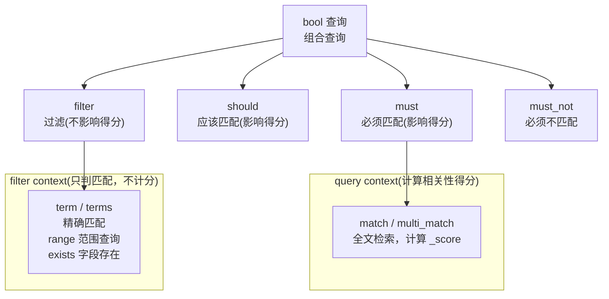

# ES 查询 DSL：核心查询类型

## 1. query context vs filter context



## 2. 为什么纯过滤场景应优先使用 filter

> 1. filter 不参与相关性评分（BM25），省去打分计算，这是执行语义带来的收益
> 2. filter 的结果可能被节点查询缓存复用，但缓存是有条件的优化（受查询类型与 segment 影响），不能承诺第二次查询直接命中缓存
> 3. 纯过滤场景（如按状态筛选）应优先使用 filter，而非 must

## 3. 常用查询示例

```json
// 组合查询：搜索"Java工程师"，价格在10-50之间，状态为上架
{
  "query": {
    "bool": {
      "must": [
        { "match": { "title": "Java工程师" }}   // 全文检索，影响得分
      ],
      "filter": [
        { "range": { "price": { "gte": 10, "lte": 50 }}},  // 范围过滤，不影响得分
        { "term": { "status": "online" }}                   // 精确匹配，不影响得分
      ]
    }
  }
}
```

## 4. 问题：ES 的 query 和 filter 有什么区别？

> - `query`：计算相关性得分（_score），决定文档与查询的相关程度
> - `filter`：只判断是否匹配，不计分，适合精确条件过滤
> - 组合场景：既要全文检索又要按条件过滤时，全文检索放 `must`，条件过滤放 `filter`

## 5. 相关章节

- [全文搜索](./chapter-02-full-text-search.md)
- [精确查询](./chapter-03-term-query.md)
- [布尔查询](./chapter-04-bool-query.md)