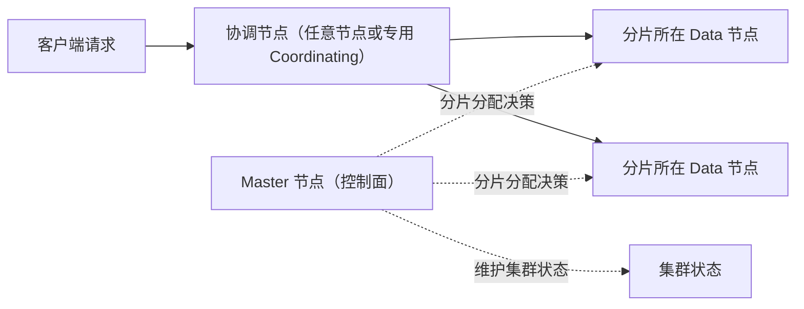
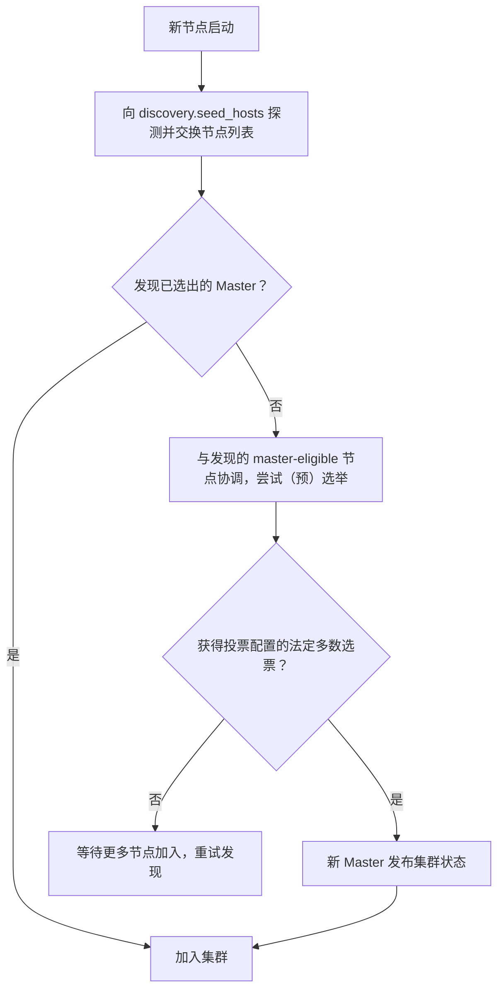

# 分布式架构

## 1. 节点角色

ES 集群中的每个节点可以承担多种角色：

| 角色 | 配置 | 职责 |
| :-- | :-- | :-- |
| **Master** | `node.roles: [master]` | 集群元数据管理、分片分配决策 |
| **Data** | `node.roles: [data]` | 存储数据、执行 CRUD 和搜索 |
| **Data Hot** | `node.roles: [data_hot]` | 存储热数据（ILM） |
| **Data Warm** | `node.roles: [data_warm]` | 存储温数据 |
| **Data Cold** | `node.roles: [data_cold]` | 存储冷数据 |
| **Ingest** | `node.roles: [ingest]` | 数据预处理（Pipeline） |
| **Coordinating** | `node.roles: []` | 查询协调（不存储数据） |
| **ML** | `node.roles: [ml]` | 机器学习任务 |

任何节点都能协调请求（把请求发往分片所在节点并汇总结果）；专用 Coordinating 节点只是在大型集群中把协调负载隔离出来的做法，不是必经的代理层。



数据面与控制面分工：读写请求由协调节点直接发往分片所在的数据节点执行，Master 不代理读写；Master 负责维护集群状态、决定分片分配到哪个节点。请求在节点间的具体执行见[写入流程](chapter-04-write-path.md)，分片的组织与路由见[分片机制](chapter-02-sharding.md)。

```yaml
# 推荐：生产环境分离角色（以下为角色配置片段，不是完整的集群配置）
# Master 节点（通常 3 个）
node.roles: [master]

# Data 节点（通用数据角色；分层部署时按层拆为 data_hot/data_warm/data_cold）
node.roles: [data]

# Coordinating 节点（可选，大型集群）
node.roles: []
```

集群的数据节点角色至少要配置 `data`，或同时具备 `data_content` 与 `data_hot`（官方节点角色要求）；只演示单个热层节点时用 `node.roles: [data_hot]`，不能据此省略内容层角色。

## 2. Master 选举

ES 使用基于法定多数投票的容错选举协议选出并维持 Master：

| 参数 | 说明 |
| :-- | :-- |
| `discovery.seed_hosts` | 集群种子节点列表 |
| `cluster.initial_master_nodes` | 仅用于首次引导新集群（见下方注意） |
| `cluster.fault_detection.leader_check.timeout` | 各节点检测 Master 存活的单次超时（默认 10s）；配合 `retry_count`（默认 3）连续失败后判定 Master 故障，重新发起发现 |

**选举流程**：

1. 节点启动后向 `discovery.seed_hosts` 探测，并相互交换已知的 master-eligible 节点列表（发现阶段）
2. 发现已选出的 Master 就直接加入集群；没有 Master 时，master-eligible 节点可发起选举——通常先通过预选举，避免在与现有 Master 的连接尚未确认断开时贸然进入正式选举
3. 正式选举需要获得**投票配置**中严格多数（法定多数）的选票才能当选；「已发现的节点数」不等于可投票配置，发现再多节点也不等于能完成选举
4. 当选 Master 发布集群状态，之后由它维护集群状态并做出分片分配决策

> ⚠️ **脑裂与首次引导**：运行期的防分裂依据是投票配置与法定多数——官方明确 Elasticsearch 不会因脑裂产生不一致的集群状态，但失去法定多数的分区将不可用。`cluster.initial_master_nodes` **仅用于首次引导新集群**：集群形成后必须从配置中移除，节点重启、故障切换或加入现有集群时都不得重新设置，否则可能引导出第二个集群。master-eligible 节点通常应为奇数（官方表述为 should normally be an odd number），偶数时 ES 会自动将其中一个排除出投票配置；生产环境常见方案是部署 3 个专用 Master 节点。

## 3. 集群状态

```json
GET /_cluster/health
```

```json
{
  "cluster_name": "prod-cluster",
  "status": "green",
  "timed_out": false,
  "number_of_nodes": 5,
  "number_of_data_nodes": 3,
  "active_primary_shards": 10,
  "active_shards": 20,
  "relocating_shards": 0,
  "initializing_shards": 0,
  "unassigned_shards": 0
}
```

| 状态 | 含义 | 处理 |
| :-- | :-- | :-- |
| 🟢 Green | 所有主分片和副本均已分配 | 正常 |
| 🟡 Yellow | 所有主分片已分配，至少一个副本分片未分配 | 检查节点数与副本分配 |
| 🔴 Red | 至少一个主分片未分配，相关数据不可完整提供 | 紧急处理 |

## 4. 分片分配

Master 节点负责将分片分配到各个 Data 节点：

```json
// 查看分片分配
GET /_cat/shards?v

// 查看分片分配原因
GET /_cluster/allocation/explain
{
  "index": "my-index",
  "shard": 0,
  "primary": true
}
```

### 4.1 分片分配策略

| 策略 | 说明 |
| :-- | :-- |
| **均衡分配** | 尽量均匀分配到各节点 |
| **主副分离** | 主分片和副本不在同一节点 |
| **磁盘水位线 low** | 磁盘用量超过阈值（默认 85%）后，不再向该节点分配新分片；新建索引的主分片除外 |
| **磁盘水位线 high** | 超过默认 90% 后，尝试把分片从该节点迁离 |
| **磁盘水位线 flood_stage** | 超过默认 95% 后，给该节点上相关索引设置只读块（`index.blocks.read_only_allow_delete`）防止磁盘写满；磁盘回落到 high 水位以下自动解除 |

```json
// 磁盘水位线配置
PUT /_cluster/settings
{
  "persistent": {
    "cluster.routing.allocation.disk.watermark.low": "85%",
    "cluster.routing.allocation.disk.watermark.high": "90%",
    "cluster.routing.allocation.disk.watermark.flood_stage": "95%"
  }
}
```

Master 的分配只是决定「分片放在哪个节点」；分片本身的组织、路由与复制机制见[分片机制](chapter-02-sharding.md)。

## 5. 集群发现机制



## 6. 最佳实践

- 生产环境通常部署 3 个专用 Master 节点，master-eligible 数量保持奇数（依据见 §2）
- Master 不存储数据，但承担集群状态更新与分配决策，资源按集群规模和状态更新频率通过监控评估，不套用固定规格
- Data 节点根据数据量和查询压力水平扩展
- 使用 `node.roles` 明确指定节点角色
- 监控集群状态和未分配分片数量
- 设置合理的磁盘水位线，避免磁盘打满
