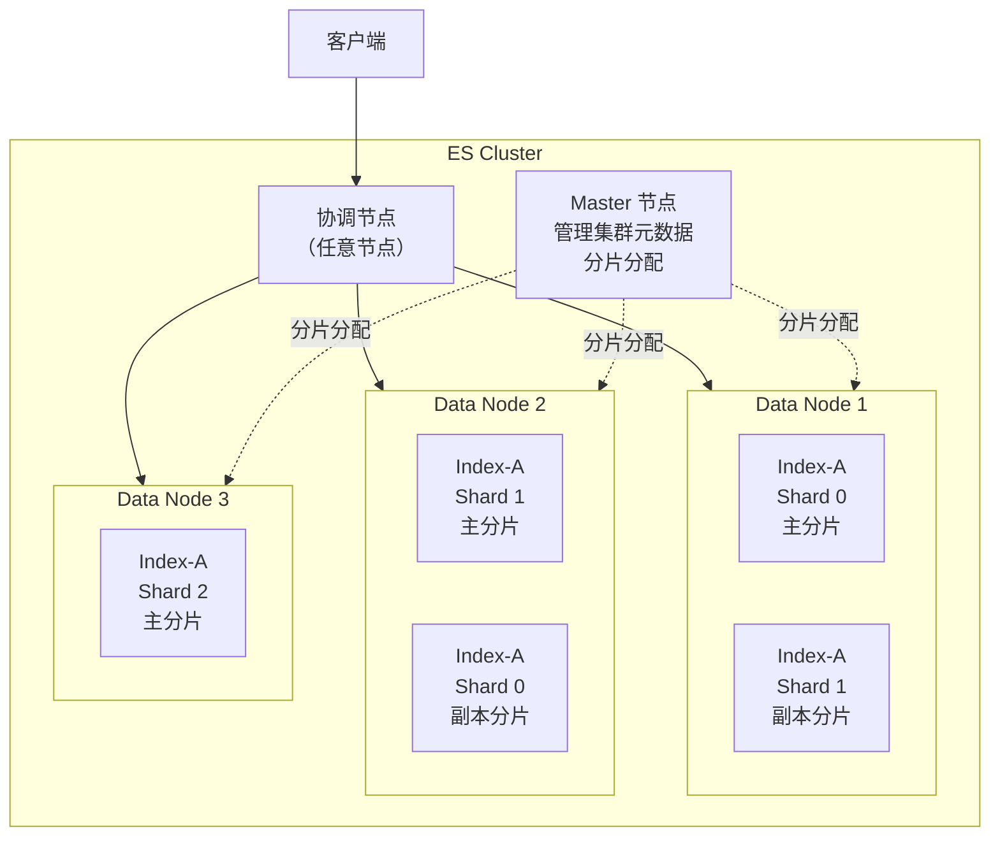

# ES 集群架构与分片机制

## 1. ES 集群架构图

读写请求由协调节点按路由结果发往目标分片所在的数据节点（并非广播到所有节点），Master 不代理读写，只负责集群元数据与分片分配。

## 2. 分片核心规则

| 规则 | 说明 | 为什么这样设计 |
| :-- | :-- | :-- |
| **主分片数创建后不能直接修改** | 路由公式：`shard = hash(routing) % 主分片数`（`routing` 默认取文档 `_id`） | 直接改分片数会改变路由结果，已有数据找不到；改变分片布局需 Split、Shrink 或 Reindex |
| 副本分片可动态调整 | 可随时增减副本数量 | 副本只是主分片的复制，不影响路由 |
| 主副分片不在同一节点 | ES 自动保证 | 主分片所在节点宕机时，副本在其他节点可继续服务，降低数据不可用与丢失风险 |
| 主分片数的粗略估算 | 可将节点数 × 1~3 作为初步估算起点，不是通用规划公式 | 分片过多会增加管理开销，分片过少则限制查询并行度；实际数量应结合数据量、单分片目标大小、查询负载和节点资源确定 |

分片的分配与迁移操作见[集群管理](../07-operations/chapter-01-cluster-management.md)。

## 3. 集群健康状态

| 状态 | 含义 | 处理方式 |
| :-- | :-- | :-- |
| 🟢 Green | 所有主分片和副本均已分配 | 正常 |
| 🟡 Yellow | 所有主分片已分配，至少一个副本未分配 | 用 `GET /_cluster/allocation/explain` 查看未分配副本及原因 |
| 🔴 Red | 至少一个主分片未分配 | 紧急处理，相关数据不可完整提供，先确认未分配主分片及原因 |

> **Yellow 最常见原因**：单节点集群设置了副本数 > 0，副本无法分配到同一节点（主副不能在同一节点），导致 Yellow。开发环境可设置 `number_of_replicas: 0`。进一步的排障操作见[常见问题排查](../07-operations/chapter-06-troubleshooting.md)。

## 4. 问题：主分片数不能直接修改，如何变更分片布局？

如 §2 所述，路由公式 `shard = hash(routing) % 主分片数` 依赖主分片总数，直接改会改变文档落点，因此现有索引的主分片数不能直接修改。要变更分片布局，需通过以下方式：

| 方式 | 方向 | 说明 |
| :-- | :-- | :-- |
| **Split 拆分** | 分片数变多 | 把每个主分片拆成多个，要求目标分片数是源分片数的整数倍 |
| **Shrink 收缩** | 分片数变少 | 把多个主分片合并成一个，要求源分片数是目标分片数的整数倍 |
| **Reindex 重建** | 任意 | 把数据写入采用新分片配置的新索引，灵活但需额外存储与耗时 |

三种方式的详细操作见[索引管理](../02-indexing/chapter-05-index-management.md)。
