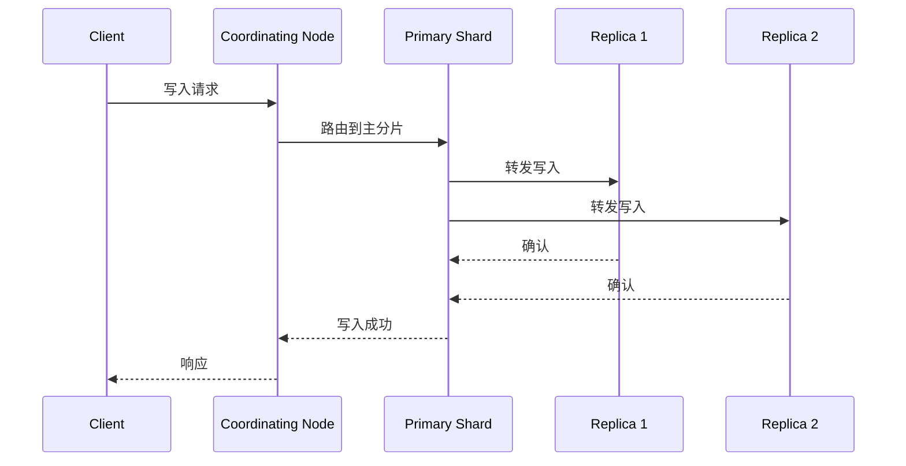

# 副本机制

## 1. 副本的作用

| 作用 | 说明 |
| :-- | :-- |
| **高可用** | 主分片故障时，副本提升为主分片 |
| **读扩展** | 搜索请求可以发送到副本分片 |
| **数据安全** | 数据在多个节点上存储多份 |

## 2. 副本同步机制

写入文档时，主分片负责写入，然后同步到所有 in-sync 副本分片：



### 2.1 写入确认语义

1. 客户端发送写入请求到协调节点
2. 协调节点路由到主分片
3. 主分片执行写入，并将请求转发到 in-sync 副本
4. 副本写入成功后返回确认
5. 主分片返回成功给协调节点
6. 协调节点返回客户端

> **注意**：写入开始前需要多少个分片副本处于活动状态，由 `index.write.wait_for_active_shards` 控制（默认 1，即只需主分片）。它决定写入前必须处于活动状态的分片数量，不等于「写入结束时会等待所有已配置副本都返回 ACK」。写入成功、复制完成与持久化保证是不同概念，不能笼统说「保证了数据一致性」。上图是正常路径的简化示意；实际复制只涉及当前 in-sync 副本集合，复制失败可能触发该副本被移出 in-sync 集合或本次写入失败。

## 3. 副本配置

```json
// 创建索引时设置副本数
PUT /my-index
{
  "settings": {
    "number_of_shards": 3,
    "number_of_replicas": 2
  }
}

// 动态修改副本数
PUT /my-index/_settings
{
  "number_of_replicas": 1
}
```

## 4. 故障恢复

### 4.1 主分片故障

```txt
1. Master 检测到主分片所在节点故障
2. 若存在可用的 in-sync 副本，Master 从中选择一个提升为新的主分片
3. 更新集群路由表
4. 其他副本重新分配，并执行恢复同步
```

> **注意**：主分片提升后集群不必然立即恢复 Green。主分片已分配但副本尚未全部分配或仍在恢复时，集群可能为 Yellow；只要有主分片未分配，集群就是 Red。

### 4.2 副本分片故障

```txt
1. Master 检测到副本分片所在节点故障
2. 标记该副本为未分配
3. 如果有足够节点，重新分配副本
4. 从主分片同步数据到新副本
```

### 4.3 节点重启恢复

```json
// 查看恢复状态
GET /_cat/recovery?v

// 查看特定索引的恢复状态
GET /my-index/_recovery?pretty
```

## 5. 副本数量建议

| 场景 | 副本数 | 说明 |
| :-- | :-- | :-- |
| 开发/测试 | 0 | 单节点，不需要冗余 |
| 生产环境 | 1 | 标准配置，1 份副本 |
| 高可用要求 | 2 | 提高冗余度与读并行能力 |
| 读密集型 | 1~2 | 副本分担搜索压力 |

> **注意**：副本数提高冗余度和搜索并行能力，但不直接等同于可容忍的节点故障数。实际容错能力取决于主副本的分布、节点故障是否独立，以及故障后是否还有可用的有效副本。

## 6. 副本与读扩展

搜索请求默认会分发到目标逻辑分片，每个分片组选择一个可用副本执行，由协调节点汇总结果；默认副本选择采用自适应副本选择（Adaptive Replica Selection，ARS），综合节点响应时间、搜索执行耗时与搜索线程池队列等负载信息，`preference` 等参数会影响候选分片的选择行为：

```json
// 搜索时指定偏好
GET /my-index/_search?preference=_primary
{
  "query": { "match_all": {} }
}
```

| preference | 说明 |
| :-- | :-- |
| `_primary` | 只查询主分片 |
| `_replica` | 只查询副本分片 |
| `_local` | 优先查询本节点分片 |
| `_only_nodes:node-1` | 只查询指定节点（node-1 为节点 ID 占位；指定节点无目标分片时可能回退到其他节点） |

## 7. 最佳实践

- 生产环境通常配置至少 1 个副本，副本需分布到不同节点才能提供节点级冗余
- 同一分片的主副本不能分配到同一节点，实际可分配性还取决于节点角色与分配约束
- 大规模初始导入且数据有可靠恢复来源时，可临时将副本数调为 0 提升写入吞吐，导入结束后恢复并确认副本已重新分配；一般批量写入不建议默认这么做，期间会暂时失去副本冗余
- 监控未分配副本数量，及时排查原因
- 使用 `preference` 参数优化查询路由
- 单节点集群设置 `number_of_replicas: 0`
