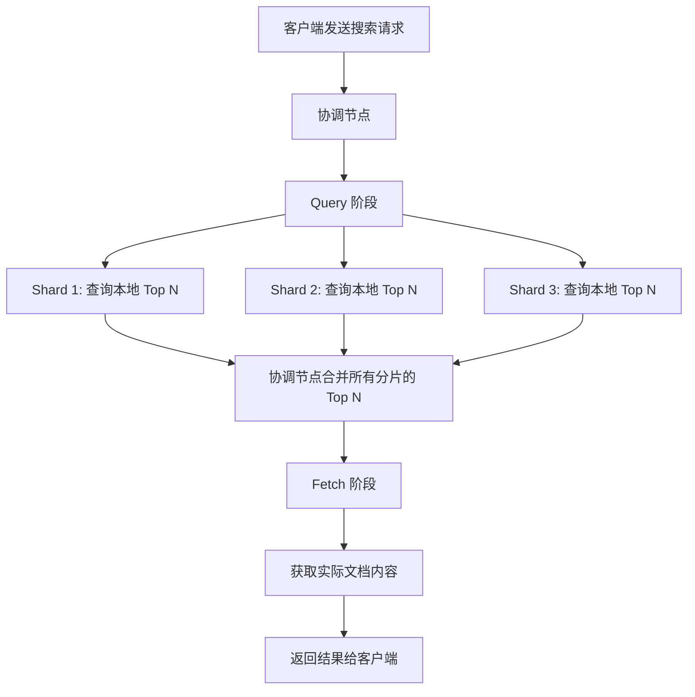

# 读取流程

## 1. 搜索流程概述

ES 的搜索分为两个阶段：**Query 阶段** 和 **Fetch 阶段**。



## 2. Query 阶段

```txt
1. 协调节点接收搜索请求
2. 协调节点将请求广播到目标索引的所有相关分片
3. 每个分片在本地执行查询，找到匹配的文档 ID
4. 每个分片返回文档 ID 列表和排序值（_score 或 sort 值）
5. 协调节点合并所有分片的结果，得到全局 Top N 文档 ID
```

> **关键点**：Query 阶段主要返回候选文档的 ID 和排序值，不返回文档内容，减少网络传输。

分片如何路由见 [集群架构与分片](./chapter-02-sharding.md)，主分片与副本的读取分工见 [副本机制](./chapter-03-replication.md)。

## 3. Fetch 阶段

```txt
1. 协调节点根据合并后的 Top N 文档 ID，确定每个文档所在分片
2. 向持有这些文档的分片发起 Fetch 请求，读取命中文档所需的字段
3. 协调节点组装最终结果返回客户端
```

> Fetch 阶段返回的内容取决于 `_source` 过滤与字段选择，不一定是完整文档。

## 4. DFS Query Then Fetch

默认的 Query Then Fetch 中，每个分片基于本地词项统计独立计算 `_score`，分片间文档数量和词项文档频率不同，可能导致相似文档获得不同评分，进而影响跨分片排序。DFS（Distributed Frequency Search）模式先收集全局词频信息，再据此评分，减少这种偏差：

```json
// 使用全局词项统计，可能改善跨分片评分一致性，但会增加额外开销
GET /my-index/_search?search_type=dfs_query_then_fetch
{
  "query": {
    "match": { "title": "Elasticsearch" }
  }
}
```

| 搜索模式 | 说明 | 适用场景 |
| :-- | :-- | :-- |
| `query_then_fetch` | 默认，每个分片独立评分 | 通用场景 |
| `dfs_query_then_fetch` | 先收集全局词频，再评分 | 分片局部统计导致排序差异、且全局统计有助于改善排序时 |

## 5. 分片偏好（Preference）

```json
// 指定查询特定分片
GET /my-index/_search?preference=_shards:0,1
{
  "query": { "match_all": {} }
}

// 优先查询主分片，主分片不可用时尝试副本（不保证读取最新数据）
GET /my-index/_search?preference=_primary_first
{
  "query": { "match_all": {} }
}
```

> `preference` 影响搜索请求选择哪些分片及其副本，不提供写入可见性或读取新鲜度保证。写入后文档需经 refresh 才可搜索，见 [写入流程](./chapter-04-write-path.md#refresh)。

## 6. 读取性能优化

| 优化手段 | 原理 |
| :-- | :-- |
| 使用 `filter` | 不计算相关性评分，符合节点查询缓存条件的查询结果可能被缓存 |
| 减少返回字段 | `_source` 过滤减少网络传输 |
| 使用 `routing` | 只查询特定分片 |
| 合理分片数 | 分片过多增加协调开销 |
| 预热文件系统缓存 | 通过合理内存配置与预热降低冷读开销，结合实际命中率与延迟验证 |

## 7. 最佳实践

- 理解 Query-Then-Fetch 两阶段原理，有助于排查搜索问题
- 分片局部统计导致排序差异时可评估 `dfs_query_then_fetch`
- 使用稳定的 `preference` 值提高分片副本选择的稳定性，帮助复用相关缓存
- 监控每个阶段的耗时，定位性能瓶颈
- 大结果集使用 `search_after` 而非深度分页
