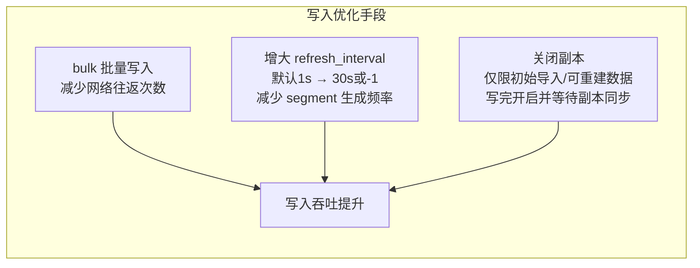
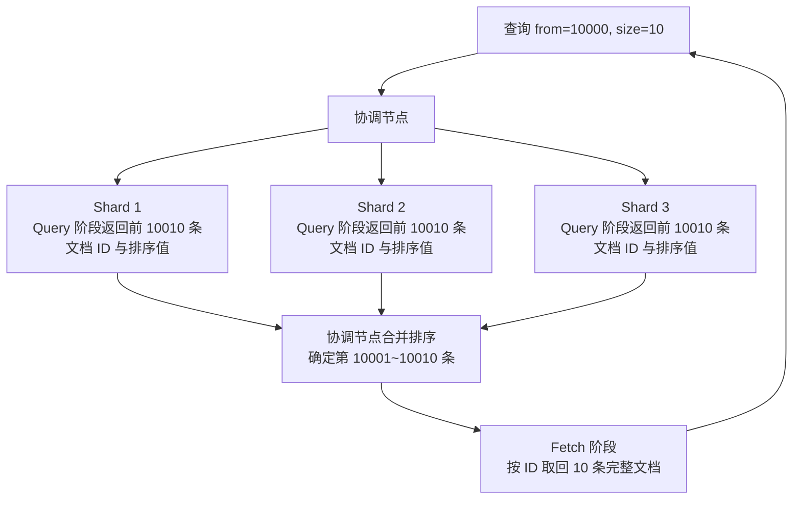

# ES 性能优化

## 1. 写入优化

> **为什么 refresh_interval 默认是 1 秒**：ES 是"近实时"搜索，1 秒的延迟对大多数搜索场景可接受，同时避免频繁生成 segment（refresh 会把 indexing buffer 中新增的内容对搜索可见，通常伴随新 segment 生成，segment 过多会影响查询性能）。批量写入时可以临时设为 -1（不自动 refresh），写完后手动 refresh。

## 2. 查询优化

| 优化手段 | 原理 | 适用场景 |
| :-- | :-- | :-- |
| 使用 filter 替代 query | filter 不计算相关性评分，符合条件的查询可能命中节点查询缓存 | 纯过滤场景（状态、标签筛选） |
| 避免深度分页 | `from=10000` 需要每个分片返回 from+size 条候选再合并 | 使用 `search_after` 替代 from/size |
| 减少返回字段 | 使用 `_source includes` 只返回需要的字段 | 文档字段多但只需部分字段 |
| 合理设置分片数 | 分片过多增加协调开销，分片规模需结合工作负载与压测确定 | 单分片经验范围约 10~50GB，非固定值 |

## 3. 深度分页问题（深度分析）

> **为什么深度分页性能差**：深度分页分两阶段。Query 阶段每个分片都要计算本地 Top(from+size) 个候选，把候选文档 ID 与排序值返回协调节点合并排序；Fetch 阶段才按 ID 取回最终命中的完整文档。分片越多、页码越深，Query 阶段的候选收集、排序与合并开销越大。`from=10000, size=10` 时，3 个分片各需收集 10010 个候选，最终只取回 10 条完整文档。
>
> **解决方案**：使用 `search_after`（游标分页），基于上一页最后一条记录的排序值继续查询，避免随页码增长而扩大候选窗口。`search_after` 要求排序值稳定唯一，跨页保持一致数据视图时需结合 Point in Time（PIT）使用。

## 4. 常见性能问题汇总

| 错误场景 | 原因 | 解决方案 |
| :-- | :-- | :-- |
| 主分片数设置过少，后期无法扩展 | 主分片数创建后不可修改（路由公式依赖分片数） | 初始规划时按数据增长率、分片级负载与恢复目标估算，扩容需 reindex 到新索引或 split |
| 深度分页超时或 OOM | Query 阶段每个分片返回大量候选到协调节点合并排序 | 使用 search_after 替代 from/size，跨页一致时结合 PIT |
| 写入慢，refresh_interval 设置过短 | refresh 频繁可能生成更多 segment，增加 merge 压力 | 批量写入时临时设置 refresh_interval=-1 |
| 集群 Yellow 状态，误以为故障 | 单节点副本无法分配（主副不能在同一节点） | 开发环境设置副本数为 0 |

## 5. 问题：ES 写入数据后为什么不能立即查到？

> ES 写入流程：数据先写入内存 buffer，同时写入 translog（受 `index.translog.durability` 控制同步持久化策略，负责故障恢复）→ 每隔 `refresh_interval`（默认 1 秒）refresh 把新增内容对搜索可见，通常形成新 segment → flush 执行 Lucene commit 完成 segment 提交并滚动 translog generation（由 translog 大小等多种条件触发，并非单一定时参数）。所以 ES 是**近实时**（Near Real-Time）搜索，默认有约 1 秒延迟。
