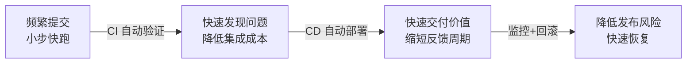
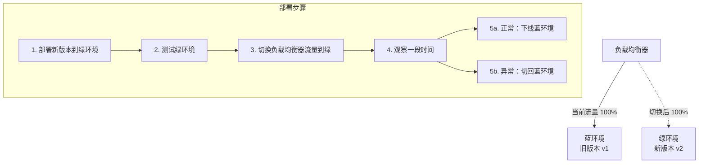
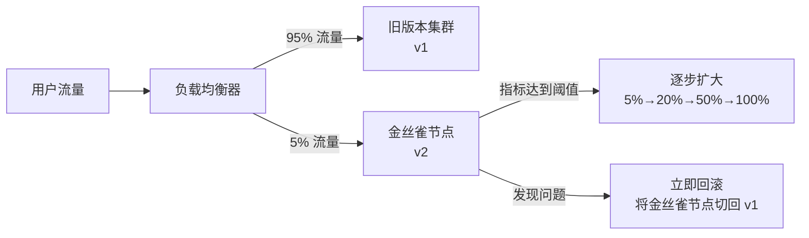
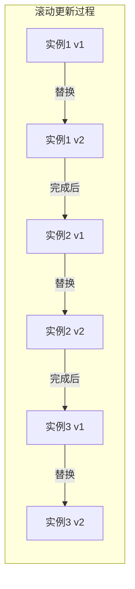

# CI/CD 持续集成与持续交付

## 1. 为什么需要 CI/CD？

### 1.1 没有 CI/CD 的痛点

| 问题 | 具体表现 |
| :-- | :-- |
| **集成地狱** | 多人开发，代码合并时大量冲突，"最后一天合代码"噩梦 |
| **手动部署不可靠** | 人工执行命令，步骤遗漏、环境差异导致线上故障 |
| **发布周期长** | 测试→修复→测试循环，一个版本发布需要数周 |
| **回滚困难** | 出问题不知道回滚到哪个版本，回滚步骤复杂 |
| **环境不一致** | "在我机器上能跑"，开发/测试/生产环境差异导致 bug |

### 1.2 CI/CD 解决的核心问题



## 2. CI/CD 流水线全流程


### 2.1 各阶段说明

| 阶段 | 工具 | 目的 |
| :-- | :-- | :-- |
| 代码托管 | GitLab / GitHub | 版本管理，触发流水线 |
| 编译构建 | Maven / Gradle | 验证代码可编译 |
| 单元测试 | JUnit / Mockito | 验证核心逻辑正确性，方法见[测试](./chapter-03-testing.md) |
| 代码扫描 | SonarQube | 检测代码质量问题及其支持的安全规则，见[安全概览](../07-security/chapter-01-security-overview.md) |
| 镜像构建 | Docker | 打包为可部署的镜像 |
| 镜像仓库 | Harbor / ECR | 存储和管理镜像版本 |
| 部署编排 | Kubernetes / Helm | 自动化部署到集群 |
| 监控告警 | Prometheus + Grafana | 实时监控，异常告警，见[可观测性](./chapter-06-observability.md) |

### 2.2 质量门禁与制品晋级

流水线把步骤串起来只是基础，交付的可靠性来自三道约束：

- **质量门禁**：构建、测试、安全扫描等检查失败时阻断后续发布阶段。哪些检查属于阻断条件（例如安全扫描的高危漏洞是否一票否决），由团队风险策略决定，不必所有告警都阻止发布。
- **制品晋级**：构建一次生成可追溯的制品标识（镜像 digest），测试、预发布、生产使用同一制品晋级，而不是在各环境重新构建。
- **发布授权与审计**：区分自动化验证、人工审批与生产部署权限，记录发布版本、审批记录与执行结果。

图中的「异常自动/手动回滚」也要落到可执行层面。自动回滚需要预先定义可检测的失败条件和观察窗口，并确认回滚动作本身安全，数据库、消息等共享状态是否允许回退，不能只依赖「监控告警」这一抽象步骤。

## 3. 常见部署策略

### 3.1 蓝绿部署（Blue-Green Deployment）



| 维度 | 说明 |
| :-- | :-- |
| **优点** | 回滚快（流量切换秒级完成），零停机发布；业务恢复时间另受连接排空、缓存、数据变更影响 |
| **缺点** | 资源成本高，通常需同时保留两套可承载流量的环境 |
| **适用场景** | 对回滚速度要求极高的核心系统 |

### 3.2 金丝雀发布（Canary Release）



| 维度 | 说明 |
| :-- | :-- |
| **优点** | 风险可控，真实流量验证，问题影响范围小 |
| **注意** | 灰度比例只是手段之一，扩大流量应依据预定义指标与阈值；少量流量不等于低风险，低频高损失的交易即使 5% 也可能造成严重影响 |
| **缺点** | 需要流量控制能力，新旧版本共存期间需兼容 |
| **适用场景** | 大型系统，功能变更影响面广，需要灰度验证 |

### 3.3 滚动更新（Rolling Update）



| 维度 | 说明 |
| :-- | :-- |
| **优点** | 资源利用率高，无需额外环境 |
| **缺点** | 回滚慢，更新期间新旧版本共存，需要接口向后兼容 |
| **适用场景** | 资源有限，可接受短暂新旧版本共存 |
| **Kubernetes 支持** | `kubectl rollout` 原生支持，`maxSurge` 和 `maxUnavailable` 控制节奏 |

图中按实例编号逐个替换只是逐批更新的示意，实际更新节奏由 `maxSurge`、`maxUnavailable`、就绪探针和调度资源共同决定，不严格按编号顺序执行。

### 3.4 三种策略对比

| 策略 | 资源成本 | 回滚速度 | 风险控制 | 复杂度 |
| :-- | :-- | :-- | :-- | :-- |
| 蓝绿部署 | 高（需保留两套环境） | ⭐⭐⭐⭐⭐ 快（流量切换） | 中（全量切换） | 低 |
| 金丝雀发布 | 低 | ⭐⭐⭐ 需要操作 | 高（小流量验证） | 高 |
| 滚动更新 | 低 | ⭐⭐ 较慢 | 低（全量替换） | 中 |

### 3.5 发布前的兼容性约束

三种策略的对比（资源成本、回滚速度）描述的是部署手段，不是发布安全的保证。真正决定回滚能否成功的，是发布前对共享状态的兼容性评估：

- **接口兼容性**：新旧版本共存期间，接口是否需要向后兼容。
- **数据库迁移**：新增字段先用向后兼容的迁移方式（先加可空列或默认值），待旧版本下线且确认无需回退后，再删除旧字段。
- **缓存与消息格式**：新旧版本共享缓存、消息队列时，序列化格式变更需要兼容或双写。

关键要区分两件事：回滚代码不等于回滚数据，流量切换或实例替换快，不代表业务能够立即恢复。数据变更可能不可逆，回滚方案需要单独评估。数据库迁移的具体实现见 [数据库迁移 (Flyway / Liquibase)](../../spring/04-data-access/chapter-07-flyway-liquibase.md)。

## 4. Dockerfile 与镜像构建最佳实践

```dockerfile
# 多阶段构建：减小最终镜像体积
# 第一阶段：构建（eclipse-temurin 是 OpenJDK 官方推荐的维护中发行版）
FROM maven:3.9-eclipse-temurin-17 AS builder
WORKDIR /app
COPY pom.xml .
# 先复制 pom.xml 并下载依赖（利用 Docker 层缓存）
RUN mvn dependency:go-offline
COPY src ./src
# 测试已在前序质量门禁完成，这里跳过测试只打包；不要把 -DskipTests 当成跳过整条流水线测试的理由
RUN mvn package -DskipTests

# 第二阶段：运行（只包含 JRE，不包含 Maven 和源码）
FROM eclipse-temurin:17-jre-noble
WORKDIR /app
COPY --from=builder /app/target/*.jar app.jar
EXPOSE 8080
ENTRYPOINT ["java", "-jar", "app.jar"]
```

**最佳实践**：

- 使用**多阶段构建**，最终镜像只包含运行时依赖
- 将**不常变化的层**（依赖）放在前面，利用 Docker 层缓存加速构建
- 不要在镜像中存储敏感信息（密码、密钥），通过环境变量或 Secret 注入
- 固定基础镜像 **digest**，并确认基础镜像与项目 JDK 基线一致且仍处于维护状态，避免标签漂移导致构建结果变化。固定 digest 只保证引用内容不随标签变化，不代表镜像始终安全，需要定期评估安全更新并升级 digest；依赖版本、构建工具等可变输入仍需统一管理，才算完整的可复现构建。
- 生产构建接入**镜像漏洞扫描**与**构建产物追溯**（记录源码提交、构建结果与镜像摘要），无需在本节展开供应链安全教程。

## 5. 常见问题

**Q1：CI 和 CD 的区别是什么？**

> - **CI（持续集成）**：开发者频繁提交代码，自动触发构建和测试，快速发现集成问题。目标是"代码随时可构建"。
> - **CD（持续交付）**：在 CI 基础上，软件始终处于可发布状态，自动部署到测试环境，生产发布可保留人工决策（是否审批由团队决定）。目标是"代码随时可发布"。
> - **CD（持续部署）**：更进一步，符合条件的变更通过所有验证后自动进入生产，无需每次人工审批。

**Q2：蓝绿部署和金丝雀发布如何选择？**

> - 对**回滚速度**要求极高（核心支付、交易系统）→ 蓝绿部署
> - 需要**真实流量验证**、风险控制（大型电商、社交平台）→ 金丝雀发布
> - **资源有限**、变更风险低 → 滚动更新

**Q3：如何保证生产环境和测试环境的一致性？**

> 测试和生产环境使用**同一构建产物（镜像 digest 一致）**，减少应用制品差异。应用自身的配置差异（连接串、开关、密钥等）通过 **Kubernetes** 的 ConfigMap 和 Secret 管理，而不是修改镜像；但数据库版本、外部服务版本、网络策略、权限、资源限制属于平台与依赖服务的配置，需要单独对齐，ConfigMap 和 Secret 管不到。分清制品一致性、应用配置一致性与运行环境一致性，镜像一致不等于环境等价，镜像一致性不能替代生产环境验证。

**Q4：流水线中哪个阶段最容易出问题？**

> 实践中最常见的问题：
>
> 1. **测试覆盖率不足**：单元测试只覆盖 happy path，边界情况漏测
> 2. **环境配置差异**：测试环境数据库版本、配置与生产不一致
> 3. **数据库变更未纳入流水线**：代码部署了但 DDL 没执行，导致启动失败

> **复习检验标准**：能否画出 CI/CD 流水线的完整流程？能否说出三种部署策略的适用场景？能否解释蓝绿部署的回滚原理？
