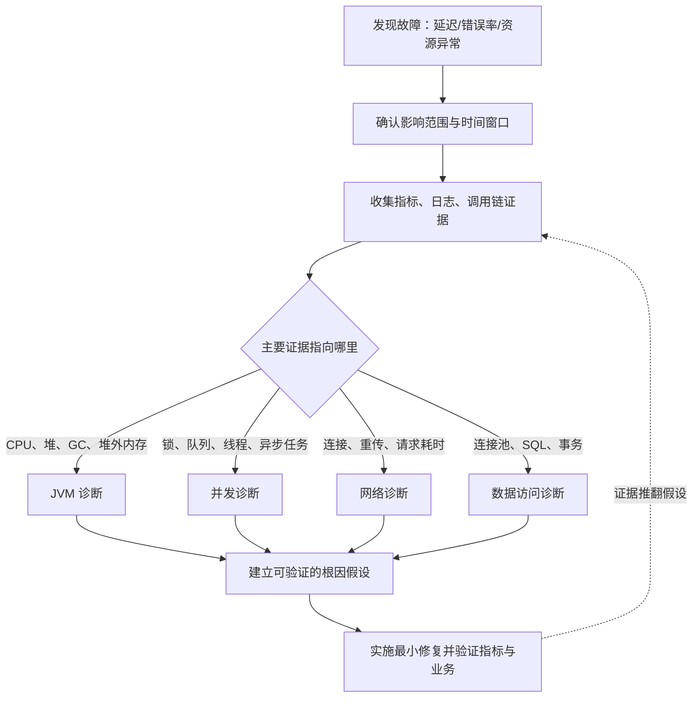

# Java 诊断总览

诊断页面按故障域组织。先记录现象，再根据证据选择最接近的方向进入，最后回到对应的原理页面验证根因。

## 症状索引

不要先猜根因属于哪个技术域，从现象开始。

| 你看到的现象 | 证据先指向 | 入口 |
| :-- | :-- | :-- |
| CPU 利用率高 | 计算繁忙，还是线程/系统活动导致 | [JVM 诊断](./01-jvm/chapter-01-jvm-diagnostics.md) / [并发诊断](./02-concurrency/chapter-01-concurrency-diagnostics.md) |
| 堆使用量持续增长、OOM | 正常分配、存活对象增长还是回收不佳 | [JVM 内存案例](./01-jvm/chapter-02-cases-cpu-memory.md) / [GC 案例](./01-jvm/chapter-03-cases-gc-resources.md) |
| GC 频繁、停顿长、吞吐下降 | 分配速率、晋升还是 SafePoint | [GC 延迟案例](./01-jvm/chapter-04-cases-gc-latency.md) |
| 死锁、锁竞争、线程池饱和 | 锁、队列、线程还是异步任务 | [并发诊断](./02-concurrency/chapter-01-concurrency-diagnostics.md) |
| 异步任务丢弃、下游超时 | 调度、参数还是超时级联 | [异步超时案例](./02-concurrency/chapter-05-cases-async-timeout.md) |
| 接口超时、RT 高、连接失败 | 排队、网络、应用执行还是数据库 | [网络诊断](./03-network/chapter-01-network-diagnostics.md) |
| 连接数持续异常（TIME_WAIT/CLOSE_WAIT） | 连接生命周期、关闭方还是连接池 | [网络诊断](./03-network/chapter-01-network-diagnostics.md) |
| 获取连接超时、连接池耗尽、慢 SQL | 连接需求超供给，还是连接持有过长 | [数据访问诊断](./04-data-access/index.md) |
| 容器 OOMKilled、堆外异常 | 直接内存、容器限制还是资源泄漏 | [堆外与网络案例](./01-jvm/chapter-05-cases-offheap-network.md) |

相似症状可能来自不同层级。比如「接口超时」既可能是线程池排队，也可能是网络连接、数据库执行或 GC 暂停。证据链才是分流依据，不要只凭症状名称归档。

## 跨域决策路径

诊断入口不是固定顺序，而是由证据决定。出现故障时先按下面的路径收窄，再进入对应子域。

证据可能把路径带回上一步，初始假设也常被推翻。这不是严格的线性流程，排障常在几个子域之间往返。

## JVM 诊断

- [JVM 线上诊断](./01-jvm/chapter-01-jvm-diagnostics.md)：CPU、GC、OOM、线程和常用工具的排查流程。
- [CPU 与内存泄漏案例](./01-jvm/chapter-02-cases-cpu-memory.md)：正则回溯、无界缓存和 Metaspace 泄漏。
- [GC、资源与综合诊断案例](./01-jvm/chapter-03-cases-gc-resources.md)：Full GC、连接池耗尽以及 Arthas 与 JFR 组合排查。
- [GC 延迟与分配异常案例](./01-jvm/chapter-04-cases-gc-latency.md)：分配速率、对象寿命、SafePoint 和晋升异常。
- [TCP 层与堆外内存案例](./01-jvm/chapter-05-cases-offheap-network.md)：连接数限制、直接内存和容器 OOMKilled。

## 并发诊断

- [并发问题诊断](./02-concurrency/chapter-01-concurrency-diagnostics.md)：死锁、锁竞争、线程池和虚拟线程诊断。
- [并发性能优化](./02-concurrency/chapter-02-concurrency-optimization.md)：减少共享争用，处理异步化与资源隔离。
- [锁与执行模型案例](./02-concurrency/chapter-03-cases-lock-execution.md)：死锁和线程池饱和。
- [并发案例：可变键与虚拟线程 pinning](./02-concurrency/chapter-04-cases-mutable-key-pin.md)：并发集合键变更和虚拟线程 pinning。
- [异步任务与下游超时案例](./02-concurrency/chapter-05-cases-async-timeout.md)：任务丢弃、参数失效、调度阻塞和超时级联。

## 网络诊断

- [网络性能分析与故障排查](./03-network/chapter-01-network-diagnostics.md)：常见网络症状、抓包和 Java 网络诊断。
- [连接失败与建立缓慢案例](./03-network/chapter-02-cases-connection-failures.md)：DNS、TCP 建连、监听端口、连接队列与防火墙证据。
- [请求超时与延迟案例](./03-network/chapter-03-cases-timeout-latency.md)：连接与读写阶段、重传、RTT、应用处理耗时与下游依赖。
- [连接泄漏与状态异常案例](./03-network/chapter-04-cases-connection-leaks.md)：连接生命周期、TIME_WAIT/CLOSE_WAIT、文件描述符与连接池。

## 数据访问诊断

- [数据访问诊断总览](./04-data-access/index.md)：连接池耗尽、慢 SQL 与跨层排障入口。
- [连接池耗尽案例](./04-data-access/chapter-01-cases-connection-pool-exhaustion.md)：获取连接超时、连接泄漏、慢 SQL 引发的资源占用。
- [慢 SQL 案例](./04-data-access/chapter-02-cases-slow-sql.md)：执行计划变化、锁等待、数据库与应用耗时不一致。

## 优化与关联专题

下列专题偏向优化方法与决策，不是故障证据定位，放在对应技术模块，供排查后做取舍时参考。

- [高并发网络优化与最佳实践](../04-java-network/chapter-12-network-optimization.md)：连接池、I/O 模型和网络参数的优化取舍。
- [数据访问性能优化](../05-java-data-access/chapter-08-performance.md)：连接池、批处理、链路分析和常见故障。

## 使用方式

1. 记录症状、时间点和影响范围，不要先猜根因。
2. 选择对应诊断页，先确认数据来自正确的层级。
3. 用案例中的信号缩小范围，再回到原理页验证。
4. 修复后同时验证指标恢复、错误消失和业务结果正常。
