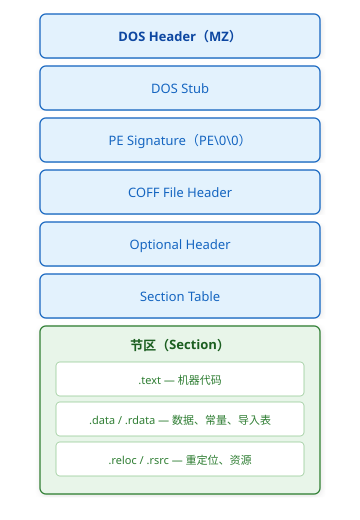

# PE 头部：从 MZ 到节表

一个 `.exe` 文件躺在硬盘上时，是按固定结构组织的一串字节。这一章拆解 PE 文件的「头」部分——从最开头的 `MZ` 到节表，回答「这个文件是什么、跑在什么机器上、内容分布在哪」。

> 本文字段说明基于 Microsoft 官方的 [PE Format 规范](https://learn.microsoft.com/en-us/windows/win32/debug/pe-format)。PE 格式自 Windows NT 时代沿用至今，结构稳定；本文以 64 位（PE32+）为主。

## 1. 整体画面

PE（Portable Executable，可移植可执行文件）是 Windows 的 `.exe`、`.dll`、`.sys` 等文件的统一格式。「可移植」指的是格式与 CPU 架构无关——同一个结构既能描述 32 位 x86，也能描述 64 位 x64。

一个 PE 文件从文件开头到结尾，大致是：



理解这张图，后面所有内容都挂在它上面。下面从前往后逐段看。

## 2. DOS Header 与 DOS Stub

每个 PE 文件最开头的两个字节固定是 `4D 5A`，对应 ASCII 字符 `MZ`。这 64 字节的结构叫 DOS Header，其中对逆向真正有用的只有一个字段：**`e_lfanew`**，位于文件偏移 `0x3C` 处，是一个 4 字节整数，记录「PE 头从这里开始」的文件偏移。

DOS Header 之后是一小段 DOS Stub——一段 16 位实模式代码，作用是在真正的 DOS 环境下打印「This program cannot be run in DOS mode」然后退出。在 Windows 下它完全不会执行，可以忽略。

用十六进制查看器打开任意 `.exe`，开头一定是：

```text
00000000  4D 5A 90 00 03 00 00 00  ...   ←  "MZ" 开头
0000003C  E8 00 00 00                    ←  e_lfanew = 0xE8，PE 头在 0xE8 处
```

## 3. PE Signature 与 COFF File Header

跳到 `e_lfanew` 指向的位置，先看到 4 字节的 **PE Signature**：`50 45 00 00`，即 `PE\0\0`，确认「这里开始是真正的 PE 结构」。

紧接着是 20 字节的 **COFF File Header**（`IMAGE_FILE_HEADER`），回答「这是什么文件、跑在什么机器上」这类元信息，关键字段：

| 字段 | 含义 |
| :-- | :-- |
| `Machine` | 目标架构。`0x8664` 是 x64，`0x14C` 是 x86 |
| `NumberOfSections` | 节区数量 |
| `SizeOfOptionalHeader` | 紧随其后的 Optional Header 的大小 |
| `Characteristics` | 文件属性标志，如是否 DLL、是否可执行 |

判断一个二进制是 32 位还是 64 位，最直接的就是看 `Machine` 字段，或看 Optional Header 里的 `Magic`。

## 4. Optional Header：核心就在这里

尽管名字叫「Optional（可选）」，对可执行映像来说它必不可少。64 位版本叫 `IMAGE_OPTIONAL_HEADER64`，用 `Magic` 字段区分：`0x10B` 是 32 位（PE32），`0x20B` 是 64 位（PE32+）。

对逆向最关键的几个字段：

| 字段 | 含义 | 为什么重要 |
| :-- | :-- | :-- |
| `AddressOfEntryPoint` | 入口点 RVA，程序启动后最先执行的代码地址 | 找到 `main` 之前的真正入口 |
| `ImageBase` | 镜像首选加载地址，通常是 `0x140000000`（x64） | RVA 加上它就是虚拟地址（VA） |
| `SectionAlignment` | 节区在内存中的对齐粒度，通常是 `0x1000` | 计算内存地址用 |
| `FileAlignment` | 节区在文件中的对齐粒度，通常是 `0x200` | 计算文件偏移用 |
| `SizeOfImage` | 整个镜像在内存中占用的总大小 | 判断某个地址是否在模块范围内 |
| `DataDirectory` | 一个 16 项的数组，记录导入表、导出表等的位置和大小 | 定位各类表的入口 |

`DataDirectory` 是 `IMAGE_DATA_DIRECTORY` 数组，每项含 `VirtualAddress` 和 `Size` 两个字段。常用项的索引是固定的：

| 索引 | 名称 | 内容 |
| :-- | :-- | :-- |
| 0 | Export Table | 导出函数 |
| 1 | Import Table | 导入函数 |
| 5 | Base Relocation Table | 重定位信息 |
| 12 | Import Address Table | 导入地址表（IAT） |

这些索引不用背，反汇编器都会自动解析并命名，但你需要知道它们的存在和大致作用，才能理解反汇编窗口里那些段名和注释从哪来。

## 5. 节表与节区

头之后是 **Section Table（节表）**，它描述后面实际存放内容的各个节区。每个节区一个 `IMAGE_SECTION_HEADER`，记录节名、虚拟地址、大小和文件中的位置。常见的节区：

| 节区 | 通常存放 | 常见权限 |
| :-- | :-- | :-- |
| `.text` | 机器代码 | 读 + 执行 |
| `.data` | 已初始化的全局/静态变量 | 读 + 写 |
| `.rdata` | 只读数据：常量、字符串、导入表等 | 读 |
| `.idata` | 导入表（有时并入 `.rdata`） | 读 |
| `.reloc` | 重定位表 | 读 |
| `.rsrc` | 资源：图标、菜单、字符串表、版本信息 | 读 |

节名只是约定，不是规范强制，加壳或混淆的程序常常使用非常规节名，甚至故意命名成误导性名字。所以判断一个节区放什么，看它的权限标志比看名字更可靠。

---

> 本章建立的是 PE 头部的结构：`MZ` 头定位 PE 头，Optional Header 给出入口点和各类表的位置，节表描述内容的分布。下一章讲这些表里最关键的两个地址概念——[RVA 与文件偏移](./chapter-02-address-and-tables.md)。
