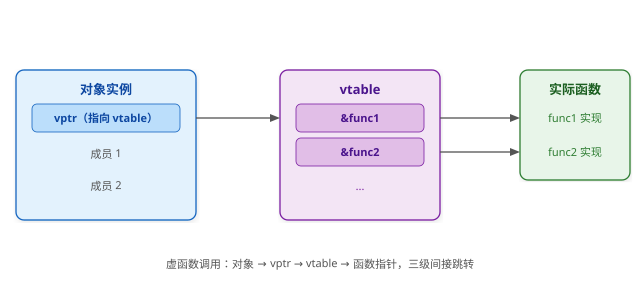

# 虚函数表与 RTTI：还原 C++ 类结构

C++ 程序编译后，会留下两个独特的结构：**虚函数表（vtable）** 和 **RTTI（运行时类型信息）**。它们是还原 C++ 类结构的钥匙——从 vtable 能看出类的虚函数，从 RTTI 能看出类的名字和继承关系。

## 1. 虚函数是怎么实现的

C++ 的多态靠虚函数实现。编译后，每个有虚函数的类，都有一张**虚函数表（vtable）**：一个函数指针数组，按声明顺序存放所有虚函数的地址。

每个对象实例的第一个字段（通常），是一个指向 vtable 的指针（vptr）。调用虚函数时，程序通过「对象 → vptr → vtable → 函数指针」这三级间接跳转，找到实际要调用的函数。



这套机制解释了「为什么调用同一个函数名，实际执行的代码不同」——因为 vtable 里的指针，被子类替换成了自己的实现。

## 2. 反汇编里识别 vtable

识别 vtable 有两个特征：

**构造函数里写 vptr**。C++ 对象的构造函数，开头会把自己类的 vtable 地址写进对象：

```asm
mov  [rcx], offset vtable_ClassName   ; 把 vtable 地址写进对象开头
```

看到「往对象开头写一个地址，而这个地址指向一张函数指针表」，基本就是「构造函数初始化 vptr」。

**间接调用**。虚函数调用是间接的：

```asm
mov  rax, [rcx]        ; 取 vptr（对象第一个字段）
call qword ptr [rax+8] ; 调 vtable 第 2 项（第二个虚函数）
```

看到「先取对象开头的指针，再按偏移间接 call」，就是虚函数调用。`[rax+8]` 说明是第二个虚函数。

## 3. RTTI：运行时类型信息

C++ 的 `typeid` 和 `dynamic_cast` 需要运行时知道对象的真实类型，这就是 **RTTI** 提供的信息。

RTTI 结构里，对逆向最有价值的是**类的名字**——它以字符串形式存在二进制里（MSVC 下形如 `.?AVClassName@@`）。反汇编器（IDA、Ghidra）能解析 RTTI，自动恢复出类名。

RTTI 还编码了**继承关系**：基类列表、继承层级。通过 RTTI，能还原出「类 A 继承自类 B」这种关系。

## 4. 从 vtable + RTTI 还原类结构

把 vtable 和 RTTI 结合起来，能还原出一个 C++ 类的完整面貌：

1. **类名**：从 RTTI 字符串得到。
2. **虚函数列表**：从 vtable 得到（每个函数指针是一个虚函数，顺序对应声明顺序）。
3. **成员布局**：从构造函数的「基址 + 偏移」访问得到（上一章的方法）。
4. **继承关系**：从 RTTI 的基类列表得到。

这些信息拼起来，你就能把一个「无名结构体 + 一堆函数指针」还原成「`class Foo : public Bar`，有这些成员、这些虚函数」。

## 5. 还原的实践顺序

分析一个 C++ 程序时，建议按这个顺序还原类结构：

1. 先让反汇编器解析 RTTI，得到类名（自动完成）。
2. 定位构造函数，识别 vptr 写入和成员初始化。
3. 从 vtable 读出虚函数列表，逐个分析虚函数。
4. 结合上一章的方法，恢复成员布局。
5. 把类名、虚函数、成员重命名到反编译产物里。

这样反编译产物会从「一堆 `v1`、`sub_xxx`」变成「`Foo::bar()`、`this->field`」的可读代码。

---

> 本章建立的是 C++ 类结构的还原方法：vtable 暴露虚函数，RTTI 暴露类名和继承关系，两者结合还原类结构。这为分析 C++ 商业软件打基础。下一阶段进入[动态调试](../06-dynamic-debugging/chapter-01-debugging-basics.md)。
