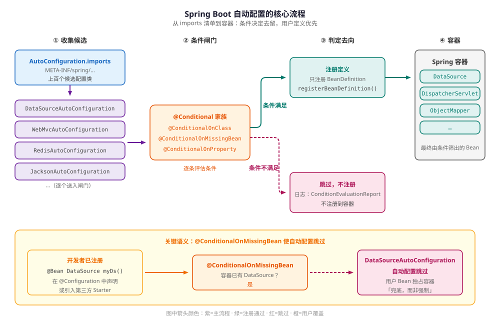

# Spring Boot 自动配置原理

> 本文以 Spring Boot 3.x 为准，结论对照 3.2.x 与 3.5.x 源码核对。Spring Boot 4.0 已把代码库拆分为多个模块，自动配置类分散在不同 jar 中，本文不覆盖 4.x。
>
> 涉及 2.7 与 3.0 的注册机制差异时，会在对应段落单独说明。
>
> 阅读前应了解 Spring 的 `@Configuration`、`@Bean` 和 Bean 生命周期基础；本文不重复这些内容。

自动配置解决的是“默认的 Bean 配置从哪里来”的问题。Spring Boot 在用户配置之后读取一份候选清单，按 classpath、已有 Bean 和配置属性筛选配置类，再把通过的配置类注册为 BeanDefinition（Bean 的定义元数据，描述如何创建 Bean）。它既不是启动时扫描所有依赖的注解，也不是运行期动态生成 Bean。

第 1 节先交代它在启动流程中的位置，之后按五个问题展开，一个问题对应一节：

1. 候选配置类从哪里来？（第 2 节）
2. 自动配置为什么排在用户配置之后？（第 3 节）
3. 条件在什么时候、根据什么做判断？（第 4 节）
4. 多个自动配置类之间如何排序？（第 5 节）
5. 配置没有生效时，应该从哪里查？（第 6 节）

## 1. 自动配置在启动流程中的位置

`SpringApplication.run()` 先创建应用上下文，再调用 `refresh()`。除创建上下文外，下面的流程都发生在 `refresh()` 内部：配置类解析由 `ConfigurationClassPostProcessor` 在 `invokeBeanFactoryPostProcessors` 阶段完成，Bean 实例化在 `finishBeanFactoryInitialization` 阶段。

这段流程分两段，不要读成一条逐级向下的时间线。

**第一段是发现。** `ConfigurationClassPostProcessor` 从已注册的 BeanDefinition 出发解析配置类，主配置类通常排在最前面。解析到 `@ComponentScan` 时扫描用户组件，解析到 `@Import(AutoConfigurationImportSelector.class)` 时把 `AutoConfigurationImportSelector` 登记为延迟选择器。登记只表示“稍后处理”，此时选择器还没有读取任何候选。

**第二段是执行。** 所有普通配置类解析完，`ConfigurationClassParser` 才处理登记的延迟选择器：`process()` 读取 classpath 上的 `AutoConfiguration.imports`，完成去重、排除和预过滤，`selectImports()` 负责排序。随后解析排序后的自动配置类，逐条评估 `@Conditional`，通过的 `@Bean` 方法注册为 BeanDefinition。`refresh()` 的后续阶段才实例化 Bean，依赖注入和生命周期回调这时发生。

关键结论：**延后的是选择器的执行，不是候选的发现。** 通过 `@EnableAutoConfiguration` 加载时，自动配置类在所有用户配置类解析完之后、Bean 实例化之前参与解析和注册。这个顺序是“用户定义优先”的基础。

下图把这条链路画成一条通路：候选清单逐个进入条件判断，通过的注册 BeanDefinition 并进入容器，不通过的跳过；图的下半部分单独画出“开发者已注册同类型 Bean 时自动配置跳过”这一分支。



这里的“注册 BeanDefinition”不是“创建 Bean 实例”。条件通过只代表这个定义进入了容器，对象要等到实例化阶段才创建。

## 2. 候选配置从哪里来

第 1 节提到的候选清单，入口在 `@SpringBootApplication` 的注解链上。

### 2.1 从 `@SpringBootApplication` 拆起

`@SpringBootApplication` 是三个注解的组合：

```java
@Target(ElementType.TYPE)
@Retention(RetentionPolicy.RUNTIME)
@SpringBootConfiguration
@EnableAutoConfiguration
@ComponentScan(excludeFilters = {
        @Filter(type = FilterType.CUSTOM, classes = TypeExcludeFilter.class),
        @Filter(type = FilterType.CUSTOM, classes = AutoConfigurationExcludeFilter.class)
})
public @interface SpringBootApplication {
    // 省略 exclude、excludeName、scanBasePackages 等属性
}
```

三个部分各自负责一件事：

- `@SpringBootConfiguration` 本质上是 `@Configuration`，用来标记主配置类。测试框架也依靠它识别启动类。
- `@EnableAutoConfiguration` 打开自动配置。
- `@ComponentScan` 扫描当前包及子包中的组件，同时用 `AutoConfigurationExcludeFilter` 排除带有 `@AutoConfiguration` 或已在 imports 清单中登记的自动配置类，避免它们被当成普通配置类重复注册。

代码块省略的属性不是 `@SpringBootApplication` 自己实现的，而是通过 `@AliasFor` 转发给被组合的注解：

```java
@AliasFor(annotation = EnableAutoConfiguration.class)
Class<?>[] exclude() default {};
```

所以启动类上的 `exclude` 与第 6 节的 `spring.autoconfigure.exclude` 最终进入同一份排除集合。

继续拆 `@EnableAutoConfiguration`：

```java
@AutoConfigurationPackage
@Import(AutoConfigurationImportSelector.class)
public @interface EnableAutoConfiguration {
    // 省略 exclude、excludeName 属性
}
```

`@AutoConfigurationPackage` 把启动类所在的包注册到 `AutoConfigurationPackages`。JPA（Jakarta Persistence）实体扫描等默认会以这个包为起点，所以启动类通常放在最外层业务包，而不是某个很深的子包里。

`@Import(AutoConfigurationImportSelector.class)` 才是自动配置的入口。接下来看这个选择器读取什么。

### 2.2 imports 清单

Spring Boot 3.x 从下面这个文件读取自动配置候选：

```txt
META-INF/spring/org.springframework.boot.autoconfigure.AutoConfiguration.imports
```

文件内容是一行一个全限定类名，支持用 `#` 写注释：

```txt
com.example.greeting.GreetingAutoConfiguration
# 这一行是注释
com.example.greeting.AnotherAutoConfiguration
```

classpath 上可以有多个同名文件，`ImportCandidates.load()` 会把它们全部读出并合并，后面的流程再去重。被列出的类只是“候选”，是否生效仍要经过条件判断。

在加载候选类之前，`AutoConfigurationImportFilter` 会先用元数据做一次预过滤。例如 `OnClassCondition` 可以根据 classpath 和 `spring-autoconfigure-metadata.properties`（由 `spring-boot-autoconfigure-processor` 生成）直接排除缺少依赖的候选，剩下的类才进入解析和完整条件评估。

自动配置类用 `@AutoConfiguration` 标记：

```java
// 示意：SomeLibrary、MyProperties 由你的自动配置模块提供
@AutoConfiguration
@ConditionalOnClass(SomeLibrary.class)
@EnableConfigurationProperties(MyProperties.class)
public class MyAutoConfiguration {
    // @Bean 方法
}
```

`@AutoConfiguration` 从 Spring Boot 2.7 开始提供，自动配置类应使用它，而不是普通 `@Configuration`。它本身被 `@Configuration(proxyBeanMethods = false)`、`@AutoConfigureBefore` 和 `@AutoConfigureAfter` 标注。`proxyBeanMethods = false` 表示不为配置类生成 CGLIB 子类，`@Bean` 方法之间不要互相调用；需要另一个 Bean 时，把它声明为方法参数。

### 2.3 `spring.factories` 的历史差异

Spring Boot 2.6 及更早版本通过 `META-INF/spring.factories` 注册自动配置，使用的键是：

```properties
org.springframework.boot.autoconfigure.EnableAutoConfiguration=\
com.example.greeting.GreetingAutoConfiguration
```

Spring Boot 2.7 引入 `AutoConfiguration.imports`，同时继续兼容旧写法；从 3.0 开始，自动配置候选只从 imports 文件读取。升级到 3.x 时，如果某个自定义 Starter 仍然只写 `spring.factories`，它的自动配置不会被加载。

Starter 的完整目录结构、依赖聚合和注册文件写法见 [Starter 机制](./chapter-02-starter.md)，这里只保留理解原理所需的契约。

### 2.4 把这条链路跑一遍

下面四份文件构成一个最小可运行例子：一个接口、一个自动配置类、一份登记文件、一个启动类。例子不建独立模块，自动配置类直接放在应用自己的 classpath 上，注册机制与第三方 Starter 相同。

`src/main/java/com/example/greeting/GreetingService.java`：

```java
package com.example.greeting;

public interface GreetingService {
    String greet();
}
```

`src/main/java/com/example/greeting/GreetingAutoConfiguration.java`：

```java
package com.example.greeting;

import org.springframework.boot.autoconfigure.AutoConfiguration;
import org.springframework.boot.autoconfigure.condition.ConditionalOnMissingBean;
import org.springframework.context.annotation.Bean;

@AutoConfiguration
public class GreetingAutoConfiguration {

    @Bean
    @ConditionalOnMissingBean
    public GreetingService defaultGreetingService() {
        return () -> "hello from auto-configuration";
    }
}
```

`src/main/resources/META-INF/spring/org.springframework.boot.autoconfigure.AutoConfiguration.imports`：

```txt
com.example.greeting.GreetingAutoConfiguration
```

`src/main/java/com/example/DemoApplication.java`：

```java
package com.example;

import com.example.greeting.GreetingService;
import org.springframework.boot.SpringApplication;
import org.springframework.boot.autoconfigure.SpringBootApplication;
import org.springframework.context.ConfigurableApplicationContext;

@SpringBootApplication
public class DemoApplication {

    public static void main(String[] args) {
        try (ConfigurableApplicationContext context = SpringApplication.run(DemoApplication.class, args)) {
            System.out.println(context.getBean(GreetingService.class).greet());
        }
    }
}
```

运行 `./mvnw spring-boot:run`（Gradle 项目用 `./gradlew bootRun`），输出：

```text
hello from auto-configuration
```

自动配置类和启动类在同一个包下，`@ComponentScan` 却没有把它当成普通配置类重复注册，靠的是第 2.1 节那个 `AutoConfigurationExcludeFilter`。

接着在 `com.example` 包里加一个用户配置：

```java
package com.example;

import com.example.greeting.GreetingService;
import org.springframework.context.annotation.Bean;
import org.springframework.context.annotation.Configuration;

@Configuration
public class GreetingConfig {

    @Bean
    public GreetingService greetingService() {
        return () -> "hello from user configuration";
    }
}
```

再运行一次，输出变成：

```text
hello from user configuration
```

| 场景 | 输出 | 原因 |
| :-- | :-- | :-- |
| 只有自动配置 | `hello from auto-configuration` | `@ConditionalOnMissingBean` 没有找到同类型定义，默认 Bean 注册 |
| 应用里有同类型 `@Bean` | `hello from user configuration` | 用户配置先解析先注册，自动配置跳过 |

这个例子有三处可以单独制造故障，症状各不相同：

- 漏写 imports 文件，或放错目录：应用照常启动，`getBean` 时抛 `NoSuchBeanDefinitionException: No qualifying bean of type 'com.example.greeting.GreetingService'`。
- imports 里的类名拼错：启动直接失败，异常链里是 `FileNotFoundException: class path resource [com/example/greeting/GreetingAutoConfig.class] cannot be opened because it does not exist`，说明登记的类名和实际类对不上。
- 去掉 `@ConditionalOnMissingBean`：第二个场景启动后 `getBean` 抛 `NoUniqueBeanDefinitionException`，因为同类型有了两个定义。这里两个方法的 Bean 名称不同；如果都叫 `greetingService`，Spring Boot 默认禁止定义覆盖，会在注册阶段先抛 `BeanDefinitionOverrideException`。

前两种属于“候选没进清单”，第三种属于“条件没起作用”，分别对应第 2 节和第 4 节的两个环节。上面的输出和异常在 Spring Boot 3.5.13、Spring Framework 6.2.17、JDK 17 下实际运行验证。

## 3. 为什么用户配置优先

候选清单回答的是“有哪些配置类”，这一节回答“为什么用户配置先参与条件判断”。第 2.4 节两个场景的差别就来自这里。

`AutoConfigurationImportSelector` 实现的是 `DeferredImportSelector`。`ConfigurationClassParser` 在解析普通配置类时，先把这个选择器收集起来；等所有普通配置类处理完，才交给 `AutoConfigurationGroup`：先调用 `process()` 收集候选，再调用 `selectImports()` 排序。因此，通过 `@EnableAutoConfiguration` 加载时，自动配置类会晚于用户配置类进入解析流程。

`@ConditionalOnMissingBean` 的评估阶段是 `REGISTER_BEAN`。它在注册 BeanDefinition 时检查容器里是否已经有匹配的定义。此时用户的 `@Bean` 已经注册，所以自动配置会跳过。

这里有两个容易混淆的点：

- 条件看到的是 BeanDefinition，不是已经实例化的 Bean。不要用“对象已经 new 出来”来理解这个判断。
- 这个跳过行为只对使用了 `@ConditionalOnMissingBean` 的自动配置成立。如果某个自动配置没有这个条件，或者另一个自动配置排在它前面并注册了同类型 Bean，结果可能不同。

一个典型例子是数据源：用户自己声明 `@Bean DataSource myDataSource()` 后，`DataSourceAutoConfiguration` 的 `@ConditionalOnMissingBean` 检测到 `DataSource` 定义，跳过默认数据源。第三方 Starter 的自动配置如果排在前面并注册了同类型 Bean，后面的自动配置也会跳过。

不要在普通 `@Configuration` 里依赖 `@ConditionalOnMissingBean` 去判断“另一个 Bean 是否存在”。普通配置类之间的注册顺序没有自动配置那样的保证，条件可能在你以为的 Bean 之前就被评估了。

## 4. 条件如何决定去留

先后顺序确定后，接下来看每个候选是否满足生效条件。

### 4.1 两个评估阶段

`@Conditional` 并不都在同一时刻执行。理解阶段差异，才能解释为什么有些条件能看到用户 Bean，有些不能。

- **解析配置类时评估**：主要看 classpath、配置属性、Web 应用类型。`@ConditionalOnClass`、`@ConditionalOnProperty` 等普通 `Condition` 写在类上时，解析配置类阶段就会执行；同一个注解写在 `@Bean` 方法上时，推迟到注册这条定义的时刻。
- **注册 BeanDefinition 时评估**：主要看容器里已经有哪些 BeanDefinition。`OnBeanCondition` 实现 `ConfigurationCondition`，阶段为 `REGISTER_BEAN`，`@ConditionalOnBean`、`@ConditionalOnMissingBean`、`@ConditionalOnSingleCandidate` 都走这条路径。

这解释了第 3 节的现象：`@ConditionalOnClass` 可以在早期把明显不匹配的候选排除掉，而 `@ConditionalOnMissingBean` 要等到用户 BeanDefinition 注册之后才有意义。

### 4.2 常用条件

最常用的是三个，先记住它们的典型落点：`JacksonAutoConfiguration` 用 `@ConditionalOnClass` 判断 Jackson 是否在 classpath；`DataSourceAutoConfiguration` 用 `@ConditionalOnMissingBean` 判断用户是否已经定义 `DataSource`；`HttpEncodingAutoConfiguration` 用 `@ConditionalOnProperty` 控制 `server.servlet.encoding.enabled` 开关。其余条件按用途查表：

| 注解 | 判断什么 | 典型用法 | 注意事项 |
| :-- | :-- | :-- | :-- |
| `@ConditionalOnClass` | classpath 上是否存在指定类 | 有 Jackson 才配置 JSON 序列化 | 写在 `@Bean` 方法上时，求值要取到注解里的类，缺类会直接报错（见 4.3）；优先放在自动配置类级别，或用 `name` 属性 |
| `@ConditionalOnMissingClass` | classpath 上是否不存在指定类 | 替代实现不存在时才启用默认实现 | 与 `@ConditionalOnClass` 相反，仍要注意类加载时机 |
| `@ConditionalOnBean` | 容器中是否已有指定 Bean | 有 `TransactionManager` 才开启事务管理 | 受注册顺序影响，适合自动配置类，不适合普通配置类 |
| `@ConditionalOnMissingBean` | 容器中是否没有指定 BeanDefinition | 用户未自定义数据源才用默认数据源 | 在 `@Bean` 方法上默认按返回类型推断；只看到当前已注册的定义 |
| `@ConditionalOnSingleCandidate` | 是否只有一个候选 Bean，或存在 `@Primary` | 多个数据源时只在主数据源明确时配置 | 有多个候选且没有 primary 时不匹配 |
| `@ConditionalOnProperty` | 配置属性是否满足条件 | 用开关启用某个功能 | `havingValue` 为空时，只要值不是 `false` 就匹配；`matchIfMissing` 控制属性缺失时的行为 |
| `@ConditionalOnWebApplication` | 当前是否是 Web 应用 | MVC 配置只在 Servlet 环境生效 | 可用 `type` 区分 `SERVLET`、`REACTIVE` 和 `ANY` |
| `@ConditionalOnResource` | 指定资源是否存在 | 存在 `META-INF/build-info.properties` 才配置项目信息 | 适合判断资源，不适合替代 classpath 或属性条件 |
| `@ConditionalOnExpression` | SpEL（Spring Expression Language）表达式是否为 true | 组合多个条件的临时方案 | 可读性和可测试性较差，优先使用专用条件 |

条件不是运行期开关。应用启动完成后修改配置属性，不会让已经评估过的自动配置重新决策。

### 4.3 三个容易出错的边界

**`@ConditionalOnClass` 不要直接引用可能缺失的类。** 类级别的条件只读注解元数据，`ConfigurationClassParser` 用 ASM 解析，不加载字节码，判断失败就跳过整个配置类。把条件写在 `@Bean` 方法上则不同：求值时要取到注解里的 `Class` 对象，`@ConditionalOnMissingBean` 还要推断方法返回类型，缺类会在求值过程中抛 `NoClassDefFoundError`，而不是被判定为不匹配。所以条件优先放在自动配置类级别，或用 `@ConditionalOnClass(name = "com.example.OptionalType")` 只写类名；`@Bean` 方法的签名和返回值里也不要出现可选类型。

**`@ConditionalOnMissingBean` 依赖注册顺序。** 它适合自动配置类，因为自动配置被延后处理；在普通 `@Configuration` 里，它看到的可能只是“此刻已经注册的定义”，不能代表整个容器。需要按需获取某个可选 Bean 时，可以改用 `ObjectProvider`。

**`@ConditionalOnBean` 和 `@ConditionalOnMissingBean` 都检查定义。** 即使某个 Bean 还没有实例化，只要它的 BeanDefinition 已经注册，条件就会命中。默认搜索策略会同时查看当前容器和祖先容器，因此父容器里的同类型 Bean 也会影响判断。

## 5. 自动配置类如何排序

条件决定一个候选是否生效，排序决定多个生效候选的处理先后。

自动配置类之间常有先后依赖。例如 `DataSourceAutoConfiguration` 需要在 SQL 初始化之前处理，让 SQL 初始化配置能看到数据源相关的定义：

```java
@AutoConfiguration(before = SqlInitializationAutoConfiguration.class)
@ConditionalOnClass({ DataSource.class, EmbeddedDatabaseType.class })
@ConditionalOnMissingBean(type = "io.r2dbc.spi.ConnectionFactory")
@EnableConfigurationProperties(DataSourceProperties.class)
public class DataSourceAutoConfiguration {
    // 只保留条件相关注解
}
```

表达顺序有三种方式：

- `@AutoConfiguration(before = ...)`：声明本类要在指定类之前处理。
- `@AutoConfiguration(after = ...)`：声明本类要在指定类之后处理。
- `@AutoConfigureOrder`：给一个整数值，值越小越先处理。它是独立注解，直接标注在类上，`@AutoConfiguration` 没有 `order` 属性：

```java
@AutoConfiguration
@AutoConfigureOrder(Ordered.HIGHEST_PRECEDENCE)
public class MyAutoConfiguration {
    // ...
}
```

当目标类不在编译期 classpath 上时，可以用 `beforeName` / `afterName` 写全限定类名。`AutoConfigurationSorter` 负责最终排序；如果 before/after 形成环，启动会失败并报 `AutoConfigure cycle detected between ...`。

需要区分两件事：**配置类的处理顺序不等于 Bean 的实例化顺序。** `@AutoConfigureAfter` 只保证配置类在解析阶段的先后。A 依赖 B 时，仍然要通过构造器注入、方法参数或 `@DependsOn` 声明依赖，不能靠 `@AutoConfigureAfter` 保证 B 先创建。

## 6. 配置没生效时怎么查

加载、条件和排序都理解后，排查就可以按固定路径走。

### 6.1 打开条件报告

启动时加 `--debug`：

```bash
java -jar app.jar --debug
```

在 IDE 里运行时，`--debug` 要加在 Program arguments，不是 VM options。放错位置不会报错，只是报告不出现。

日志里会输出 `ConditionEvaluationReport`。节选如下：

```text
============================
CONDITIONS EVALUATION REPORT
============================

Positive matches:
-----------------
   DataSourceAutoConfiguration matched:
      - @ConditionalOnClass found required classes 'javax.sql.DataSource',
        'org.springframework.jdbc.datasource.embedded.EmbeddedDatabaseType' (OnClassCondition)

Negative matches:
-----------------
   DataSourceAutoConfiguration.PooledDataSourceConfiguration:
      Did not match:
         - @ConditionalOnMissingBean (types: javax.sql.DataSource; SearchStrategy: all)
           found beans of type 'javax.sql.DataSource' myDataSource (OnBeanCondition)
```

`Positive matches` 是条件匹配的配置类，`Negative matches` 是条件不匹配的配置类及原因。先在自己的自动配置类名或它依赖的类名上搜索，通常能直接看到是哪条条件没有满足。

如果项目引入了 Actuator，也可以暴露 `conditions` 端点：

```yaml
management:
  endpoints:
    web:
      exposure:
        include: conditions
```

```bash
curl -s http://localhost:8080/actuator/conditions
```

返回结果按应用上下文分组，重点看 `negativeMatches` 里的 `notMatched` 原因。

### 6.2 按顺序检查

| 检查项 | 怎么确认 | 常见原因 |
| :-- | :-- | :-- |
| 候选清单 | 在自动配置模块的 jar 中执行 `unzip -p <path>/<your-autoconfigure>.jar META-INF/spring/org.springframework.boot.autoconfigure.AutoConfiguration.imports`，输出应是一行一个全限定类名 | 类没有写进 imports，或仍只写在 `spring.factories` |
| classpath | `mvn dependency:tree` 或 `gradle dependencies` 确认依赖 | 缺少可选依赖，`@ConditionalOnClass` 不满足 |
| 配置属性 | 检查当前 profile、环境变量和配置中心的值 | `@ConditionalOnProperty` 的值或 `matchIfMissing` 不符合预期 |
| 已有 Bean | 在条件报告的 `negativeMatches` 中找自己的类，确认是哪条 `@ConditionalOnMissingBean` 命中 | 用户配置、其他自动配置或组件扫描先注册了同类型 Bean |
| 显式排除 | 检查 `spring.autoconfigure.exclude` 和启动类上的 `exclude` | 排除配置仍然存在 |
| 应用类型 | 确认 `@ConditionalOnWebApplication` 的 `type` 与实际上下文一致 | Servlet 条件写在 Reactive 应用里，或反之 |
| 条件已匹配但仍失败 | 在 `Positive matches` 中确认类已生效，再读异常栈 | 失败发生在解析之后的 Bean 创建或注入阶段，与条件判断无关 |

### 6.3 排除自动配置

确认不需要某个自动配置时，可以显式排除：

```java
@SpringBootApplication(exclude = DataSourceAutoConfiguration.class)
public class MyApplication {
    public static void main(String[] args) {
        SpringApplication.run(MyApplication.class, args);
    }
}
```

如果目标类不在编译期 classpath 上，用 `excludeName` 写全限定类名；配置文件里的 `spring.autoconfigure.exclude` 也接受全限定类名。

也可以在配置文件中写：

```yaml
spring:
  autoconfigure:
    exclude:
      - org.springframework.boot.autoconfigure.jdbc.DataSourceAutoConfiguration
```

`spring.boot.enableautoconfiguration=false` 会关闭全部自动配置，通常只用于诊断，不建议作为常规配置。

## 7. 小结与下一步

自动配置的主线可以概括为一句话：**读取候选清单，根据条件和顺序筛选配置类，在用户配置之后注册 BeanDefinition。**

读完这一页，你应该能判断三类问题：候选有没有进清单、条件为什么没有匹配、多个配置类为什么顺序不对。

几个值得记住的结论：

- `AutoConfiguration.imports` 决定“有哪些候选”，条件决定“哪些候选生效”。
- 选择器在解析主配置类时只是被登记；读取候选、排序和注册都推迟到所有用户配置类解析完之后，`@ConditionalOnMissingBean` 因此能看到用户 BeanDefinition。
- 条件主要在解析配置类和注册 BeanDefinition 两个阶段评估；看到的是定义，不是实例。
- `@AutoConfigureBefore` / `@AutoConfigureAfter` 只影响配置类处理顺序，不保证 Bean 实例化顺序。
- 排查从 imports、classpath、属性、已有 Bean、显式排除、应用类型六个方向入手，条件已匹配仍失败则回到异常栈。

继续阅读：

- [Starter 机制](./chapter-02-starter.md)：把自动配置类和依赖打包成 Starter。
- [外部化配置](./chapter-03-configuration.md)：`@ConfigurationProperties` 与配置优先级。
- [内嵌容器](./chapter-04-embedded-server.md)：自动配置的一个典型落点。
- [启动流程与启动参数](./chapter-05-startup.md)：自动配置在 `refresh()` 中的执行位置。
- [Actuator 监控](./chapter-06-actuator.md)：用 `conditions` 端点查看条件评估结果。
- [DevTools 热部署](./chapter-07-devtools.md)：开发期的自动重启。
