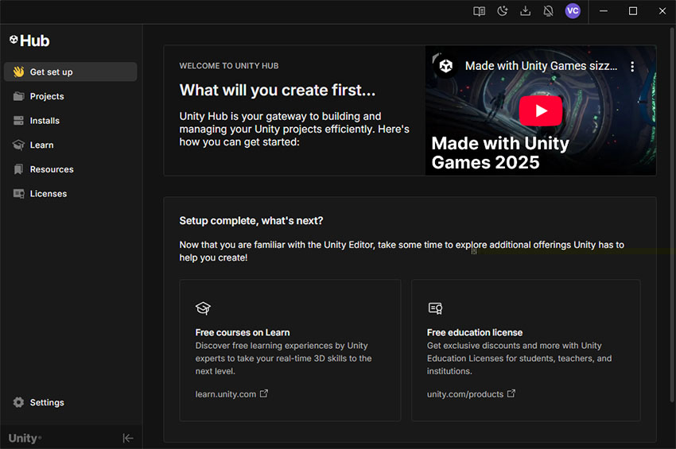

# 安装 Unity Hub 与选择 LTS 版本

你会用命令行和基本的软件安装流程。读完这一篇，你能在本机装好 Unity Hub，选对 Unity 6.3 LTS 版本并完成编辑器安装，同时知道安装失败时怎么排查。

## 1. Unity Hub 是什么

Unity Hub 是 Unity 官方的版本管理器，负责三件事：

- **管理 Unity 编辑器版本**：下载、安装、卸载不同版本的 Unity 编辑器，并在它们之间切换。
- **管理项目**：创建、打开项目，把项目和某个 Unity 版本绑定。
- **管理许可证**：登录账号、激活许可证。

不要跳过 Hub 直接装编辑器。不同项目可能依赖不同 Unity 版本，Hub 让你在几个版本之间切换而不互相干扰。编辑器本身很大（数 GB），Hub 也能复用已下载的安装包。

## 2. 安装 Unity Hub

从官网下载：<https://unity.com/download>，选择对应平台的 Unity Hub 安装包。

macOS 下载的是 `.dmg`，打开后把 Unity Hub 拖进 Applications 即可。Windows 下载 `.exe` 安装程序，按向导点击下一步。Linux 需要先安装 .NET 依赖，参考官方文档。

安装完成后启动 Unity Hub，第一次会提示登录 Unity 账号或创建账号。没有账号也可以先跳过，但激活许可证和下载编辑器通常需要登录。

*图源：[Unity 官方文档](https://docs.unity3d.com/6000.3/Documentation/Manual/GettingStartedInstallingHub.html)*

## 3. 理解 Unity 的版本策略：LTS 与 Update

Unity 6 起，官方把版本分成两类（这是选版本的关键）：

- **LTS（长期支持）**：每年发布一次，官方维护两年，持续提供 bug 修复和关键平台更新。适合要长期维护、或即将进入生产的项目。
- **Update release（更新版本）**：每年多次发布，带来最新功能，但只支持到下一个版本发布为止。适合试用新特性的新项目。

对学习者和新项目，**选 LTS** 是最稳的选择：教程、插件、第三方资源对 LTS 的兼容性最好，遇到问题也最容易找到答案。

当前（2026 年 11 月）的 LTS 是 **Unity 6.3 LTS**，版本号 `6000.3`，支持至 2027 年 12 月。更早的 Unity 6.0 LTS 标准支持已于 2026 年 10 月结束，不要再选。

## 4. 安装 Unity 6.3 LTS 编辑器

1. 打开 Unity Hub，进入 **Installs** 页签，点击 **Install Editor**。
2. 在版本列表里选择 **Unity 6.3 LTS**（`6000.3.x`），点击 Install。
3. 安装向导会问你要不要加模块（Modules）。对新手，先只勾选你需要的构建目标：
   - 只在编辑器里学习和运行，**可以一个模块都不加**。
   - 之后要打包到 Android 或 iOS，再加对应模块。模块可以随时补装。

不勾选模块不会影响在编辑器里运行游戏。等真正要打包时再装，避免现在下载好几个 GB 用不到的组件。

*图源：[Unity Hub 官方文档](https://docs.unity.com/en-us/hub/add-editor)*

安装需要下载数 GB 文件，取决于网络耗时几分钟到几十分钟。**成功标志**是版本出现在 Installs 列表里，状态显示为已安装。

## 5. 激活许可证

个人学习用 **Personal 许可证**即可，免费。

1. 进入 Hub 的 **Licenses** 页签，点击 **Add license**。
2. 选择 **Get a free personal license**，同意条款后激活。

激活成功会显示一个 Personal 许可证记录。没有许可证也能装编辑器，但打开项目时会提示无法启动，所以这一步不要漏。

## 6. 安装失败怎么办

安装过程中最容易遇到的几个问题：

| 现象 | 原因与处理 |
| --- | --- |
| 下载到一半报错或停滞 | 网络问题，Unity 安装包较大。取消后重新 Install 会断点续传；仍不行则换网络重试 |
| 磁盘空间不足 | 编辑器 + 模块可能占用 5–15 GB。清理磁盘或换安装位置（Hub 设置里可改安装目录） |
| 许可证激活失败 | 多为网络或账号问题。确认能访问 unity.com，稍后重试；公司网络代理也可能阻断，需配置代理 |
| 打开项目提示版本不匹配 | 项目是用别的 Unity 版本创建的。用对应版本打开，或在 Hub 里升级项目版本 |

## 7. 验证安装成功

装好后做一个最小验证：在 Hub 的 **Projects** 页签点 **New project**，选择 **Universal 3D** 模板（或 3D 模板，不同版本模板名略有差异），创建后能进入编辑器主界面、看到默认场景，就说明环境可用。

下一步认识编辑器界面：[编辑器界面与工作区](./chapter-03-editor-workspace.md)。
