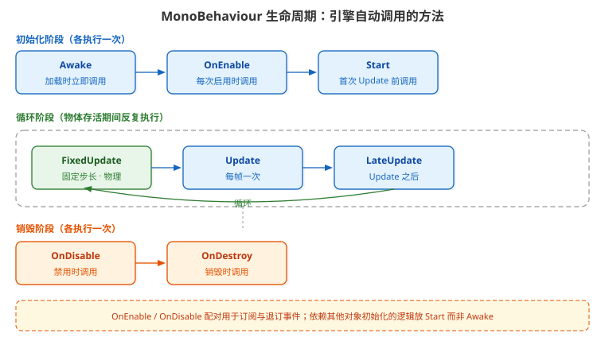

# MonoBehaviour 与生命周期

你已经在上一篇写过一个 `Rotator` 脚本，知道 `Update` 每帧执行。读完这一篇，你能说清 `MonoBehaviour` 是什么，理解 Unity 在哪些时机自动调用哪些方法，以及初始化代码该放在 `Awake`、`Start` 还是别处。

## 1. MonoBehaviour 是什么

你在 Unity 里写的脚本几乎都继承 `MonoBehaviour`：

```csharp
public class Rotator : MonoBehaviour { }
```

`MonoBehaviour` 是 Unity 提供的一个基类，它做两件事：

1. **让脚本能被挂到 GameObject 上**，成为一个组件。
2. **让 Unity 能自动调用你定义好的方法**。你在类里写 `Update()`，Unity 就会每帧调用它；写 `Start()`，Unity 就会在合适时机调用一次。

这些由引擎自动调用、有固定调用时机的方法，统称为**生命周期函数（event functions）**。你不需要手动注册或调用它们，只需要按约定命名并写对签名。

## 2. 生命周期函数的调用顺序

Unity 按下面的顺序调用生命周期函数。先建立整体印象，再逐个说明：



需要注意：`FixedUpdate`、`Update`、`LateUpdate` 在物体存活期间**反复执行**，其余的大多只执行一次。

## 3. 初始化：Awake、OnEnable、Start

这三个都在对象创建初期执行，但时机不同：

| 函数 | 调用时机 | 典型用途 |
| --- | --- | --- |
| `Awake` | 脚本实例被加载时，立即调用一次，早于 `Start` | 获取自身组件引用、初始化自己的状态 |
| `OnEnable` | 对象变为启用状态时调用，每次启用都会调用（不是只一次） | 订阅事件、注册监听 |
| `Start` | 第一次 `Update` 之前调用一次 | 依赖其他对象已经初始化的逻辑 |

关键区别：**`Awake` 在场景里所有对象都 `Awake` 完之后，才会开始调 `Start`**。所以如果 A 的 `Start` 要使用 B 在 `Awake` 里初始化好的东西，这个顺序是安全的。反过来，把依赖别的对象的逻辑放在 `Awake` 里就有风险——对方可能还没 `Awake`。

实践上：

- 初始化自己的字段、`GetComponent` 拿引用，放 `Awake` 或 `Start` 都可以，但放 `Start` 更稳妥（此时其他对象通常已初始化）。
- 订阅事件放 `OnEnable`，取消订阅放 `OnDisable`，保证启用/禁用循环不会重复订阅。

## 4. 每帧循环：FixedUpdate、Update、LateUpdate

| 函数 | 调用频率 | 典型用途 |
| --- | --- | --- |
| `FixedUpdate` | 固定时间步，默认每秒 50 次，和渲染帧率无关 | 物理相关：施力、改 Rigidbody |
| `Update` | 每渲染一帧调用一次，帧率可变 | 普通逻辑：读输入、移动、计时 |
| `LateUpdate` | 每帧在 `Update` 之后调用 | 跟随逻辑：摄像机跟随角色 |

把物理操作放 `Update` 会出问题：`Update` 随帧率波动，而物理模拟按固定步长推进，两者节奏不一致会导致抖动或结果不稳定。所以 Unity 约定：**影响物理的操作放 `FixedUpdate`，其余放 `Update`**。这部分在后面的[时间与帧循环](../03-scene-core/chapter-04-frame-loop.md)会深入讲。

## 5. 销毁：OnDisable、OnDestroy

| 函数 | 调用时机 |
| --- | --- |
| `OnDisable` | 对象被禁用、或脚本组件被禁用时调用 |
| `OnDestroy` | 对象被销毁、或场景卸载时调用 |

`OnDisable` 和 `OnEnable` 配对：`OnEnable` 里订阅的事件，在 `OnDisable` 里取消订阅。`OnDestroy` 用于对象彻底销毁前的清理，比如释放自己分配的资源。

## 6. 常见误区

**在 `Start` 之前使用未初始化的引用。** 如果你在 `Awake` 里访问一个在别的对象 `Start` 里才赋值的字段，会拿到空值。依赖别的对象的初始化，放 `Start` 而不是 `Awake`。

**在 `OnEnable` 里重复订阅事件。** 对象每次启用都会触发 `OnEnable`，如果只订阅不取消，禁用了再启用会重复订阅，导致回调执行多次。务必在 `OnDisable` 里对应取消。

**把物理操作放 `Update`。** 用 `Rigidbody.AddForce` 这类操作应放 `FixedUpdate`，否则在不同帧率下表现不一致。

## 7. 动手验证

写一个脚本，打印各生命周期函数的执行时机：

```csharp
using UnityEngine;

public class LifecycleDemo : MonoBehaviour
{
    void Awake()    => Debug.Log("Awake");
    void OnEnable() => Debug.Log("OnEnable");
    void Start()    => Debug.Log("Start");
    void Update()   => Debug.Log("Update");      // 每帧都打印，会刷屏
    void OnDisable()=> Debug.Log("OnDisable");
    void OnDestroy()=> Debug.Log("OnDestroy");
}
```

挂到任意物体上，看 Console 输出顺序：先 `Awake`、`OnEnable`、`Start`，然后每帧一条 `Update`。取消物体前面的勾（禁用物体）会打印 `OnDisable`，删除物体会打印 `OnDestroy`。

下一步了解最常用的几个 API：[常用 API：Transform、Time、GameObject](./chapter-02-core-api.md)。
