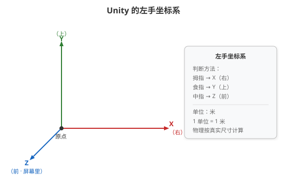

# 场景、坐标系与 Transform

你已经在 Inspector 里改过 Position，但可能没想清楚"这个数值相对于谁"。读完这一篇，你能说清 Unity 的坐标系、世界坐标与本地坐标的区别，以及父子关系如何改变一个物体的坐标。

## 1. 场景是坐标系的载体

场景（Scene）是游戏世界的一个容器，每个场景有自己的三维空间。场景里的每个物体都有一个位置，这个位置用坐标描述。

Unity 使用**左手坐标系**：



判断左右手系有个简单方法：伸出左手，拇指、食指、中指两两垂直，让拇指指向 X（右）、食指指向 Y（上），中指自然指向的就是 Z（前）。Unity 就是这样。Unreal 也是左手系，而一些建模软件（如 3ds Max 用右手系，Blender 是 Z 轴向上），导入模型时可能需要调整，这是后话。

单位是**米**。Unity 的物理引擎默认按 1 单位 = 1 米计算，所以一个"高 2"的立方体在物理世界里是 2 米高。这也是为什么之前提到：如果物体尺寸和真实世界差太多，物理表现会怪异。

## 2. Transform 的三个分量

每个物体都有一个 `Transform` 组件，描述它的空间状态，由三部分组成：

| 分量 | 含义 |
| --- | --- |
| Position（位置） | 物体在世界（或父物体）空间中的位置，`Vector3` |
| Rotation（旋转） | 物体的朝向，用四元数 `Quaternion` 存储，Inspector 里显示为欧拉角 |
| Scale（缩放） | 物体沿各轴的缩放倍数，`Vector3` |

Inspector 里看到的 Position、Rotation、Scale 就是这三者的可读形式。脚本里 `transform.position`、`transform.rotation`、`transform.localScale` 对应它们。

## 3. 世界坐标与本地坐标

这是最容易混淆的点。一个物体的坐标有两种读法：

- **世界坐标**：物体在整个场景里的绝对位置。脚本里是 `transform.position`。
- **本地坐标**：物体相对于**父物体**的位置。脚本里是 `transform.localPosition`。

对没有父物体的物体，两者相同。但一旦物体有了父物体，它们就分开了。

举个例子：父物体 A 在世界坐标 (10, 0, 0)，子物体 B 的本地坐标是 (1, 0, 0)。那么 B 的世界坐标是 (11, 0, 0)——本地坐标是"相对父物体的偏移"，世界坐标是"绝对位置"。

移动父物体 A，子物体 B 会跟着动（B 的世界坐标变，但本地坐标 (1,0,0) 不变）。这就是父子关系的核心作用：**用父物体组织一组物体，移动父物体就移动整组**。

## 4. 父子关系

在 Hierarchy 里，把一个物体拖到另一个物体下面，就建立了父子关系。子物体继承父物体的位置、旋转和缩放：

- 旋转父物体，子物体跟着转。
- 缩放父物体，子物体跟着缩放（子物体的世界缩放 = 父子缩放相乘）。
- 删除父物体，子物体一并删除。

用途很多：一辆车是父物体，四个轮子是子物体，移动车就带动轮子；一个角色是父物体，武器是子物体，角色转身武器也跟着转。

脚本里操作父子关系：

```csharp
transform.parent = otherTransform;   // 设置父物体
transform.parent = null;             // 解除父子关系
transform.SetParent(other, false);   // 第二个参数控制是否保留世界坐标
```

`SetParent` 的第二个参数值得注意：`true` 保留子物体的世界坐标（改变本地坐标来补偿），`false` 保留本地坐标。默认行为有时不符合直觉，明确传参可以避免物体"跳"到奇怪的位置。

## 5. 旋转为什么用四元数

Inspector 里旋转显示为三个欧拉角（绕 X/Y/Z 各转多少度），但脚本里 `rotation` 是四元数（`Quaternion`）。原因是欧拉角存在**万向锁**问题：某些角度组合下，旋转会丢失一个自由度，导致旋转表现异常。

四元数用四个数表示旋转，避免了万向锁，插值也更平滑。代价是四元数不直观。

对初学者，记住两条：

- 不要手动改四元数的四个分量，那没有直观意义。
- 需要"转多少度"时，用 `Quaternion.Euler(x, y, z)` 从欧拉角构造，或用 `transform.Rotate` 相对旋转。

```csharp
transform.rotation = Quaternion.Euler(0, 45, 0);  // 绕 Y 轴转 45 度
```

## 6. 动手验证

1. 场景里建两个 Cube，名字分别叫 `Parent` 和 `Child`。
2. 把 `Child` 拖到 `Parent` 下面，成为其子物体。
3. 选中 `Parent`，看它和 `Child` 的 Inspector：`Parent` 的 Position 是 (0,0,0)，`Child` 的 Position 显示的是**本地坐标**。
4. 移动 `Parent`，观察 `Child` 跟着动，但 `Child` 的本地坐标不变。
5. 在脚本里打印对比 `transform.position` 和 `transform.localPosition`，确认两者对子物体的差异。

下一步深入组件的通信方式：[组件与消息](./chapter-02-components-messages.md)。
