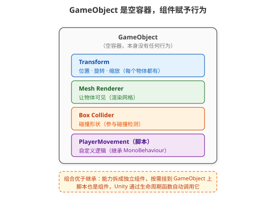

# 组件与消息

你已经知道物体由组件拼成，但还不知道组件之间怎么互相调用。读完这一篇，你能说清组件的三种通信方式，以及为什么"组合优于继承"是 Unity 设计的核心。

## 1. 回顾组件模型

一个 GameObject 是一堆组件的集合：`Transform` 管位置，`Mesh Renderer` 管渲染，`Rigidbody` 管物理，你写的脚本管逻辑。组件之间互相独立，通过引用通信。



关键点：**组件不能脱离 GameObject 存在**。每个组件都必须挂在一个 GameObject 上。脚本里 `gameObject` 拿到宿主物体，`transform` 拿到宿主物体的 `Transform`。

## 2. 获取其他组件

### 2.1 GetComponent

脚本要操作同一物体上的其他组件，用 `GetComponent`：

```csharp
Rigidbody rb = GetComponent<Rigidbody>();          // 拿同一物体上的组件
PlayerHealth hp = GetComponent<PlayerHealth>();    // 拿同一物体上的另一个脚本
```

`GetComponent` 只找**当前物体**上的组件，找不到返回 `null`。多次调用有性能开销，通常在 `Awake` 或 `Start` 里缓存，而不是在 `Update` 里反复调用。

### 2.2 获取其他物体上的组件

要操作另一个物体，先拿到那个物体的引用，再取组件：

```csharp
GameObject other = GameObject.Find("Enemy");
Enemy enemy = other.GetComponent<Enemy>();
```

或者用公开字段 + Inspector 拖拽（上一批讲过），这比 `Find` 更高效直观。

## 3. 组件之间通信的三种方式

组件之间"谁调用谁"，有从简单到复杂三种方式。

### 3.1 直接引用（最简单）

组件 A 持有组件 B 的引用，直接调用 B 的方法：

```csharp
public class Player : MonoBehaviour
{
    public Weapon weapon;   // Inspector 里拖入武器对象

    void Update()
    {
        if (Input.GetKeyDown(KeyCode.Space))
        {
            weapon.Fire();   // 直接调用另一个组件的方法
        }
    }
}
```

优点：简单、直观、类型安全。缺点：A 和 B 强耦合，A 必须知道 B 的具体类型，项目变大后依赖关系复杂。适合规模小、关系固定的场景。

### 3.2 SendMessage（不推荐）

Unity 提供 `SendMessage("MethodName")`，按方法名字符串调用同物体（或子物体）上的方法：

```csharp
gameObject.SendMessage("TakeDamage", 10);
```

它不要求强类型引用，但存在严重缺陷：方法名写错只在运行时才报错（没有编译期检查），而且性能差（用反射）。**现代 Unity 开发基本不用它**，这里只作了解。

### 3.3 事件（推荐，用于解耦）

用 C# 的事件机制，组件 A 只发出"发生了什么"，不关心谁在听：

```csharp
public class PlayerHealth : MonoBehaviour
{
    public event System.Action<int> OnHealthChanged;  // 声明事件

    private int health = 100;

    public void TakeDamage(int amount)
    {
        health -= amount;
        OnHealthChanged?.Invoke(health);   // 广播变化
    }
}
```

任何组件订阅这个事件，就会在生命值变化时收到通知：

```csharp
public class HealthBar : MonoBehaviour
{
    public PlayerHealth player;

    void Start()
    {
        player.OnHealthChanged += UpdateBar;   // 订阅
    }

    void UpdateBar(int health)
    {
        Debug.Log("当前生命值：" + health);
    }
}
```

事件让 `PlayerHealth` 不需要知道 `HealthBar` 的存在，双方解耦。这是[事件系统](../05-engineering/chapter-02-event-system.md)要深入讲的内容，现在先建立"事件比直接引用更解耦"的印象。

## 4. 组合优于继承

Unity 的设计鼓励**组合**而不是深继承。用继承，你会想建一个 `Enemy` 基类，让 `Goblin`、`Dragon` 继承它，再让会飞的龙继承 `FlyingEnemy`……继承链越来越深，某个怪物"既会飞又会游泳"时，单继承就卡住了。

用组合，能力拆成组件：`Health` 组件管血量，`Movement` 组件管移动，`Fly` 组件管飞行。任何物体需要什么能力，就挂什么组件。`Goblin` 挂 `Health` + `Movement`，`Dragon` 挂 `Health` + `Movement` + `Fly`，组合自由。

这也是为什么 Unity 里你很少写深层继承，而是写很多独立的、可复用的组件脚本。设计脚本时问自己："这个功能能不能做成一个独立组件，让不同物体复用？" 能，就拆成组件。

## 5. 动手验证

1. 建一个物体，写两个脚本：`Health`（含 `health` 字段和 `TakeDamage` 方法）和 `Reporter`（在 `Start` 里 `GetComponent<Health>()`，调用 `TakeDamage`）。
2. 把两个脚本都挂到物体上，运行，看 Console 输出，确认 `Reporter` 通过 `GetComponent` 拿到了 `Health` 并调用了它。
3. 把 `Health` 脚本从物体上移除再运行，观察 `GetComponent` 返回 `null` 导致的行为，理解"拿不到组件"是什么表现。

## 6. 下一步

组件解决了"能力怎么组合"，下一步解决"大量相同物体怎么管理"：[预制体与实例化](./chapter-03-prefab-instantiation.md)。
