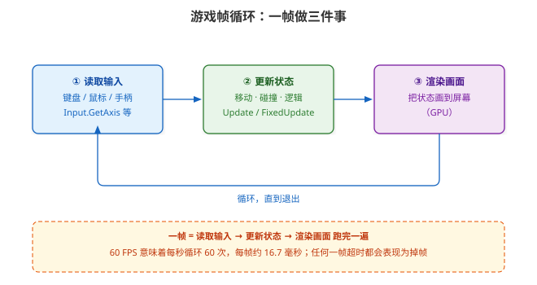

# 时间与帧循环

你一直在 `Update` 里写逻辑，但"每帧"到底是什么意思、为什么物理要放 `FixedUpdate`？读完这一篇，你能说清帧循环的机制、`Update` 与 `FixedUpdate` 的差别，以及为什么乘 `Time.deltaTime` 能让移动与帧率无关。

## 1. 游戏的帧循环

游戏不是一次性执行完的程序，而是一个持续运行的循环。每一轮循环叫一**帧（frame）**，大致做三件事：



一帧就是"读取输入 → 更新 → 渲染"跑完一遍。帧率（FPS）就是每秒跑多少帧。60 FPS 意味着每秒循环 60 次，每帧约 16.7 毫秒。

## 2. Update：每帧执行一次

`Update` 在**每一帧的更新阶段**被调用，调用频率等于帧率。帧率 60 时每秒调 60 次，帧率 200 时每秒调 200 次。

这意味着 `Update` 的执行频率是**不稳定**的：机器快、画面简单时帧率高，`Update` 调得多；机器慢、画面复杂时帧率低，`Update` 调得少。

## 3. 为什么需要 Time.deltaTime

假设你在 `Update` 里写：

```csharp
transform.Translate(0, 0, 1);   // 每帧移动 1 米
```

帧率 60 时每秒移动 60 米，帧率 200 时每秒移动 200 米——同一个游戏，在不同机器上速度差 3 倍。这显然不对。

`Time.deltaTime` 是**上一帧到这一帧经过的秒数**。用它把"每帧移动多少"换算成"每秒移动多少"：

```csharp
transform.Translate(0, 0, 1 * Time.deltaTime);   // 每秒移动 1 米
```

帧率越高，`deltaTime` 越小，每帧移动的距离越少，但乘以每秒的帧数后，**每秒总移动距离恒定**。这就是"帧率无关"。

结论：凡是表示"速率"的增量（每秒转多少度、每秒回多少血、每秒掉多少耐久），都乘 `Time.deltaTime`。

## 4. FixedUpdate：固定步长

`FixedUpdate` 和 `Update` 不同，它按**固定时间步长**调用，默认每 0.02 秒一次（即每秒 50 次），与渲染帧率无关。

为什么物理要单独用固定步长？物理模拟（刚体、碰撞、关节）对步长敏感：如果步长忽大忽小，模拟会不稳定，物体可能抖动、穿透，甚至飞出场景。固定步长保证物理每次都在相同的时间间隔上计算，结果稳定。

所以 Unity 的约定是：

- **物理操作**（`AddForce`、改 `Rigidbody` 速度等）放 `FixedUpdate`。
- **普通逻辑**（读输入、普通移动、计时）放 `Update`。

在 `FixedUpdate` 里，用 `Time.fixedDeltaTime`（固定步长）或直接写增量，Unity 会自动按固定步长处理物理。

## 5. Update 和 FixedUpdate 的配合

一个常见需求是"读输入 + 施力"。输入在 `Update` 里读最灵敏，但施力要在 `FixedUpdate` 里做。正确写法：

```csharp
float horizontal;   // 在 Update 里读，缓存起来

void Update()
{
    horizontal = Input.GetAxis("Horizontal");   // 读输入放 Update
}

void FixedUpdate()
{
    rb.AddForce(horizontal * force * Vector3.forward);   // 施力放 FixedUpdate
}
```

不要把所有逻辑都塞进 `Update`，也不要把读输入塞进 `FixedUpdate`（固定步长比帧率慢，读输入会漏掉快速按键）。

## 6. 帧率波动的其他影响

- **输入延迟**：帧率越低，`Update` 调用越稀疏，输入响应越慢。这是低帧率"卡"的直观感受。
- **`Time.time`**：游戏运行的总秒数，用来做计时。`Time.time` 和 `Time.deltaTime` 都随游戏运行累加。
- **固定步长**：`FixedUpdate` 每秒固定调 50 次，和渲染解耦。极端情况下，如果一帧耗时很长，Unity 可能在一帧内补跑多次 `FixedUpdate`，保证物理时间不被拉慢。

## 7. 动手验证

写一个脚本，对比两个计时器：

```csharp
using UnityEngine;

public class FrameDemo : MonoBehaviour
{
    float updateTimer, fixedTimer;

    void Update()
    {
        updateTimer += Time.deltaTime;
        Debug.Log($"Update 已运行 {updateTimer:F2} 秒");
    }

    void FixedUpdate()
    {
        fixedTimer += Time.fixedDeltaTime;
        Debug.Log($"FixedUpdate 已运行 {fixedTimer:F2} 秒");
    }
}
```

运行后观察 Console：`FixedUpdate` 每 0.02 秒稳定输出一次，`Update` 的输出间隔则随帧率波动。这直观展示了"固定步长"和"每帧"的区别。

## 8. 下一步

核心概念到此结束。下一篇进入玩法基础，先把物理系统展开，理解刚体和碰撞体如何配合：[物理：Rigidbody 与 Collider](../04-gameplay/chapter-01-physics-rigidbody-collider.md)。
