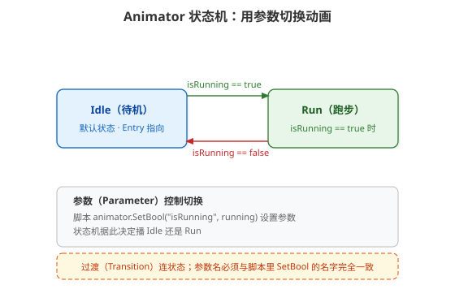

# 动画：Animator 与状态机

你会写脚本了，但角色怎么"动起来"——跑步、跳跃、攻击怎么切换？读完这一篇并跟着做，你能理解 Unity 的动画系统：Animation Clip、Animator Controller 和状态机，并让角色根据输入切换动画。

## 1. 动画系统的三个组成部分

Unity 的动画由三样东西组成：

| 概念 | 是什么 | 类比 |
| --- | --- | --- |
| Animation Clip | 一段动画片段（跑步、跳跃、挥拳） | 一段视频 |
| Animator Controller | 管理多个片段的切换规则 | 播放列表和切换逻辑 |
| Animator 组件 | 挂在物体上，执行 Controller 的组件 | 播放器 |

它们的关系：`Animator` 组件引用一个 `Animator Controller`，Controller 里组织多个 `Animation Clip`，并用**状态机**决定什么时候播哪段。

## 2. 创建动画

以"角色待机和跑步"为例（用任何带骨骼动画的模型，或用官方提供的模型资源）：

1. 选中角色，在菜单 **Window → Animation → Animation** 打开动画窗口。
2. 点击 **Create**，创建第一个 Clip，命名 `Idle`，保存为 `.anim` 文件。
3. 录制待机动画（或直接拖入现成的动画片段）。
4. 再创建一个 `Run` Clip。

创建第一个 Clip 时，Unity 会自动给物体挂上 `Animator` 组件，并创建一个 `Animator Controller` 资源。


*图源：[Unity 官方文档](https://docs.unity3d.com/6000.3/Documentation/Manual/class-Animator.html)*

## 3. Animator Controller 状态机

双击 Controller 资源，打开 **Animator** 窗口，看到状态机视图：

- 每个 Clip 是一个**状态**（橙色方块）。
- 状态之间用**过渡（Transition）** 连接，白箭头表示"可以从这个状态切到另一个"。
- 有一个 `Entry` 节点指向默认状态（默认播的动画）。

两个状态（Idle 和 Run）之间拖两条过渡：Idle → Run 和 Run → Idle，形成互相切换。



## 4. 用参数控制切换

状态机需要一个"什么时候切"的条件，这就是**参数（Parameter）**：

1. 在 Animator 窗口左侧 **Parameters** 面板，点 `+` 新建一个 `Bool` 参数，命名 `isRunning`。
2. 选中 Idle → Run 的过渡，在 Inspector 里把条件设为 `isRunning == true`。
3. 选中 Run → Idle 的过渡，条件设为 `isRunning == false`。

现在状态机是：`isRunning` 为真时播 Run，为假时播 Idle。

## 5. 用脚本驱动参数

脚本里设置参数，就能控制动画切换：

```csharp
using UnityEngine;

public class PlayerAnimator : MonoBehaviour
{
    private Animator animator;

    void Start()
    {
        animator = GetComponent<Animator>();
    }

    void Update()
    {
        bool running = Input.GetAxis("Vertical") != 0;   // 按了前后键就是跑步
        animator.SetBool("isRunning", running);           // 设置参数，驱动状态机
    }
}
```

**成功标志**：运行时按住方向键，角色从待机切换到跑步动画；松开切回待机。

## 6. 参数类型与选择

Animator 支持四种参数：

- **Bool**：开关型，如 `isRunning`、`isGrounded`。
- **Float**：连续值，如移动速度，可配合 Blend Tree 做动画混合。
- **Int**：枚举状态，如武器类型。
- **Trigger**：一次性触发，如 `jump`、`attack`，触发后自动复位。

"跳跃"这类一次性动作用 Trigger：设 `SetTrigger("jump")`，状态机切到 Jump 动画，播完自动回到 Idle。

## 7. 常见问题

| 现象 | 原因 |
| --- | --- |
| 物体完全不动 | 没挂 Animator 组件；或 Controller 没配；或没有 Animation Clip |
| 动画不切换 | 过渡条件没设，或参数名拼写不一致（脚本和 Animator 里的名字要完全一致） |
| 两个动画瞬间硬切 | 过渡的过渡时间（Transition Duration）是 0，调大让切换平滑 |
| 参数改了但没反应 | `SetBool` 的参数名和 Animator 里定义的参数名不一致 |

## 8. 下一步

动画让角色有了"表现"。下一步给游戏加声音，让表现更完整：[音频](./chapter-05-audio.md)。
